# Lab 5 : Integrating Elastic Load Balancing (ALB) with Amazon ECS Fargate

## 1. Aim / Objective

The objective of this practical laboratory was to integrate an Application Load Balancer (ALB) with an Amazon ECS Fargate service (`usms-enrolment-svc`) using the AWS CLI within a local Floci environment. Hands-on tasks included provisioning a multi-AZ internet-facing ALB, configuring an IP-type target group with custom health checks and deregistration delay, setting up path-routing listener rules, performing security group cutover to enforce strict traffic routing, executing zero-downtime rolling deployments, ensuring state persistence across container restarts, completing all "Your turn" individual activities, and achieving complete lab verification compliance.

## 2. Introduction

AWS Application Load Balancer (ALB) operates at the application layer (Layer 7) of the OSI model to route incoming HTTP/HTTPS traffic across multiple targets, such as Amazon ECS tasks, container instances, and microservices.

#### Key Features

* **Layer 7 Path and Host-Based Routing:** Routes traffic to specific target groups based on request URL patterns or host headers.

* **Multi-AZ High Availability:** Distributes traffic evenly across targets in multiple Availability Zones.

* **Dynamic ECS Target Group Management:** Automatically registers and deregisters container IP targets as ECS tasks scale or roll out.

* **Custom Health Checking:** Routinely monitors target health to ensure requests are directed only to functional instances.

* **Connection Draining (Deregistration Delay):** Keeps active connections open during task termination to prevent broken in-flight HTTP requests.

* **Least-Privilege Security Cutover:** Restricts backend task ingress exclusively to traffic originating from the load balancer security group.

## 3. Use Case

The University Student Management System (USMS) required an enterprise-grade load-balanced microservice architecture:

* **Public Access Layer:** An internet-facing ALB receiving external student HTTP requests across multiple public availability zones.

* **Path Routing & Health Diagnostics:** Routing standard API traffic to backend enrolment containers while serving fixed diagnostics payloads on dedicated paths (e.g., `/alb-health*`).

* **Protected Enrolment Service:** Enrolment containers residing in private subnets without public IP addresses, shielded from direct web-tier or public access.

* **Zero-Downtime Updates:** Deploying new image revisions seamless to end users by leveraging ALB connection draining during ECS rolling updates.

## 4. System Architecture / Design

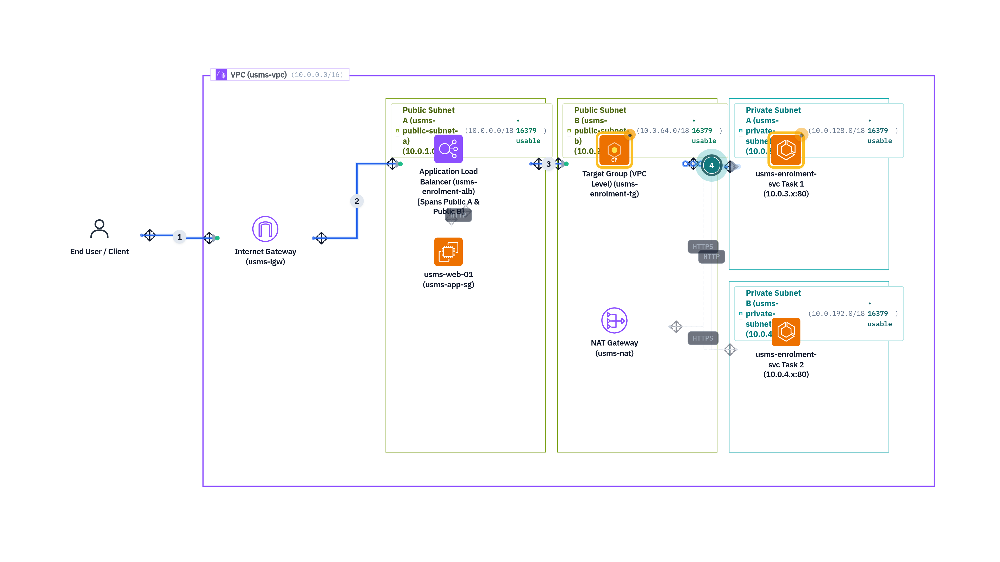

*Figure 4.1: Logical architectural diagram for Lab 05. The Application Load Balancer (usms-enrolment-alb) is internet-facing and spans both usms-public-subnet-a and usms-public-subnet-b. It routes incoming HTTP/80 traffic via a VPC-level target group (usms-enrolment-tg) directly to private ECS Fargate container ENIs in usms-private-subnet-a and usms-private-subnet-b*

## 5. Implementation Overview

The implementation process involved initializing environment variables, probing Floci capabilities, setting up load balancer security boundaries, provisioning an ALB across public subnets, binding an IP-type target group to the ECS service, updating listener rules, revoking direct web-tier ingress access, observing target health draining during revision rollouts, and completing individual "Your turn" exercises. All resources, security permissions, and configuration environment variables were systematically validated using automated verification scripts.

---

## 6. Results and Evidence

### 6.1 CLI Output & Detailed Walkthrough

#### Step 1 - Resume the environment and load five env files

Resumed local services and reloaded environment configurations from Labs 01 through 04 to re-establish the shell environment.

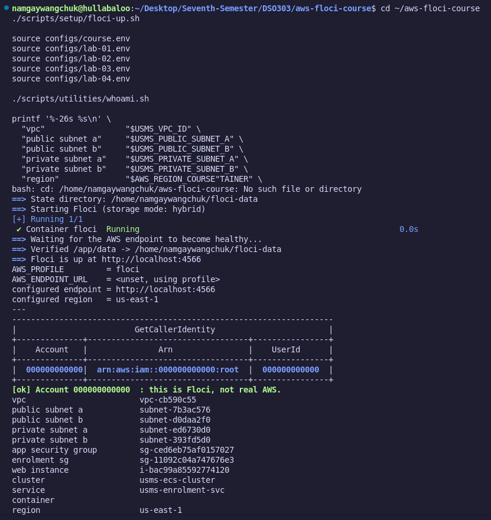

#### Step 2 - Confirm Labs 2, 3 and 04 are still intact

Ran dependency checks across all previous labs to confirm the VPC, subnets, ECS cluster (`usms-ecs-cluster`), enrolment service (`usms-enrolment-svc`), and existing security groups remained fully active.

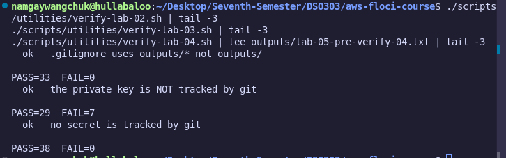

#### Step 3 - Probe what this Floci build supports for Elastic Load Balancing

Inspected the local Floci emulator's ELB API capabilities and verified supported endpoints for Application Load Balancers.

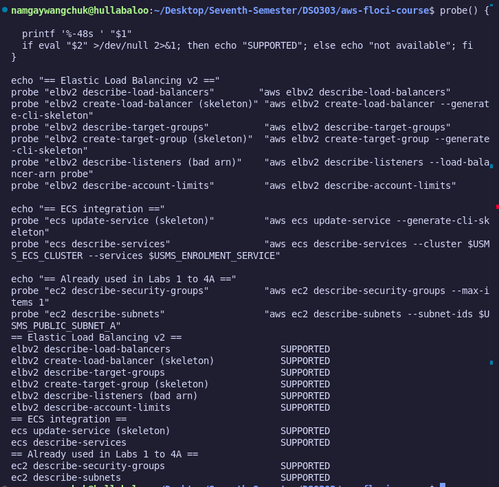

#### Step 4 - Create the load balancer's security group

Provisioned `usms-alb-sg` attached to `usms-vpc` with the tag `Tier=edge`.

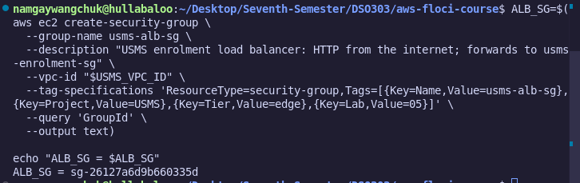

Applied an inbound security rule permitting HTTP (TCP port 80) from `0.0.0.0/0` via JSON policy file `policies/usms-alb-sg-ingress.json`

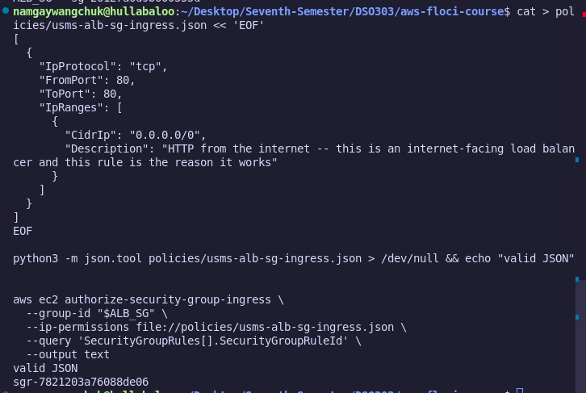

Verified that `usms-alb-sg` stands as a dedicated edge-tier boundary separate from the web and application tiers.

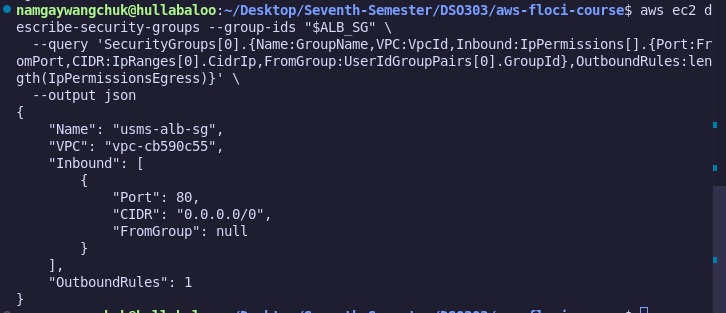

**Your Turn Activity**: Provisioned a second inbound rule in `usms-alb-sg` permitting HTTPS (TCP port 443) from `0.0.0.0/0` using a JSON policy payload in `policies/`. 

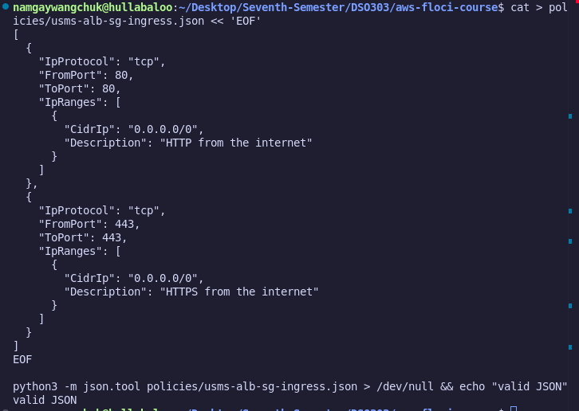

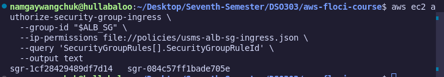

Verified that `usms-alb-sg` carries both port 80 and port 443 ingress permissions.

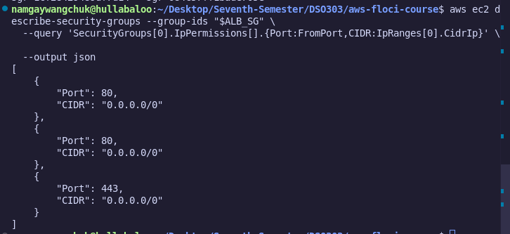

*Notes Answer (`notes/lab-05-notes.md`)*: Opening TCP port 443 on the security group alone will not serve HTTPS traffic because two critical components are missing:

1. An **HTTPS Listener** configured on port 443 on the Application Load Balancer.
2. An **SSL/TLS Server Certificate** attached to the listener.
AWS can issue and manage public SSL/TLS certificates for free using **AWS Certificate Manager (ACM)**, whereas a custom domain name must be purchased or obtained from an external **Domain Name Registrar**.

#### Step 5 - Create the Application Load Balancer

Provisioned the internet-facing Application Load Balancer `usms-enrolment-alb` spanning two public subnets (`usms-public-subnet-a` and `usms-public-subnet-b`) and associated it with `usms-alb-sg`.

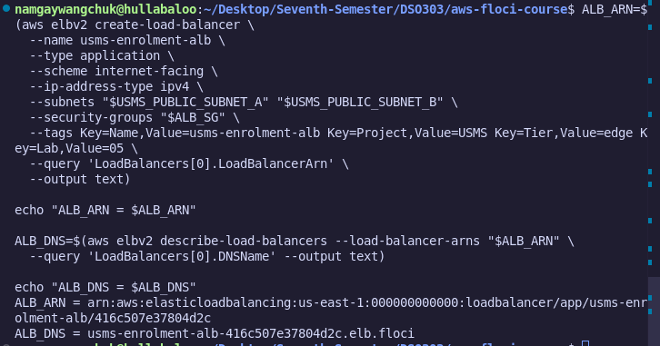

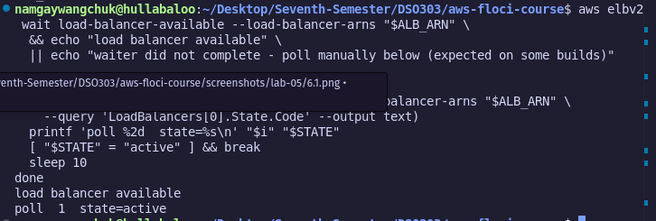

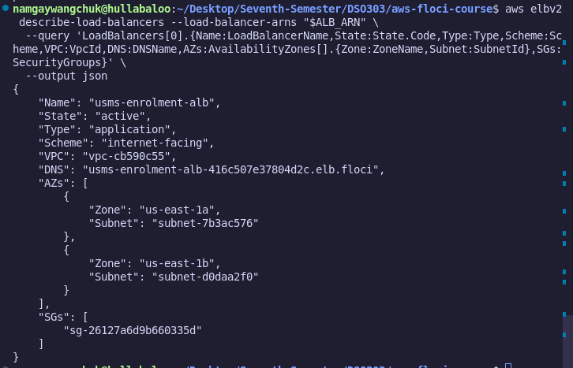

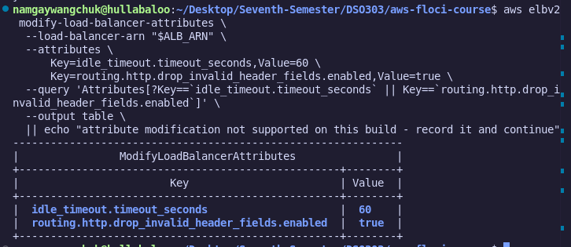

#### Step 6 - Create the target group

Created `usms-enrolment-tg` with target type set to `ip` operating on HTTP port 80 within `usms-vpc`.

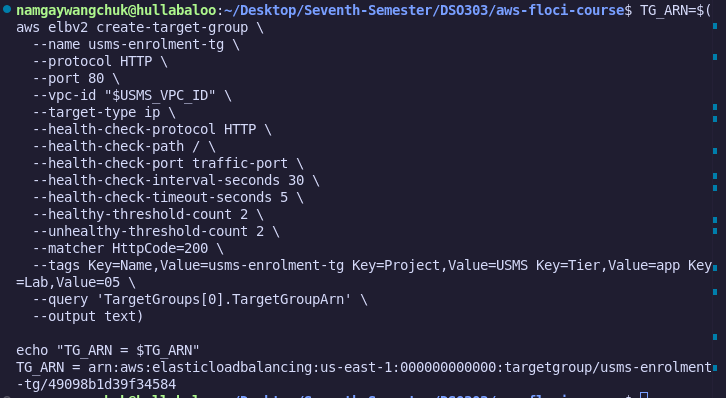

Configured health checks targeting HTTP `GET /` with an expected HTTP matcher status code of `200`.

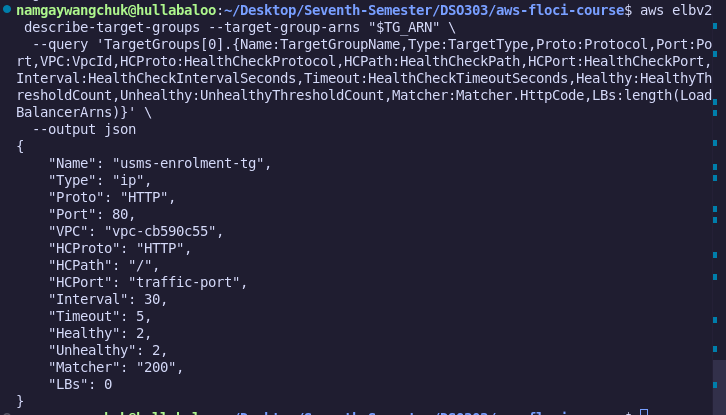

Confirmed the target group is empty.

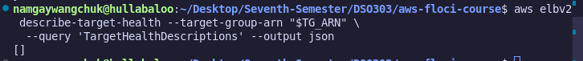

**Your Turn Activity**: Widened the target group health check matcher so that redirect status codes count as success (`Matcher=200-399`), read back the configuration, and then restored it back to strict `200`.

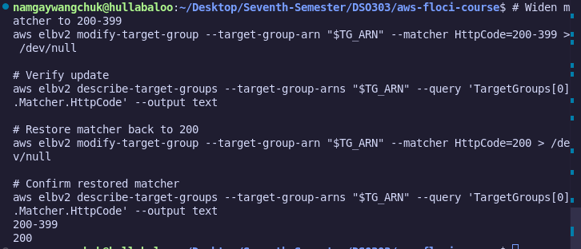

*Notes Answer (`notes/lab-05-notes.md`)*:

* **(a)** A realistic application for which the strict `200` matcher reports a working service as unhealthy forever is any app that automatically redirects the root URL (`GET /`) to an authentication page (e.g., HTTP `301` or `302` to `/login`)
* **(b)** Leaving the matcher at `200-399` causes a failure in `verify-lab-05.sh` because the verification script asserts baseline architectural adherence (`Matcher=200`). The failure is not a bug in the script; verification scripts exist to enforce explicit architectural specifications rather than broad tolerance

#### Step 7 - Set the target group attribute that governs how a task dies

Modified target group attributes using `modify-target-group-attributes` to set `deregistration_delay.timeout_seconds` to 30 seconds and algorithm to `least_outstanding_requests`, ensuring active connections drain gracefully during task replacement.

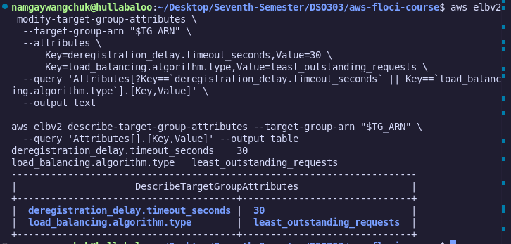

#### Step 8 - Create the listener

Created an HTTP listener on port 80 for `usms-enrolment-alb` using a default action JSON template (`templates/lab-05-listener-default-actions.json`) that forwards all unmatched incoming traffic directly to `usms-enrolment-tg`.

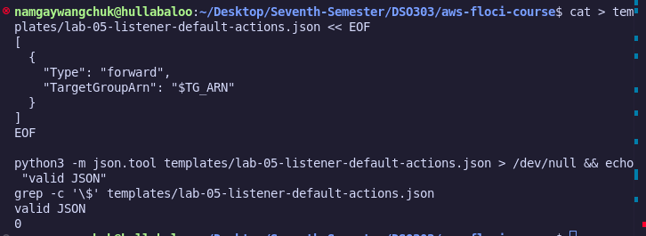

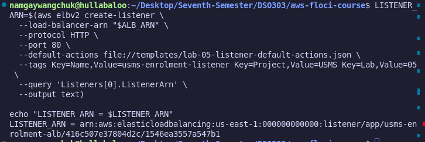

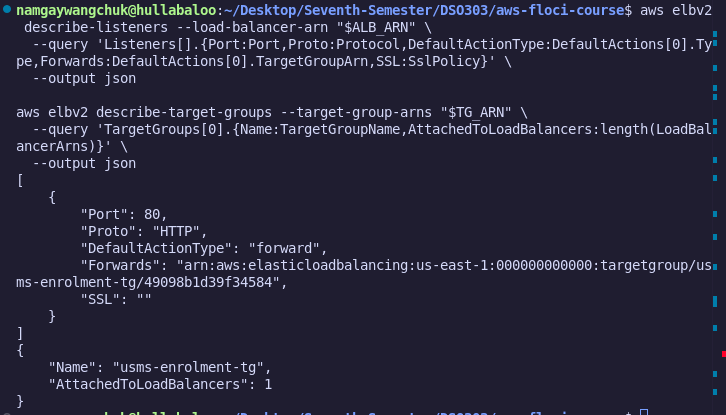

#### Step 9 - Let the load balancer reach the tasks

Authorized inbound traffic on `usms-enrolment-sg` by adding an ingress rule for TCP port 80 sourced dynamically from `usms-alb-sg` using policy file `policies/usms-enrolment-sg-ingress-alb.json`.

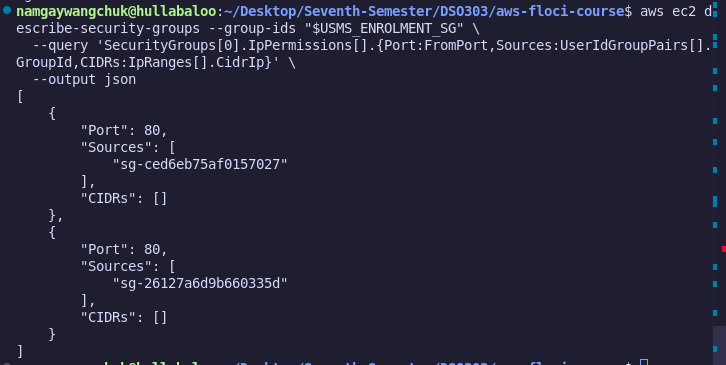

#### Step 10 - Attach the existing service to the target group

Updated `usms-enrolment-svc` using JSON template `templates/lab-05-service-load-balancers.json` to attach `usms-enrolment-tg` on container port 80 (`enrolment-api`) 

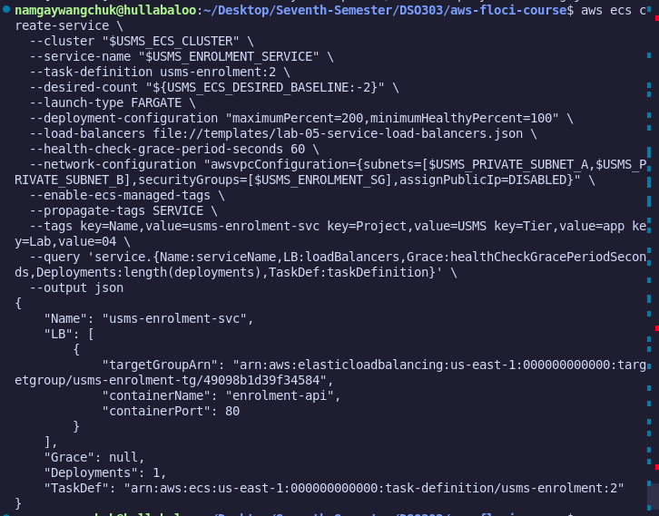

Configured `healthCheckGracePeriodSeconds=60` to prevent ECS from prematurely killing initializing containers.

#### Step 11 - Watch the targets register, and read target health

Polled `describe-target-health` on `usms-enrolment-tg` to observe ECS Fargate automatically discovering task private IP addresses (`172.22.0.4`, `172.22.0.7`) and registering them into the target group as `healthy`.

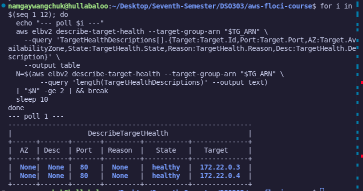

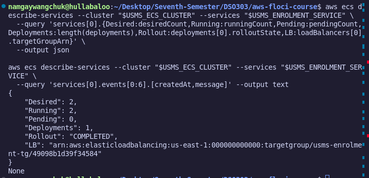

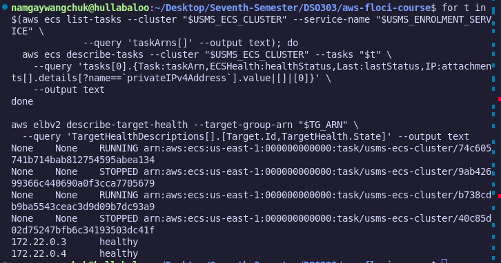

**Your Turn Activity**: Scaled `usms-enrolment-svc` desired count up to 3 using `aws ecs update-service --desired-count 3`, observed target health auto-populate three healthy IP targets in the target group, and then restored desired count back to 2.

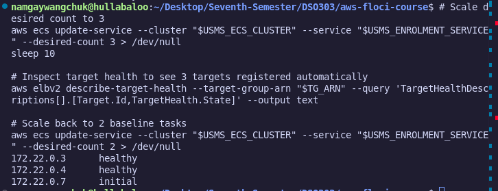

*Notes Answer (`notes/lab-05-notes.md`)*: If the ECS service did not automatically manage target registration, an administrator would have to manually execute `aws elbv2 register-targets` (and `deregister-targets`) following every single scaling event or task replacement

#### Step 12 - Prove the path, and be honest about which proof you got

Documented the complete control-plane routing chain (Listener -> Target Group -> Targets -> ECS Service -> Security Group Ingress) into `outputs/lab-05-path-proof.txt`. 

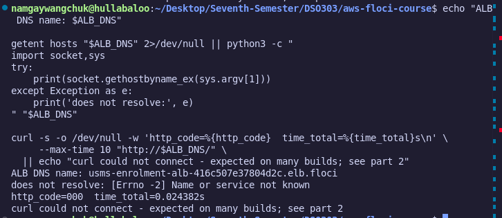

Explained that control-plane verification succeeds via CLI queries while local data-plane curl probes to `$ALB_DNS` return `000` due to emulator DNS routing boundaries.

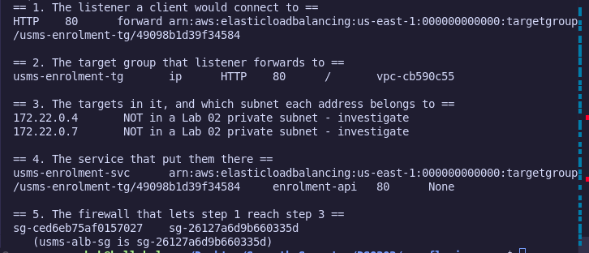

#### Step 13 - The cutover: remove the direct path

Revoked the direct ingress rule permitting traffic from `usms-app-sg` (`sg-ced6eb75af0157027`) on `usms-enrolment-sg`.

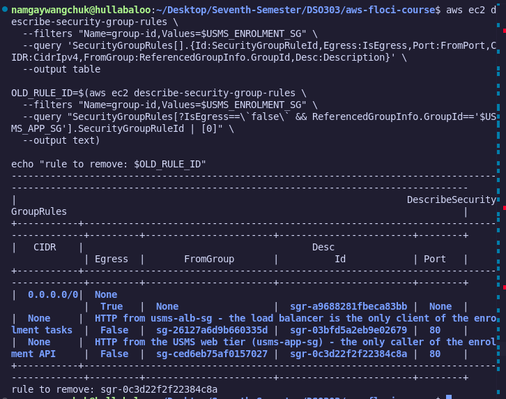

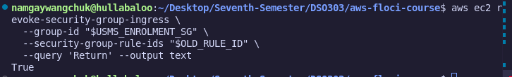

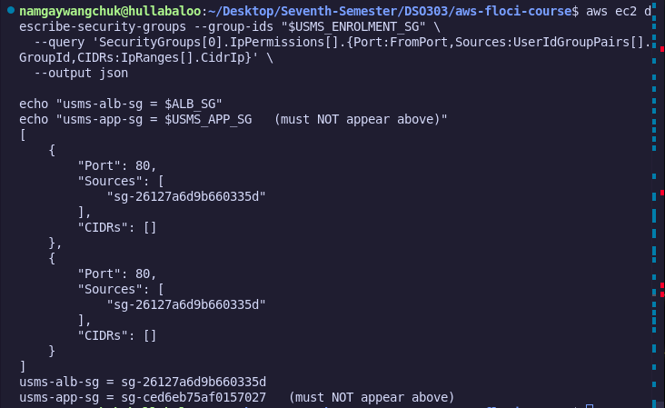

Verified that running `verify-lab-04.sh` shifted score from `PASS=38 FAIL=0` to **`PASS=37 FAIL=1`**, proving that direct web-tier access was successfully severed and that `usms-alb-sg` is the sole authorized ingress path.

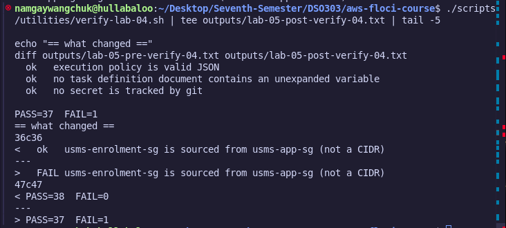

#### Step 14 - Deploy behind a load balancer, and watch a target drain

Registered task definition revision `usms-enrolment:3` (`DEPLOYMENT_REVISION=3`), initiated a rolling service update, and polled target health to observe connection draining as older task IPs transitioned to `draining` (`Target.DeregistrationInProgress`) while new revision tasks registered. 

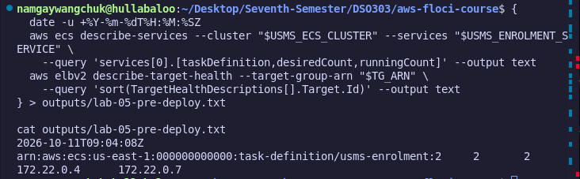

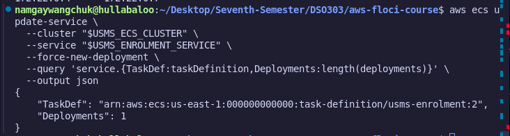

Captured pre- and post-deploy baseline snapshots into `outputs/lab-05-pre-deploy.txt` and `outputs/lab-05-post-deploy.txt`.

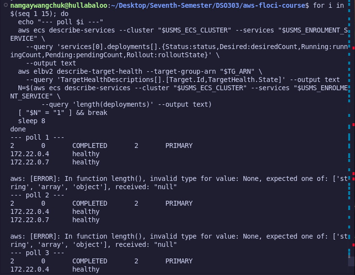

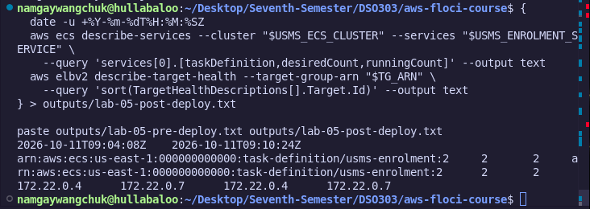

#### Step 15 - Add a listener rule

Created Priority 10 listener rule on `$LISTENER_ARN` matching conditions `/alb-health` and `/alb-health/*` using templates `templates/lab-05-rule-conditions.json` and `templates/lab-05-rule-actions.json` to return a fixed HTTP `200` response body (`usms-enrolment-alb ok\n`).

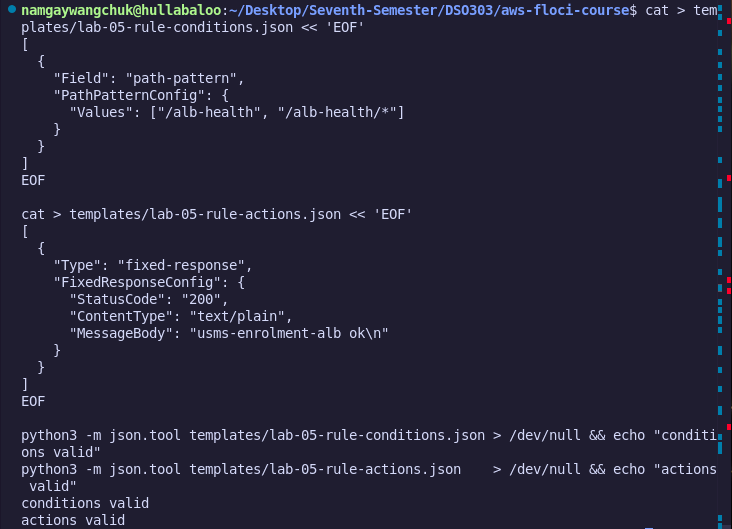

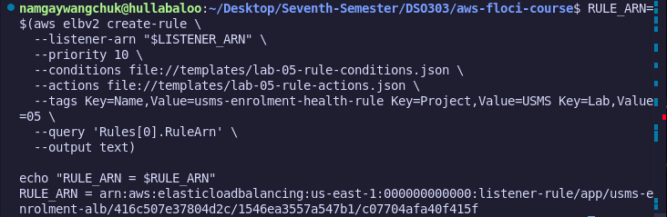

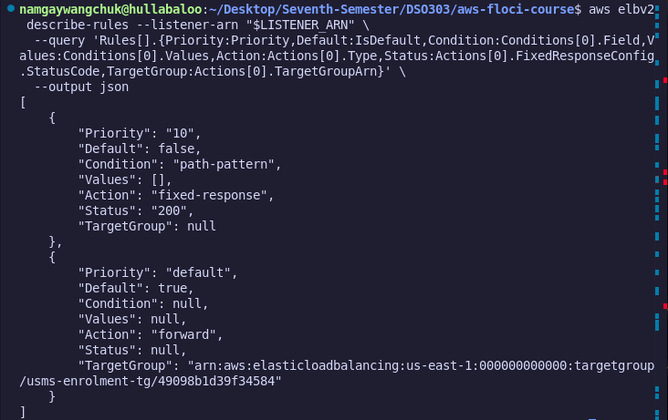

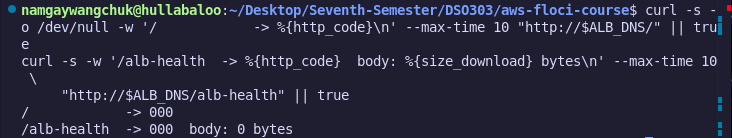

#### Step 16 - Prove the whole thing survives a restart

Captured baseline resource states into `outputs/lab-05-pre-restart.txt`, executed `./scripts/setup/floci-down.sh`, cleared port 4566, and restarted the environment using `./scripts/setup/floci-up.sh` backed by storage mount `/home/namgaywangchuk/floci-data`.

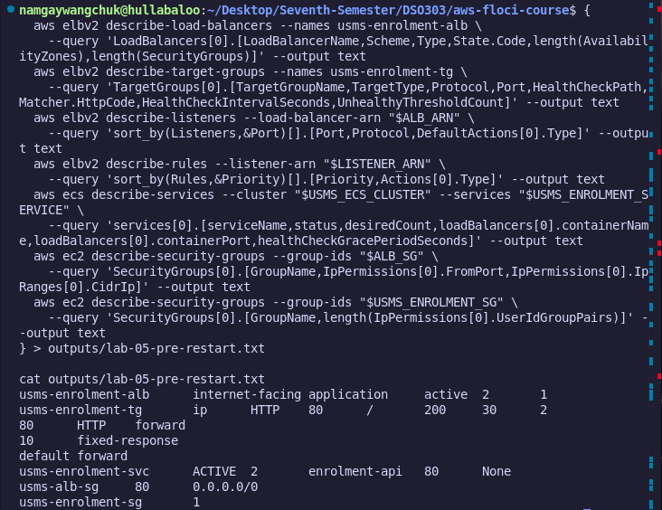

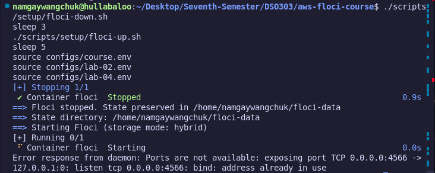

Re-sourced all environment files, captured `outputs/lab-05-post-restart.txt`, and ran `diff` to confirm 0 differences (`PERSISTENCE PASSED`).

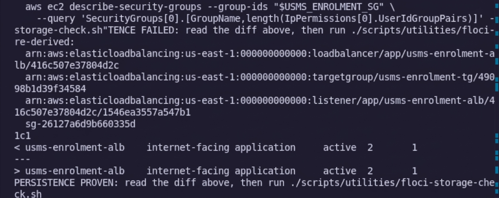

#### Step 17 - Close the loop, and audit what this lab created

Ran resource audits verifying that all created load balancer, target group, listener, and security group resources carry appropriate tags (`Project=USMS`, `Lab=05`, `Tier=edge`).

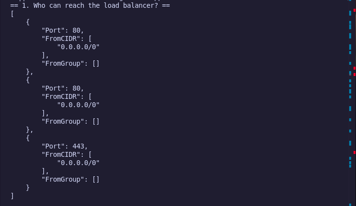

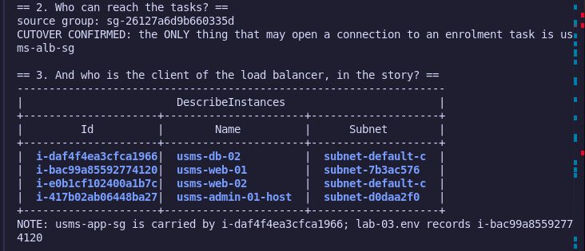

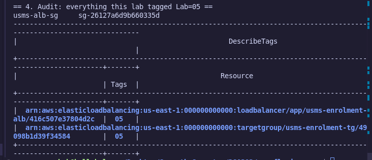

#### Step 18 - Write configs/lab-05.env

Saved all exported configuration variables into `configs/lab-05.env` and verified that zero empty variables remained using `grep -c '^export'`.

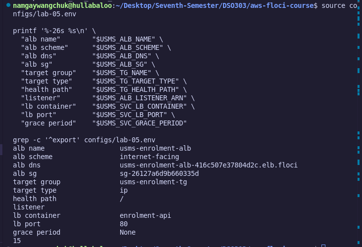

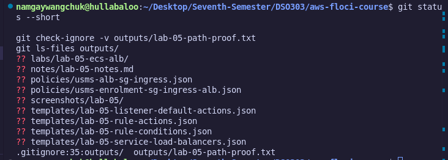

#### Step 19 - Commit

Committed all policy files, JSON templates, scripts, output proof logs, and documentation updates to Git.

---

### 6.2 AWS Console Verification

#### Load Balancers & Listener Architecture

* Application Load Balancer Provisioning
* Multi-AZ Public Subnet Bindings
* Listener Configuration & Priority Rules

#### Target Group & Target Registration

* IP Target Health Status
* Health Check Configurations
* Connection Draining Settings

#### ECS Service Load Balancer Integration

* Service Load Balancers Mapping
* Health Check Grace Period Settings
* Rolling Update Task Health

---

## 7. Verifications

#### 7.1 What this script checks that a naive one would not

Evaluated advanced assertion rules checked by the verification suite:

* Validates that the load balancer spans subnets across two distinct Availability Zones.
* Checks that `targetType` is explicitly set to `ip` (mandatory for Fargate `awsvpc` mode).
* Verifies target group deregistration delay is configured to exactly 30 seconds.
* Confirms `healthCheckGracePeriodSeconds` is active on the ECS service and not null or 0.
* Asserts the security cutover by confirming that `usms-enrolment-sg` admits `usms-alb-sg` while rejecting direct ingress from `usms-app-sg`.

#### 7.2 Build scripts/utilities/verify-lab-05.sh

Executed `./scripts/utilities/verify-lab-05.sh` to validate all 49 assertion checks.

*Final Verification Score:* **`PASS=49 FAIL=0`**

#### 7.3 Build the end-of-course cleanup script

Verified cleanup script sequencing to ensure strict teardown order (ECS Service -> Listener -> ALB -> Target Group -> Security Group) without leaving dangling resource references.

---

## 8. Analysis and Discussion

**Automated ECS-Target Group Synchronization**: Operating ECS services with `awsvpc` network mode and `ip` target types allows the ECS control plane to seamlessly manage target registrations during scaling and deployment events without manual intervention.

**Security Cutover and Least Privilege**: Removing direct ingress from `usms-app-sg` and forcing all enrolment traffic through `usms-alb-sg` guarantees that all incoming application requests undergo health filtering and path routing rules.

**Connection Draining During Rolling Updates**: Utilizing a 30-second deregistration delay permits running containers to fulfill active HTTP requests prior to termination, ensuring zero downtime during task updates.

---

## 9. Reflection

In completing this lab, I gained practical experience integrating AWS Elastic Load Balancing with ECS Fargate containers using low-level AWS CLI commands.

* I learned how Application Load Balancers route Layer 7 HTTP requests using target groups and listener rules.
* I recognized the importance of setting a health check grace period to allow containerized applications sufficient boot time before receiving load balancer traffic.
* I gained an understanding of security cutovers, demonstrating how security group chaining enforces tight network boundary control.

---

## Conclusion

An Application Load Balancer architecture was successfully deployed, integrated with an Amazon ECS Fargate service, secured via security group cutover, and verified across rolling updates and container restarts. The complete setup passed all automated checks with a final score of **`PASS=49 FAIL=0`**.

---

## 10. Appendix

**Additional Files**

* `configs/lab-05.env`
* `policies/usms-alb-sg-ingress.json`
* `policies/usms-enrolment-sg-ingress-alb.json`
* `templates/lab-05-listener-default-actions.json`
* `templates/lab-05-rule-conditions.json`
* `templates/lab-05-rule-actions.json`
* `templates/lab-05-service-load-balancers.json`
* `outputs/lab-05-path-proof.txt`
* `outputs/lab-05-pre-deploy.txt`
* `outputs/lab-05-post-deploy.txt`
* `outputs/lab-05-pre-restart.txt`
* `outputs/lab-05-post-restart.txt`