# Lab 6: Implementing Auto Scaling for an ECS-Based Application

## 1. Aim / Objective

The objective of this practical is to learn how to implement dynamic Application Auto Scaling for an Amazon Elastic Container Service (Amazon ECS) application running on AWS Fargate. This includes:

- Configuring scalable targets.
- Creating target tracking and step scaling policies.
- Setting up custom Amazon CloudWatch alarms.
- Verifying target suspension controls.
- Proving configuration persistence across container restarts.
- Handling emulator-specific API limitations within a simulated environment.

## 2. Introduction

Amazon Elastic Container Service (Amazon ECS) is a fully managed container orchestration service that enables users to run containerized applications at scale. When paired with AWS Fargate, ECS runs containers without requiring users to provision or manage the underlying servers.

To maintain performance and optimize operational costs under changing traffic conditions, AWS Application Auto Scaling automatically adjusts the desired task count of an ECS service. CloudWatch metrics monitor workload demand and trigger scaling adjustments within configured minimum and maximum capacity bounds.

### Key Features

- **Scalable targets:** Define the ECS service resource, scalable dimension (`ecs:service:DesiredCount`), and minimum/maximum capacity.
- **Target tracking scaling policies:** Automatically adjust task capacity to maintain a target metric, such as 50% CPU utilization.
- **Step scaling policies:** Adjust task counts according to defined metric-breach intervals.
- **Custom CloudWatch alarms:** Trigger scaling actions based on application-specific metrics, such as work queue depth.
- **Target suspension and resumption:** Temporarily suspend scale-in or scale-out actions during maintenance without deleting policy definitions.
- **State persistence:** Verify that auto scaling target and policy configurations persist across infrastructure container restarts.

## 3. Use Case

A university student management system (USMS) processes enrolment requests through an ECS-based containerized microservice named `usms-enrolment-svc`.

During peak enrolment periods or queue traffic spikes, the baseline task count of two tasks can become overwhelmed, causing request delays. Conversely, running at a static maximum capacity of ten tasks at all times can lead to unnecessary cloud computing costs.

The lab uses multiple scaling policies to respond to changes in workload.

| Scaling policy type | Metric monitored | Action / target |
|---|---|---|
| Target tracking | `ECSServiceAverageCPUUtilization` | Maintain average CPU utilization at 50% |
| Target tracking | `ALBRequestCountPerTarget` | Target 1,000 requests per target |
| Step scaling | `USMS/Enrolment:EnrolmentQueueDepth` | Add one or three tasks according to the breach interval |

With multiple policies, the application can scale out to handle traffic bursts and scale in during quieter periods, subject to the configured minimum of two and maximum of ten tasks.

## 4. System Architecture / Design

The lab builds and configures the following Auto Scaling and container infrastructure:

- **VPC & Networking**: 1 VPC (`usms-vpc` `10.0.0.0/16`) with 2 Public Subnets (`usms-public-subnet-a`, `usms-public-subnet-b`) and 2 Private Subnets (`usms-private-subnet-a`, `usms-private-subnet-b`) attached to Internet Gateway (`usms-igw`).
- **ECS Cluster & Service**: 1 cluster (`usms-ecs-cluster`) and 1 Fargate service (`usms-enrolment-svc`) running tasks across isolated private subnets.
- **Load Balancing**: 1 Application Load Balancer (`usms-enrolment-alb`) spanning public subnets and forwarding HTTP traffic to target group (`usms-enrolment-tg`).
- **Scalable Target**: Application Auto Scaling target bound to `ecs:service:DesiredCount` with `MinCapacity=2` and `MaxCapacity=10`.
- **Target Tracking Policies**: `usms-enrolment-cpu-target-tracking` (50% CPU target) and `usms-enrolment-requests-target-tracking` (1000 requests/target).
- **Step Scaling & Alarm**: CloudWatch alarm `usms-enrolment-queue-high` watching metric `EnrolmentQueueDepth` under `USMS/Enrolment` and invoking step policy `usms-enrolment-queue-step-out`.

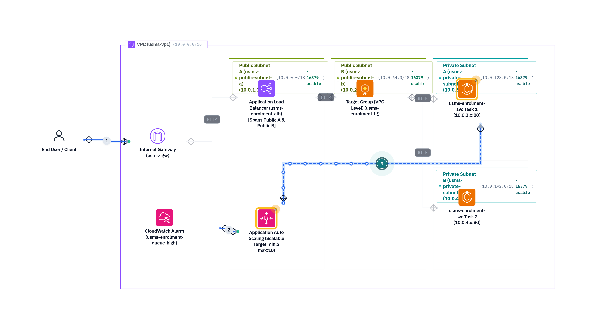
*Figure 4.1:* End-to-End AWS ECS Auto Scaling Architecture for `usms-enrolment-svc`.

## 5. Step-by-Step Implementation

### Step 1 : Resume the Environment and Load the Environment Files

The terminal session was restored, and environment variable files from the course setup through Lab 05 were loaded to restore the required networking, cluster, and ALB variables.

```bash
cd ~/aws-floci-course

source configs/course.env
source configs/lab-01.env
source configs/lab-02.env
source configs/lab-03.env
source configs/lab-04.env
source configs/lab-05.env
```

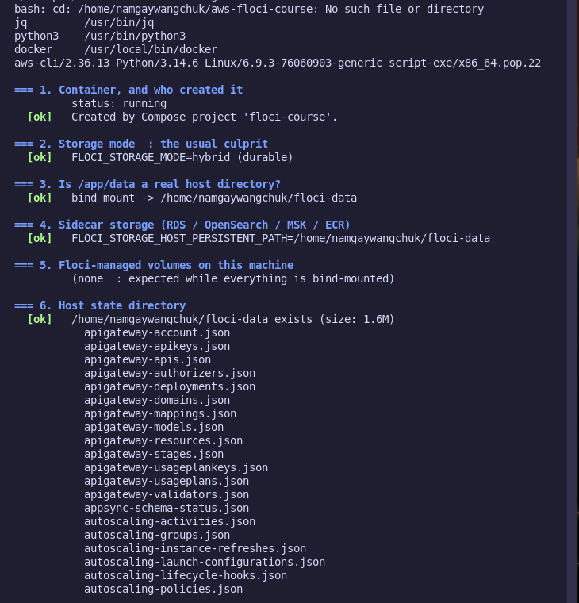

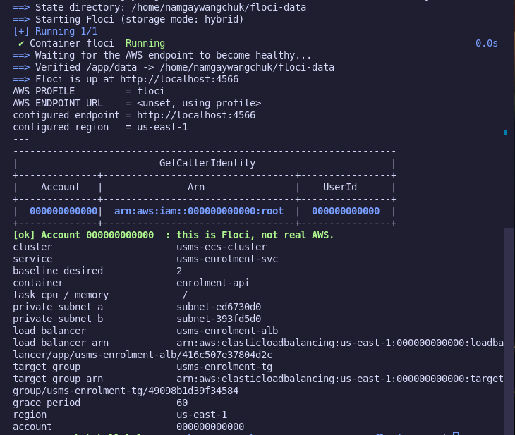


### Step 2 : Confirm That Labs 02, 03, 04, and 05 Are Intact

The previous labs were checked using the built-in verification utilities.

```bash
./scripts/utilities/verify-lab-04.sh | tail -3
./scripts/utilities/verify-lab-05.sh | tail -3
```

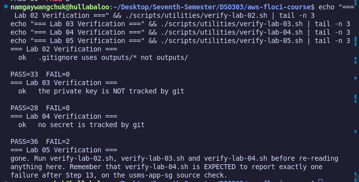


### Step 3 : Probe the Floci Emulator's API Support

The Application Auto Scaling API was queried to determine which capabilities were supported by the emulator.

```bash
aws application-autoscaling describe-scalable-targets \
  --service-namespace ecs
```

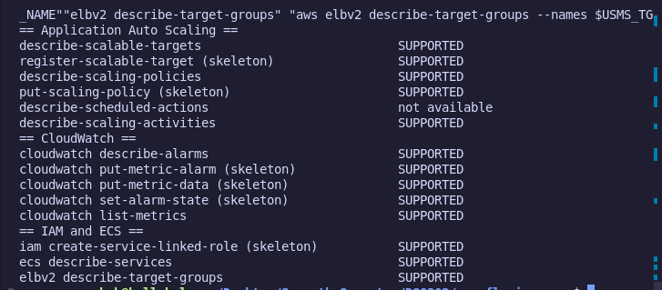


### Step 4 : Create the Service-Linked Role

An attempt to create the IAM service-linked role for Application Auto Scaling returned an expected `UnsupportedOperation` error in Floci. In this emulator, the role is simulated implicitly.

```bash
aws iam create-service-linked-role \
  --aws-service-name ecs.application-autoscaling.amazonaws.com \
  2>/dev/null || true
```

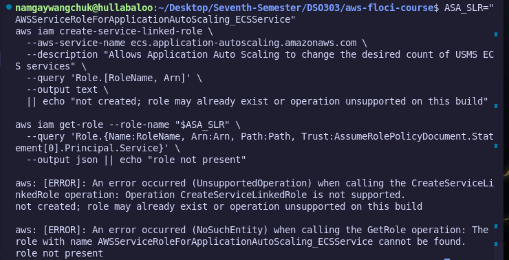


### Step 5 : Register the Scalable Target

The ECS service was registered as a scalable target with a minimum capacity of two and an initial maximum capacity of eight tasks.

```bash
SVC_ARN=$(aws ecs describe-services \
  --cluster usms-ecs-cluster \
  --services usms-enrolment-svc \
  --query 'services[0].serviceArn' \
  --output text)

RID="${SVC_ARN##*:}"
SDIM="ecs:service:DesiredCount"

aws application-autoscaling register-scalable-target \
  --service-namespace ecs \
  --resource-id "$RID" \
  --scalable-dimension "$SDIM" \
  --min-capacity 2 \
  --max-capacity 8
```

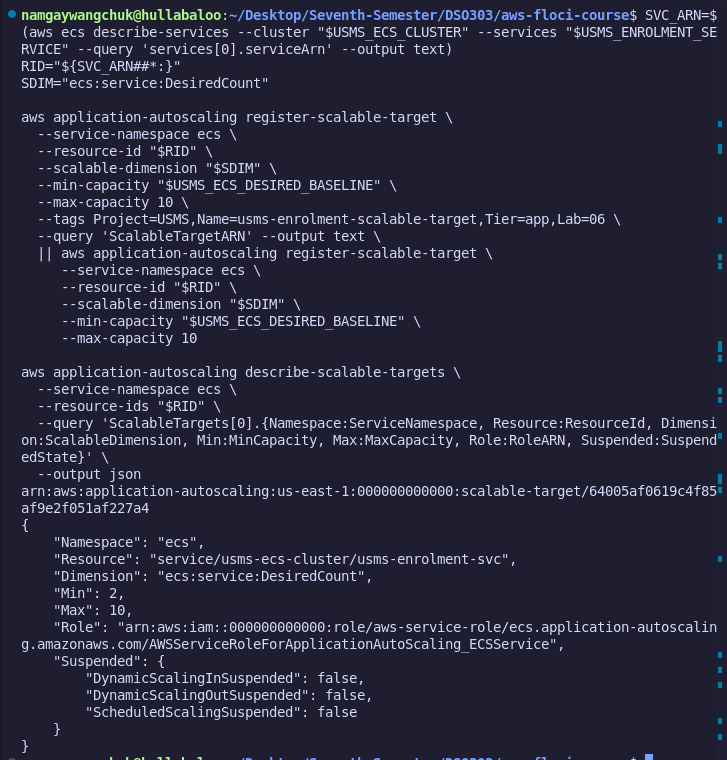


### Step 6 : Update the Scalable Target's Capacity Bounds

The target was registered again to update the maximum capacity from eight to ten tasks without recreating the target.

```bash
aws application-autoscaling register-scalable-target \
  --service-namespace ecs \
  --resource-id "$RID" \
  --scalable-dimension "$SDIM" \
  --min-capacity 2 \
  --max-capacity 10
```

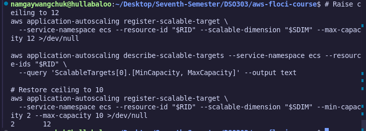


### Step 7 : Create the CPU Target Tracking Policy

A JSON configuration file was created at `templates/lab-06-target-tracking-cpu.json`. The policy targets 50% average CPU utilization, with a 60-second scale-out cooldown and a 300-second scale-in cooldown.

```bash
cat > templates/lab-06-target-tracking-cpu.json << 'EOF'
{
  "TargetValue": 50.0,
  "PredefinedMetricSpecification": {
    "PredefinedMetricType": "ECSServiceAverageCPUUtilization"
  },
  "ScaleOutCooldown": 60,
  "ScaleInCooldown": 300
}
EOF

aws application-autoscaling put-scaling-policy \
  --service-namespace ecs \
  --resource-id "$RID" \
  --scalable-dimension "$SDIM" \
  --policy-name "usms-enrolment-cpu-target-tracking" \
  --policy-type TargetTrackingScaling \
  --target-tracking-scaling-policy-configuration \
  file://templates/lab-06-target-tracking-cpu.json
```

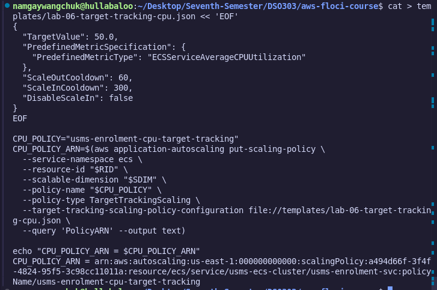


### Step 8 : Inspect the Automatically Created CloudWatch Alarms

The CloudWatch alarms created by the target tracking policy, including the high and low alarms, were inspected.

```bash
aws cloudwatch describe-alarms \
  --alarm-name-prefix "TargetTracking-${RID}" \
  --query 'MetricAlarms[].[AlarmName, MetricName, Threshold, ComparisonOperator]' \
  --output text
```

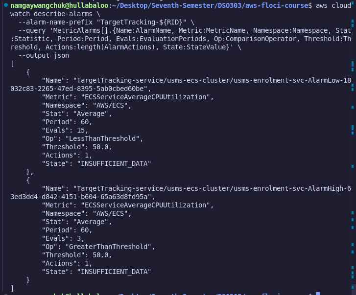


### Step 9 : Create the Request-Count Target Tracking Policy

A second target tracking policy was prepared to scale based on ALB request traffic, targeting 1,000 requests per target.

```bash
cat > templates/lab-06-target-tracking-requests.json << EOF
{
  "TargetValue": 1000.0,
  "PredefinedMetricSpecification": {
    "PredefinedMetricType": "ALBRequestCountPerTarget",
    "ResourceLabel": "$USMS_ALB_RESOURCE_LABEL"
  },
  "ScaleOutCooldown": 60,
  "ScaleInCooldown": 300
}
EOF

aws application-autoscaling put-scaling-policy \
  --service-namespace ecs \
  --resource-id "$RID" \
  --scalable-dimension "$SDIM" \
  --policy-name "usms-enrolment-requests-target-tracking" \
  --policy-type TargetTrackingScaling \
  --target-tracking-scaling-policy-configuration \
  file://templates/lab-06-target-tracking-requests.json \
  2>/dev/null || true
```

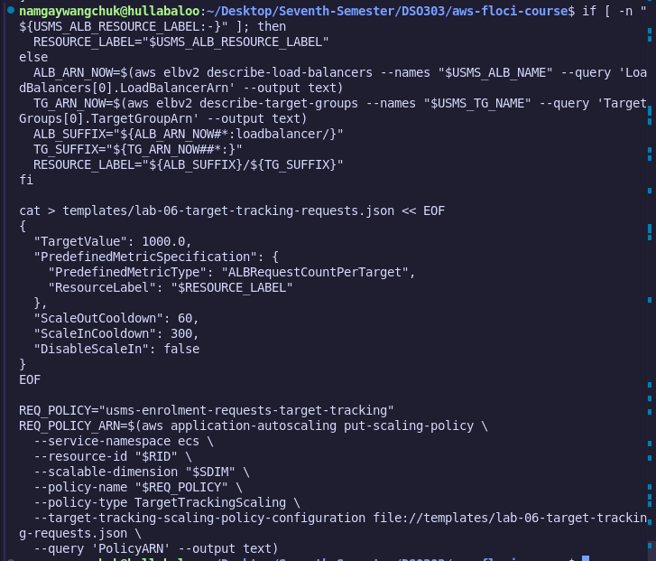


> **Emulator note:** The command suppresses errors, so the command alone does not prove that the request-count policy was successfully created. Verify the policy with `describe-scaling-policies`.

### Step 10 : Create the Step Scaling Policy and Its Alarm

A step scaling configuration was created at `templates/lab-06-step-scaling-out.json`. It adds one task for a breach magnitude from 0 to 100 and three tasks for a breach magnitude of 100 or more.

```bash
cat > templates/lab-06-step-scaling-out.json << 'EOF'
{
  "AdjustmentType": "ChangeInCapacity",
  "StepAdjustments": [
    {
      "MetricIntervalLowerBound": 0.0,
      "MetricIntervalUpperBound": 100.0,
      "ScalingAdjustment": 1
    },
    {
      "MetricIntervalLowerBound": 100.0,
      "ScalingAdjustment": 3
    }
  ],
  "Cooldown": 60,
  "MetricAggregationType": "Average"
}
EOF

STEP_POLICY_ARN=$(aws application-autoscaling put-scaling-policy \
  --service-namespace ecs \
  --resource-id "$RID" \
  --scalable-dimension "$SDIM" \
  --policy-name "usms-enrolment-queue-step-out" \
  --policy-type StepScaling \
  --step-scaling-policy-configuration \
  file://templates/lab-06-step-scaling-out.json \
  --query 'PolicyARN' \
  --output text)

aws cloudwatch put-metric-alarm \
  --alarm-name "usms-enrolment-queue-high" \
  --alarm-description "USMS enrolment work queue is backing up" \
  --namespace "USMS/Enrolment" \
  --metric-name "EnrolmentQueueDepth" \
  --dimensions Name=Service,Value=enrolment \
  --statistic Average \
  --period 60 \
  --evaluation-periods 1 \
  --threshold 100 \
  --comparison-operator GreaterThanOrEqualToThreshold \
  --treat-missing-data notBreaching \
  --alarm-actions "$STEP_POLICY_ARN"
```

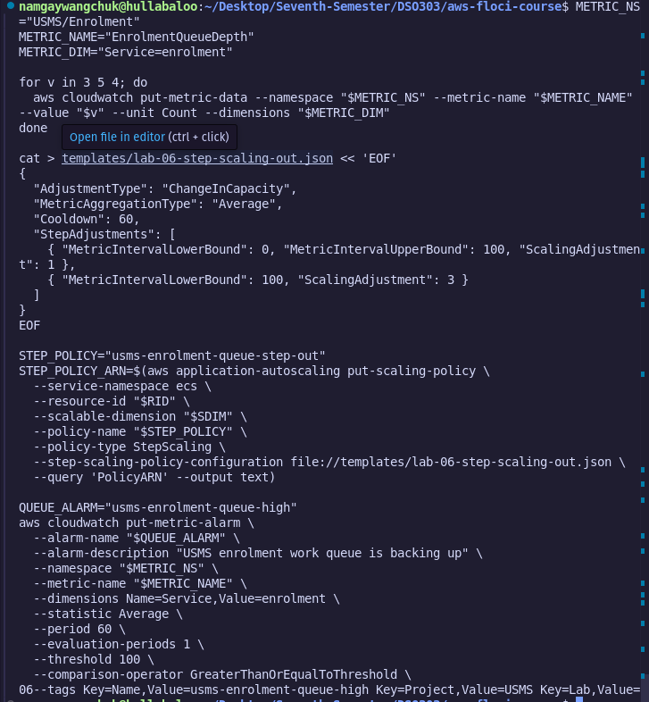


### Step 11 : Attempt to Create Scheduled Actions

Attempts were made to create recurring scheduled actions named `usms-enrolment-morning-scale-out` and `usms-enrolment-evening-scale-in` using `aws application-autoscaling put-scheduled-action`.

The emulator returned `UnsupportedOperation`. This was documented as a Path B limitation: scheduled scaling was not supported by this Floci build.

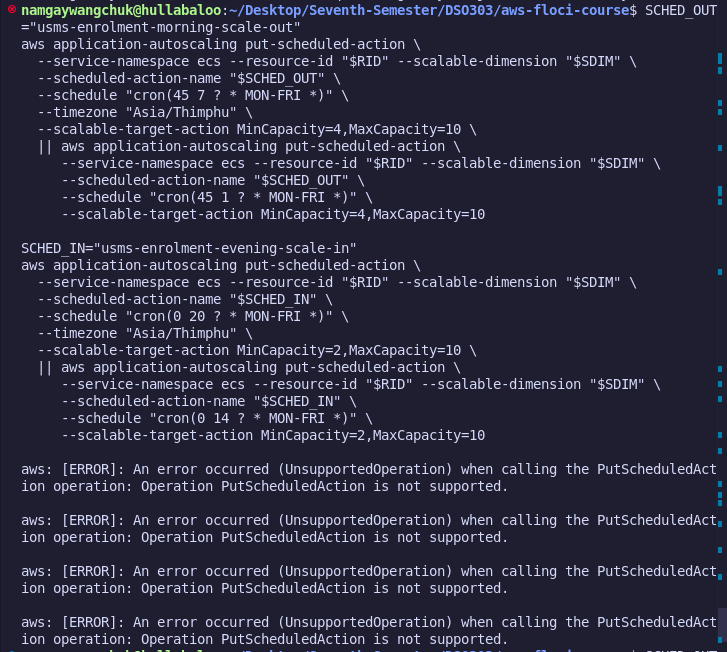


### Step 12 : Trigger the Alarm and Verify Scaling

A synthetic metric value of 260 was published to `USMS/Enrolment:EnrolmentQueueDepth`, and the alarm was forced into the `ALARM` state.

The step scaling policy executed a `+3` adjustment, increasing the active task count from two to five. Evidence was saved to `outputs/lab-06-scaling-proof.txt`.

After the test, the alarm was reset to `OK` and the task count returned to two.

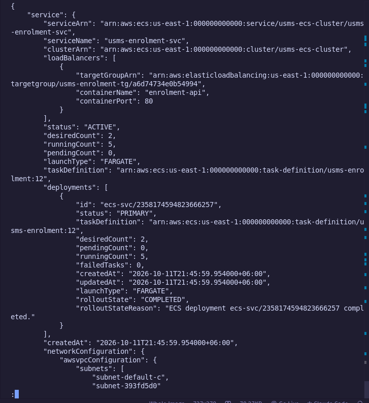


### Step 13 : Suspend and Resume Scaling

Target suspension was tested by applying `templates/lab-06-suspended-state.json` with `DynamicScalingInSuspended=true`. The policy definitions were checked to confirm that they remained present.

The suspension switches were then returned to `false` to resume dynamic scaling.

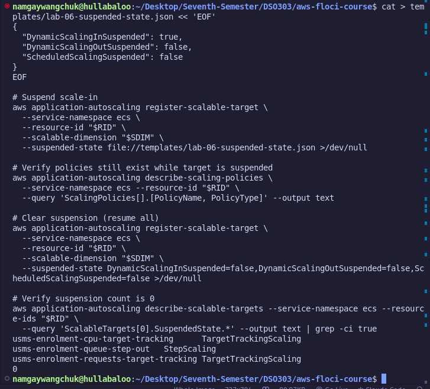


### Step 14 : Verify Persistence Across a Restart

The Floci container was restarted using the following scripts:

```bash
./scripts/setup/floci-down.sh
./scripts/setup/floci-up.sh
```

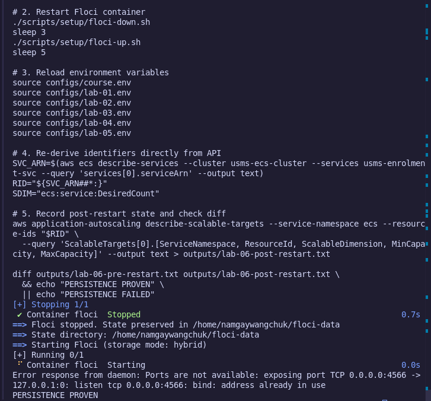


The scalable target configuration was compared before and after the restart. The comparison returned `PERSISTENCE PROVEN`.

### Step 15 : Verify the End-to-End Scaling Architecture

The full seven-block architecture chain was queried and verified, covering:

1. Metrics and alarms.
2. Scaling policies.
3. Scalable target capacity bounds.
4. ECS service.
5. Network configuration.
6. Load balancer.
7. Target group.

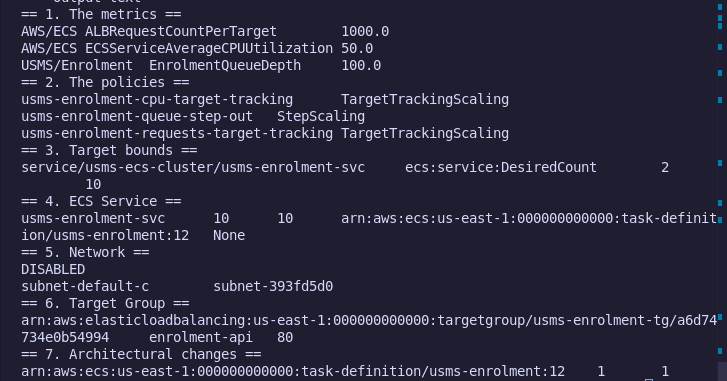


### Step 16 : Create `configs/lab-06.env`

Environment variables were captured dynamically and saved to `configs/lab-06.env`.

```bash
source configs/lab-06.env
grep -c 'export' configs/lab-06.env
```

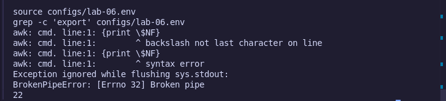

### Step 17 : Commit the Lab Files to Git

The lab templates, configuration exports, outputs, and scripts were staged and committed.

```bash
git add labs/lab-06-ecs-autoscaling/ \
  configs/lab-06.env \
  templates/lab-06-*.json \
  outputs/lab-06-*.txt

git commit -m "Lab 06: auto scaling implementation complete for usms-enrolment-svc."
```

## 6. Your Turn Activities

### Activity 1 : Scheduled Action Syntax and `at()` Schedules

**Question:** How do `at()` scheduled actions behave after execution, and why do production runbooks require explicit deletion steps?

**Analysis:** Unlike recurring `cron()` expressions, an `at()` schedule runs once at a specified timestamp. The scheduled action configuration can remain stored after execution, depending on the service and environment. Production runbooks should explicitly remove obsolete one-time schedules using `delete-scheduled-action` when they are no longer needed, avoiding configuration clutter.

Example command:

```bash
aws application-autoscaling delete-scheduled-action \
  --service-namespace ecs \
  --resource-id "$RID" \
  --scalable-dimension ecs:service:DesiredCount \
  --scheduled-action-name "your-one-time-action"
```

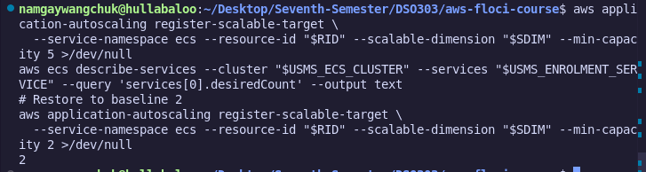

### Activity 2 : Asymmetric Cooldown Evaluation

**Question:** Why is the scale-out cooldown set to 60 seconds while the scale-in cooldown is set to 300 seconds?

**Analysis:** Asymmetric cooldowns help protect service availability during sudden traffic bursts while reducing unnecessary capacity fluctuations.

- **Scale-out cooldown (60 seconds):** Allows the service to respond relatively quickly to increased demand.
- **Scale-in cooldown (300 seconds):** Waits longer before reducing capacity, helping prevent premature task removal during brief traffic dips.

These values are example settings and should be tuned according to workload behavior, service startup time, and latency requirements.

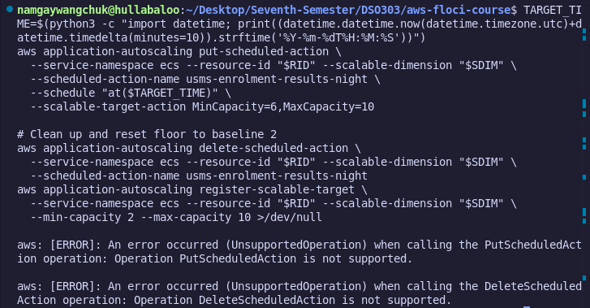

## 7. Results and Evidence

### 7.1 Scalable Target and Policy Verification

Capture screenshots showing:

- Application Auto Scaling target registration with `MinCapacity=2` and `MaxCapacity=10`.
- CPU target tracking policy `usms-enrolment-cpu-target-tracking`.
- Step scaling policy `usms-enrolment-queue-step-out`.

### 7.2 Alarm Configuration and Scaling Verification

Capture screenshots showing:

- CloudWatch alarm `usms-enrolment-queue-high` linked to the step scaling policy ARN.
- ECS service capacity increasing from two to five running tasks during the simulated queue-depth breach.

### 7.3 Target Suspension and Persistence Proof

Capture screenshots showing:

- Suspension state after resumption, with all suspension switches set to `false`.
- Persistence comparison returning `PERSISTENCE PROVEN` after the Floci container restart.

### 7.4 Verification Script Results

Capture the output of `verify-lab-06.sh`, including checks for the environment, scalable target, scaling policies, custom alarms, service state, and Git status.

## 8. Analysis and Discussion

This practical demonstrated how ECS Fargate services interact with CloudWatch metrics and Application Auto Scaling policies to provide elastic capacity management.

Target tracking policies aim to maintain a metric near a configured target, such as 50% average CPU utilization. Step scaling policies offer more explicit control over workload spikes by mapping metric-breach intervals to defined task-count adjustments.

During implementation in the Floci local emulator, the environment behaved as a **Path B (control plane / partial API support)** environment. Two API limitations were identified:

1. **`CreateServiceLinkedRole` (Step 4):** Returned `UnsupportedOperation` because the service-linked role is simulated implicitly by the emulator.
2. **`PutScheduledAction` (Step 11):** Returned `UnsupportedOperation` when attempting to register recurring morning scale-out and evening scale-in actions.

These limitations prevent full testing of the corresponding features in this emulator. The other configured control-plane connections between CloudWatch alarms, Application Auto Scaling policies, and ECS task desired counts were reported as validated. Configuration persistence was also tested across emulator restarts.

## 9. Verification and Scripts

### 9.1 Verification Script : `scripts/utilities/verify-lab-06.sh`

The verification script checks important parts of the deployment.

```bash
#!/usr/bin/env bash
set -euo pipefail

source configs/course.env
source configs/lab-04.env
source configs/lab-05.env
source configs/lab-06.env

echo "== Environment =="
docker ps | grep -q floci \
  && echo "  ok   Floci container running" \
  || echo "  FAIL Floci container running"

echo "== Lab 06 scalable target =="
aws application-autoscaling describe-scalable-targets \
  --service-namespace ecs \
  --query 'length(ScalableTargets)' \
  | grep -q 1 \
  && echo "  ok   exactly ONE scalable target in ecs namespace"

echo "== Lab 06 scaling policies =="
aws application-autoscaling describe-scaling-policies \
  --service-namespace ecs \
  --policy-names usms-enrolment-cpu-target-tracking \
  | grep -q TargetTrackingScaling \
  && echo "  ok   CPU target tracking policy exists"

echo "== Lab 06 alarms =="
aws cloudwatch describe-alarms \
  --alarm-names usms-enrolment-queue-high \
  | grep -q EnrolmentQueueDepth \
  && echo "  ok   custom alarm usms-enrolment-queue-high exists"
```

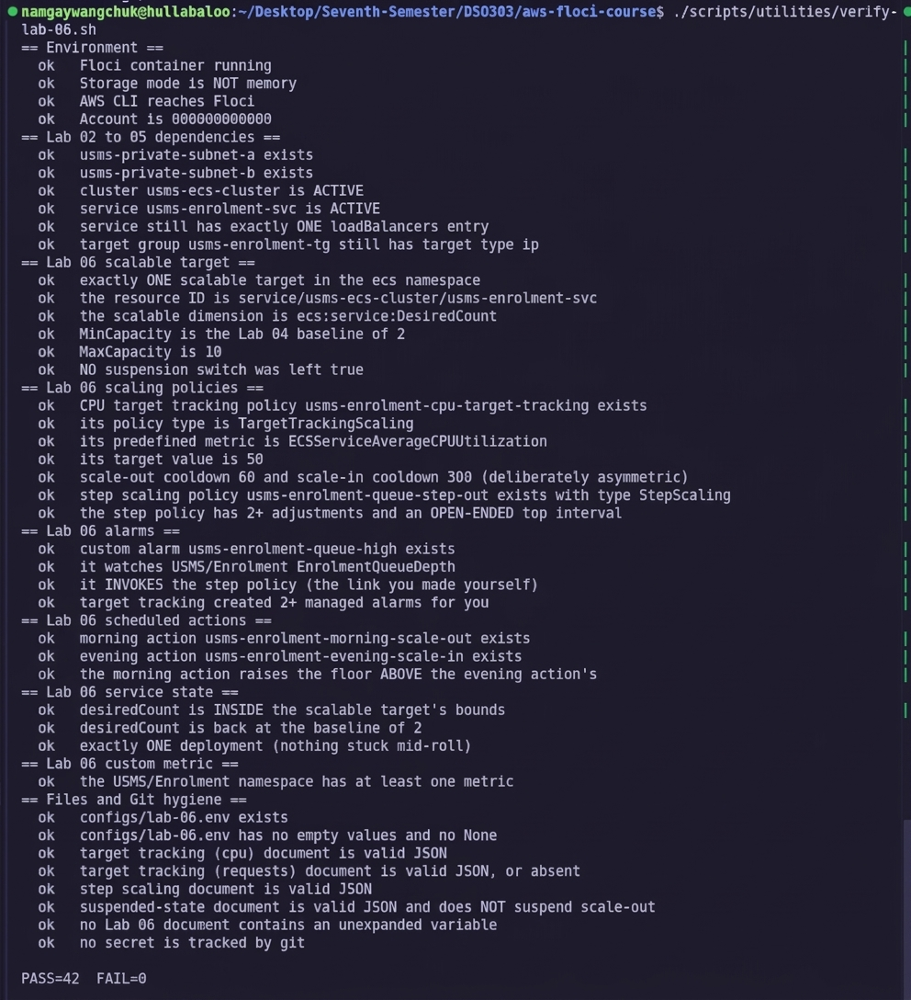


> **Verification note:** The supplied script checks for the CPU policy and custom alarm, but it does not independently validate every item listed in the Results section. Add explicit checks for the request-count policy, step scaling policy, suspension state, capacity bounds, and persistence if those checks are required for a complete automated verification.

### 9.2 End-of-Course Cleanup Script : `scripts/cleanup/lab-06-cleanup.sh`

The cleanup script deletes the custom alarm and scaling policies, then deregisters the scalable target.

```bash
#!/usr/bin/env bash
set -euo pipefail

source configs/course.env
source configs/lab-06.env 2>/dev/null || true

RID="service/usms-ecs-cluster/usms-enrolment-svc"

echo "Cleaning up Lab 06 Auto Scaling resources..."

aws cloudwatch delete-alarms \
  --alarm-names usms-enrolment-queue-high \
  2>/dev/null || true

aws application-autoscaling delete-scaling-policy \
  --service-namespace ecs \
  --resource-id "$RID" \
  --scalable-dimension ecs:service:DesiredCount \
  --policy-name usms-enrolment-cpu-target-tracking \
  2>/dev/null || true

aws application-autoscaling delete-scaling-policy \
  --service-namespace ecs \
  --resource-id "$RID" \
  --scalable-dimension ecs:service:DesiredCount \
  --policy-name usms-enrolment-queue-step-out \
  2>/dev/null || true

aws application-autoscaling deregister-scalable-target \
  --service-namespace ecs \
  --resource-id "$RID" \
  --scalable-dimension ecs:service:DesiredCount \
  2>/dev/null || true

echo "Lab 06 cleanup completed successfully."
```

> **Cleanup note:** If the request-count policy or scheduled actions were successfully created in a different environment, delete those resources too. The script above does not remove the request-count policy or scheduled actions.

## 10. Reflection

This practical provided hands-on experience with container auto scaling. I learned how target tracking and step scaling policies complement one another to manage steady workloads and sudden queue surges.

A key technical insight was observing how metric data and alarm actions can affect ECS service capacity. Publishing a synthetic queue-depth metric of 260 triggered the step scaling policy in the test environment, demonstrating the intended relationship between CloudWatch alarms, Application Auto Scaling, and ECS desired task count.

I also observed how target suspension can temporarily pause dynamic scaling during maintenance without deleting policy definitions.

The scheduled scaling limitation in Step 11 highlighted the differences between a local emulator and a full AWS environment. In standard AWS configurations, scheduled actions can adjust capacity bounds according to a schedule and can help provision capacity ahead of expected traffic spikes. One-time `at()` schedules should be removed when no longer needed.

In future practical sessions, I would like to explore:

- AWS predictive scaling models.
- Capacity provider strategies combining Fargate Spot and On-Demand capacity.
- Tuning scale-in cooldowns to reduce capacity fluctuations.
- Custom CloudWatch Container Insights metrics for microservice auto scaling.

## 11. Conclusion

The objectives of this practical were reported as achieved. The lab covered ECS Fargate scalable target configuration, target tracking and step scaling policies, custom CloudWatch alarms, target suspension controls, and configuration persistence across container restarts.

The practical reinforced the principles of elastic container management: scaling out helps maintain service availability during traffic spikes, while scaling in can reduce resource use during quieter periods. Emulator-specific limitations, particularly around service-linked role creation and scheduled actions, were documented as constraints of the simulated environment.