# Lab 7: Deploying a Microservices Application on Amazon EKS

## 1. Aim / Objective

The objective of this laboratory was to deploy the University Student Management System (USMS) as three microservices (`usms-gateway`, `usms-enrolment`, `usms-results`) on an Amazon EKS cluster, using the AWS CLI and `kubectl` against a local Floci environment. The tasks were:

* Create an EKS cluster and a managed node group in Lab 2's VPC, each with its own IAM role.
* Point `kubectl` at the cluster and deploy three microservices from declarative manifests.
* Prove that the services discover each other by DNS name, then perform a rolling update, a rollback and three deliberate failure diagnoses.
* Use a ConfigMap and a Secret, and demonstrate what a Secret does not protect.
* Prove the cluster survives a restart, and save its identifiers to `configs/lab-07.env` for Lab 08.
* Complete every "Your turn" activity and record, honestly, where Floci differs from real AWS.

## 2. Introduction

Amazon EKS is a managed Kubernetes service. AWS runs the **control plane** (API server, etcd, scheduler, controllers) and the user runs the **data plane** (worker nodes and the pods on them).

#### Key Concepts

* **Control plane / data plane split:** an `ACTIVE` cluster with no nodes runs nothing.
* **Two IAM roles:** the cluster role is assumed by `eks.amazonaws.com`, the node role by `ec2.amazonaws.com`. They are never interchangeable.
* **Declarative manifests:** Deployments, Services and ConfigMaps describe desired state, and controllers reconcile reality to match it.
* **Service discovery:** every Service gets a DNS name (`<service>.<namespace>.svc.cluster.local`) that resolves to a stable ClusterIP.
* **Secrets:** Kubernetes Secrets are base64-encoded, not encrypted.
* **IRSA:** IAM Roles for Service Accounts gives individual pods AWS permissions through an OIDC identity provider, instead of every pod inheriting the node's credentials.

## 3. Use Case

A student clicks "Register for this module" in the USMS portal. The request arrives at `usms-gateway` (1 pod, nginx reverse proxy), which forwards `/enrolment/` to `usms-enrolment` (2 pods) and `/results/` to `usms-results` (2 pods). The gateway's configuration contains no IP address, only two DNS names, and the cluster keeps those names pointing at healthy pods.

## 4. System Architecture / Design

`kubectl` does not talk to Floci. It talks to the Kubernetes API server (port 6501 in this build), while the AWS CLI talks to Floci on port 4566. They are two different protocols to two different endpoints.

**Objects created in this lab**

| Layer | Object | Purpose |
| --- | --- | --- |
| IAM | `usms-eks-cluster-role` | Trusts `eks.amazonaws.com`; carries `USMSEKSClusterPolicy` |
| IAM | `usms-eks-node-role` | Trusts `ec2.amazonaws.com`; carries `USMSEKSNodePolicy` and Lab 01's `USMSStudentDataReadWrite` |
| EC2 | `usms-eks-cluster-sg` | Control-plane endpoint firewall, tcp/443 from the VPC CIDR |
| EKS | `usms-eks-cluster` | Cluster across four Lab 02 subnets |
| EKS | `usms-eks-nodes` | Managed node group, min 2 / max 4 / desired 2 |
| Kubernetes | namespace `usms` | Holds everything below |
| Kubernetes | 3 Deployments, 3 ClusterIP Services, 4 ConfigMaps, 1 Secret, 1 ServiceAccount | The microservices |

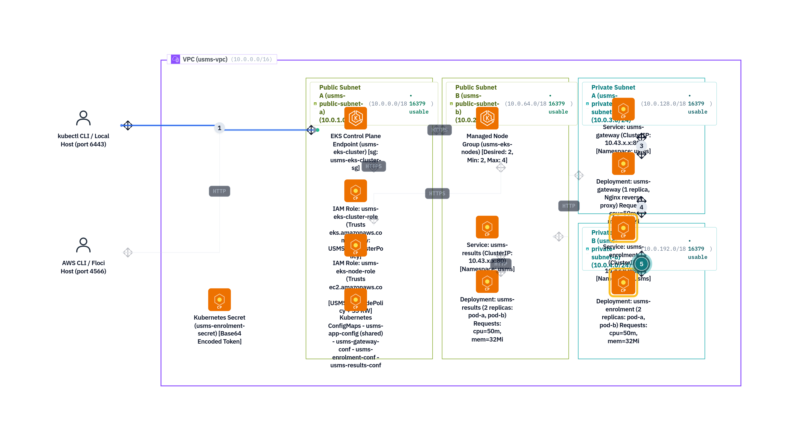

*Figure 1: High-Level EKS Microservices Architecture for Lab 07 (usms-vpc). The diagram illustrates the 3-tier microservices deployment on Amazon EKS within the usms-vpc network. The EKS Control Plane and Managed Node Group (usms-eks-nodes) operate across public subnets, governed by IAM roles (usms-eks-cluster-role, usms-eks-node-role) and cluster security groups. Workloads reside in the private subnets within the usms namespace: usms-gateway handles path-based reverse proxy routing to backend usms-enrolment and usms-results microservices (each running 2 ready replicas with 50m CPU requests). Application state and security are managed via shared/service ConfigMaps (usms-app-config) and Kubernetes Secrets.*

---

## 5. Implementation Overview

The implementation moved from the AWS side (IAM roles, security group, cluster, node group) to the Kubernetes side (kubeconfig, namespace, Deployments, Services, discovery, Secret, rollouts, failure drills). Identifiers were captured with `$(...)` and `--query` so they could be re-derived from the API, and the work finished with a Floci restart to test persistence. That test exposed a real persistence gap (Step 22) that was diagnosed and repaired.

---

## 6. Results and Evidence

### 6.1 CLI Output and Detailed Walkthrough

#### Step 1 - Start the environment and confirm the ground

Started Floci with `./scripts/setup/floci-up.sh`, sourced `course.env` and the Lab 01 to 04 env files, then ran `whoami.sh` and `floci-storage-check.sh`.

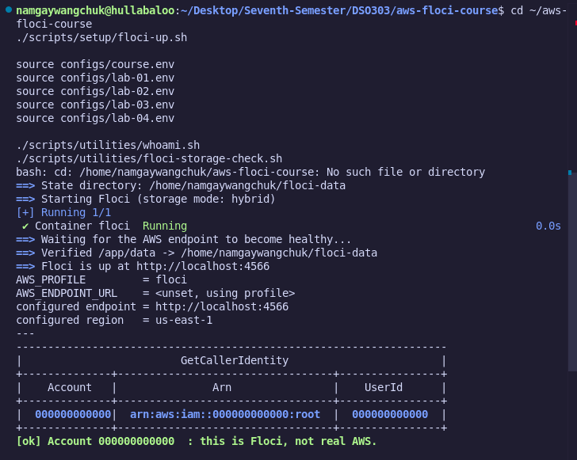

`whoami.sh` reported Account `000000000000` and `[ok] ... this is Floci, not real AWS`. The storage check reported `FLOCI_STORAGE_MODE=hybrid (durable)` with a bind mount to `/home/namgaywangchuk/floci-data`.

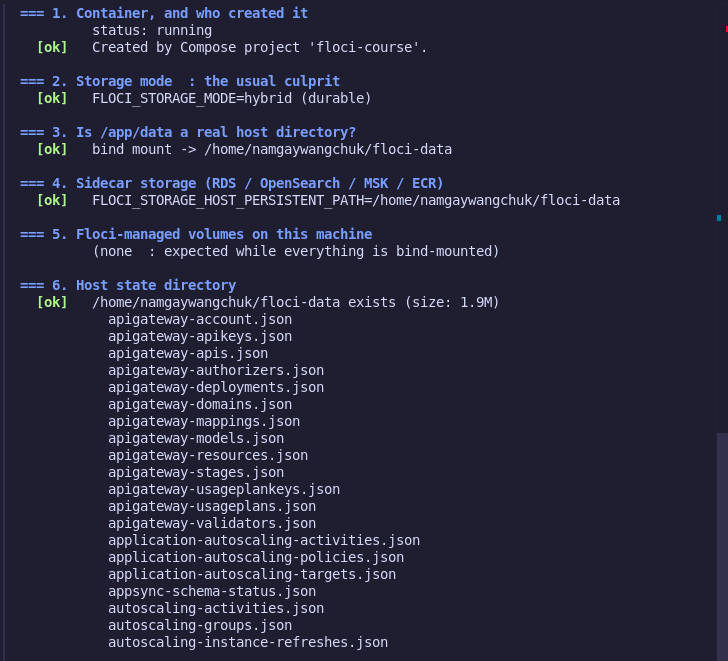

`verify-lab-02.sh` reported `PASS=33 FAIL=0`. `verify-lab-04.sh` reported `PASS=31 FAIL=7`.

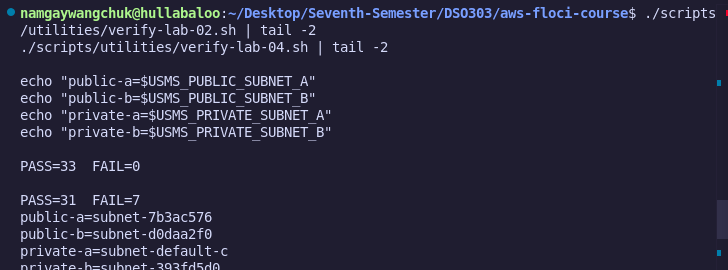

**Observations**

* The lab tolerates at most `FAIL=1` from `verify-lab-04.sh`. `FAIL=7` means some Lab 04 checks were failing before this lab began. Lab 04's ECS objects are used only in the Step 20 comparison, so the EKS work was not blocked, but the failures are recorded here rather than hidden.
* The four subnet variables were `public-a=subnet-7b3ac576`, `public-b=subnet-d0daa2f0`, `private-a=subnet-default-c`, `private-b=subnet-393fd5d0`. The ID `subnet-default-c` is not in the same format as the others. Floci accepted it throughout, and the cluster, security group and VPC (`vpc-cb590c55`) were consistent with each other.
* The shell printed `cd: /home/namgaywangchuk/aws-floci-course: No such file or directory`, because the repository lives under `~/Desktop/Seventh-Semester/DSO303/`. The commands ran from inside the repository, so this was harmless.

#### Step 2 - Probe what the build supports

Wrote `scripts/utilities/eks-support-probe.sh` with a quoted heredoc.

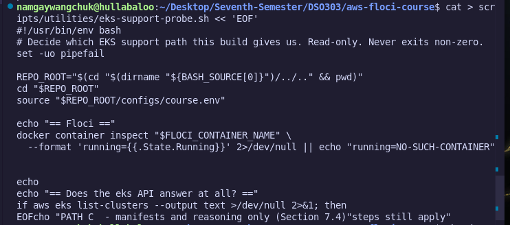

The probe reported Floci running, `aws eks list-clusters` answering `OK`, `kubectl` installed, `k3d` missing (acceptable on Path A), and the verdict **PATH A - use aws eks throughout**.

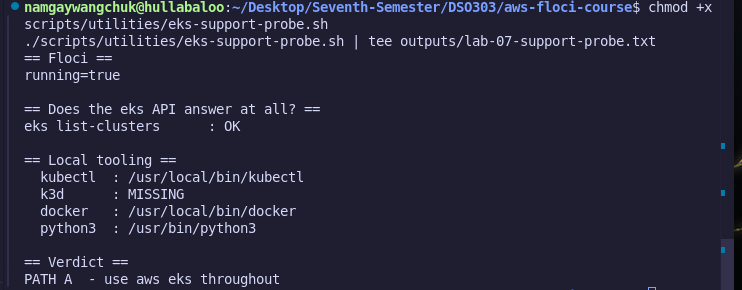

The verdict was recorded in `notes/lab-07-notes.md`.

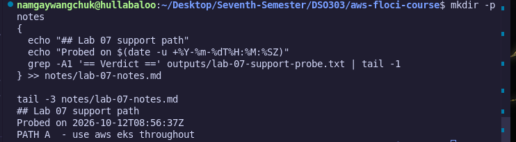

#### Step 3 - Control plane versus data plane

**Your turn answer:** the statement "EKS is just ECS with different names" is false because EKS exposes a distinct control plane and data plane. Worker nodes are real EC2 instances in the customer's account running kubelet and a container runtime, registered through a node IAM role, whereas ECS with Fargate abstracts nodes away entirely. It is nearly true because both are container orchestrators that keep N copies of a workload running, with IAM integration, network interfaces and load balancer target registration.

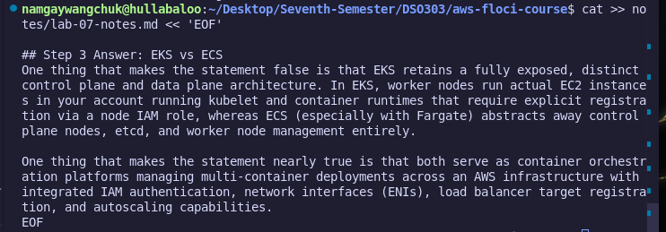

#### Step 4 - Write the two trust policies

Wrote `policies/trust-eks-cluster.json` and `policies/trust-eks-node.json` with quoted heredocs and validated both as JSON.

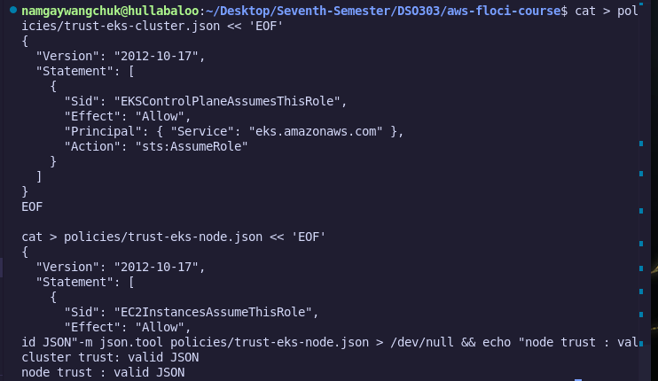

The verification printed `trust-eks-cluster.json -> eks.amazonaws.com` and `trust-eks-node.json -> ec2.amazonaws.com`.

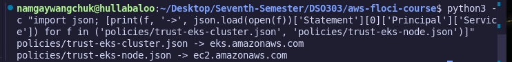

#### Step 5 - Write the two permissions policies

Wrote `usms-eks-cluster-policy.json` and `usms-eks-node-policy.json` as local stand-ins for the AWS managed policies.

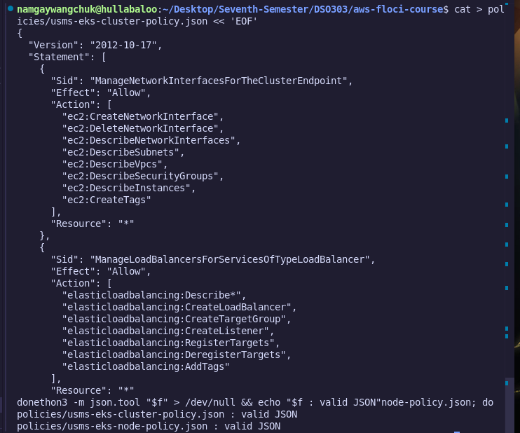

The statement summary matched the lab: the cluster policy has three statements (8, 7 and 1 actions, ending in `Deny`) and the node policy has five (3, 11, 4, 4 and 1 actions, ending in `Deny`).

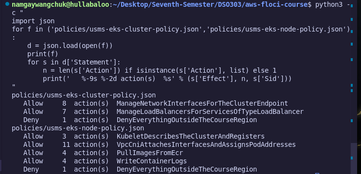

> **Floci limitation:** policies are stored and returned but not evaluated, so they are judged by reading.

#### Step 6 - Cluster role and cluster security group

Created `usms-eks-cluster-role`.

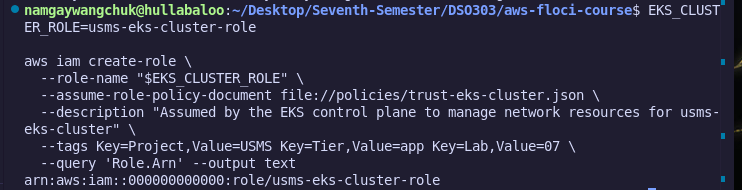

Created `USMSEKSClusterPolicy` (with a lookup fallback so the step is re-runnable) and attached it.

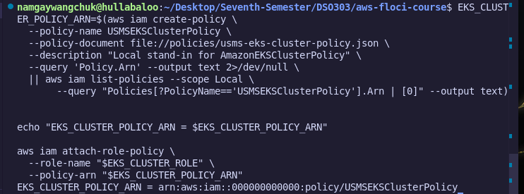

Created `usms-eks-cluster-sg` in Lab 02's VPC with `--vpc-id "$USMS_VPC_ID"`, and authorised tcp/443 from the VPC CIDR. The group ID was `sg-2b7c732eda65b86cc`.

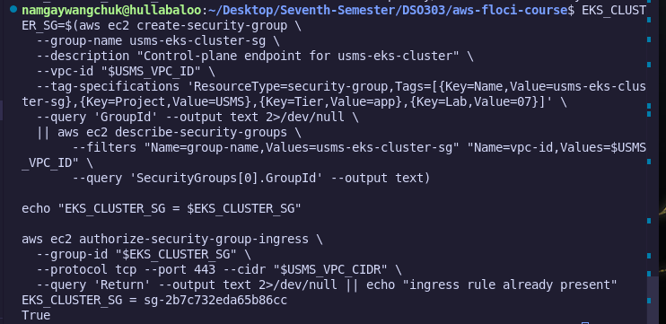

Verification showed `USMSEKSClusterPolicy` attached, trusted service `eks.amazonaws.com`, and a security group in VPC `vpc-cb590c55` with port 443.

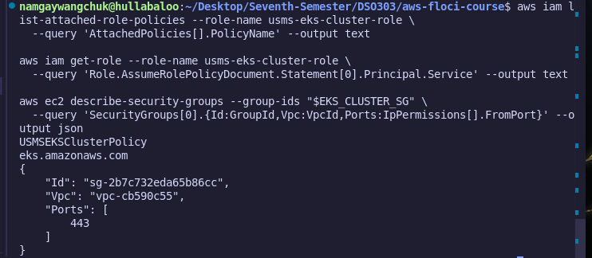

#### Step 7 - Node role and Lab 01's policy

Created `usms-eks-node-role`, created and attached `USMSEKSNodePolicy`, and attached Lab 01's `USMSStudentDataReadWrite` unchanged. `list-entities-for-policy` listed three holders: `usms-ec2-app-role`, `usms-ecs-task-role` and `usms-eks-node-role`.

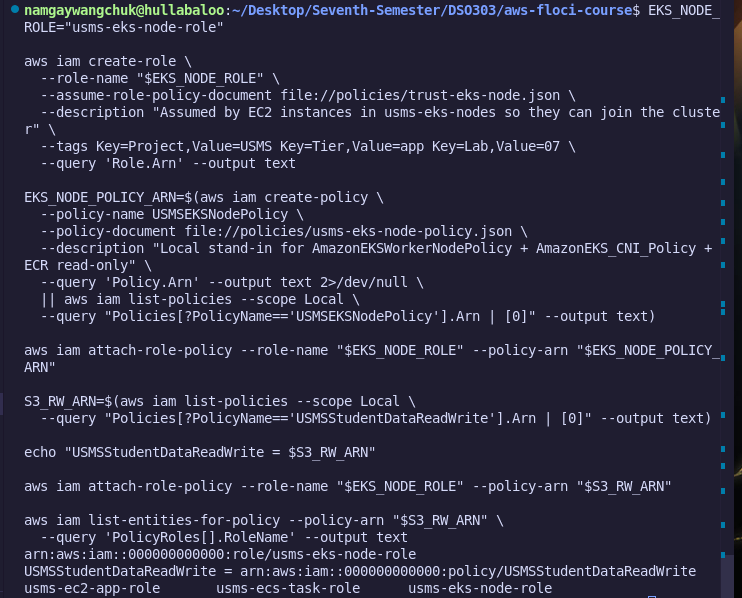

Verification showed `USMSEKSNodePolicy` and `USMSStudentDataReadWrite` attached, and the trusted service `ec2.amazonaws.com`.

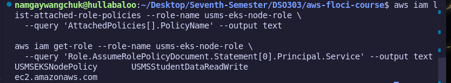

> **Floci limitation:** a node role gives credentials to every pod on every node. Real EKS uses IRSA for per-pod permissions (Step 21).

#### Step 8 - Create the cluster

Wrote `templates/lab-07-create-cluster.json` with an **unquoted** heredoc so the subnet IDs, role ARN and security group ID were expanded at write time.

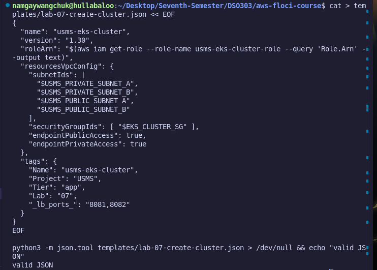

Assumed `usms-developer-role` (session `lab07-eks-build`), confirmed the assumed-role identity, ran `aws eks create-cluster`, then **unset the temporary credentials** and re-ran `whoami.sh`, which returned to root. The result table showed `Status: CREATING`, `Version: 1.30`.

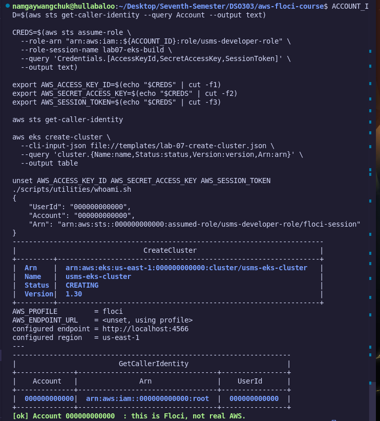

#### Step 9 - Wait for the cluster and read it back

After the wait loop, `describe-cluster` returned:

* Status `ACTIVE`, version `1.30`, endpoint `https://localhost:6501`
* Role `usms-eks-cluster-role`, security group `sg-2b7c732eda65b86cc`, VPC `vpc-cb590c55`
* Four subnets: `subnet-default-c`, `subnet-393fd5d0`, `subnet-7b3ac576`, `subnet-d0daa2f0`
* Tags including `_lb_ports_: "8081,8082"`

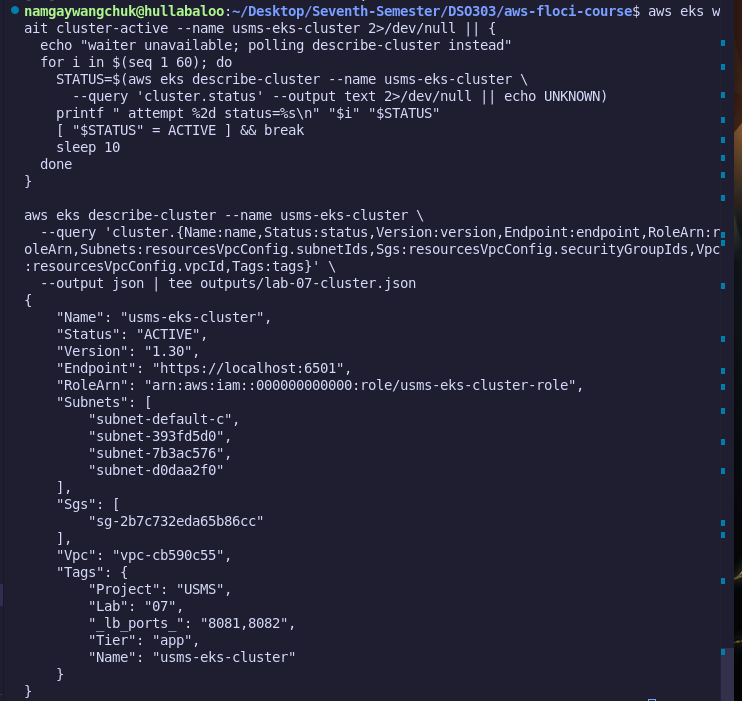

The `_lb_ports_` tag was read back independently as `8081,8082`.

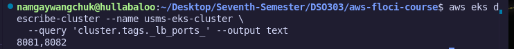

> **Floci limitation:** `_lb_ports_` is an emulator control that tells Floci which host ports to publish. Real AWS treats it as an ordinary tag.

**Your turn:** printed the Kubernetes version and OIDC issuer side by side.

```bash
aws eks describe-cluster --name usms-eks-cluster \
  --query 'cluster.[version, identity.oidc.issuer]' --output text
```

The output was `1.30` and `https://oidc.eks.us-east-1.amazonaws.com/id/4726E20D33B14A359CFEAA768E6C09E1`.

**Answer:** the OIDC issuer URL establishes trust between AWS IAM and Kubernetes ServiceAccounts (IRSA), allowing pods to assume specific IAM roles directly, without storing AWS credentials in the pod or falling back to node credentials.

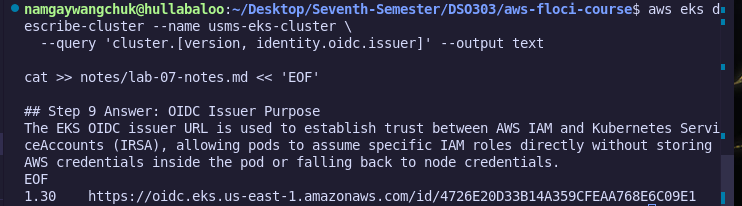

> **Observation:** the lab predicts `None` on most builds. This build returned a URL, so it supports more than the lab assumes.

#### Step 10 - Managed node group

Created `usms-eks-nodes` from `templates/lab-07-create-nodegroup.json`. It was `ACTIVE`, with min 2 / max 4 / desired 2, role `usms-eks-node-role`, labels `workload=usms` and `tier=app`, AMI `AL2023_x86_64_STANDARD`, and two subnets: `subnet-default-c` and `subnet-393fd5d0` (the private-a and private-b variables from Step 1).

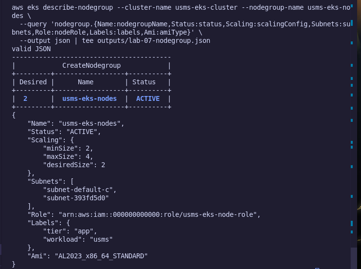

> **Floci limitation:** instance type and AMI type are stored and returned but have no effect. The node group is a recorded object, not real EC2 capacity.

#### Step 11 - Point kubectl at the cluster

Ran `aws eks update-kubeconfig --name usms-eks-cluster --alias usms-eks`. `kubectl cluster-info` showed the control plane, CoreDNS and Metrics-server at `https://localhost:6501`. `kubectl get nodes -o wide` showed **one** node, `b610a59037df`, `Ready`, role `control-plane`, version `v1.34.1+k3s1`.

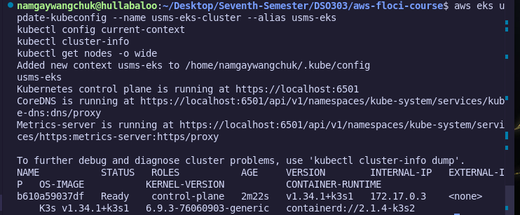

**Observations**

* Only one node registered, although the node group records "desired 2". The node group is a recorded AWS object while the real capacity is a single k3s node. Pods scheduled and ran, but this limits the node-failure exercise.
* The AWS API reports Kubernetes `1.30` while the running k3s server reports `v1.34.1+k3s1`. The Kubernetes half is a genuine k3s cluster, while the `eks` API returns recorded values.

#### Step 12 - Namespace

Created `manifests/lab-07/00-namespace.yaml` (labels `project=usms`, `tier=app`, `lab="07"`), applied it, set it as the context default, and confirmed with `kubectl config view --minify`, which printed `usms`.

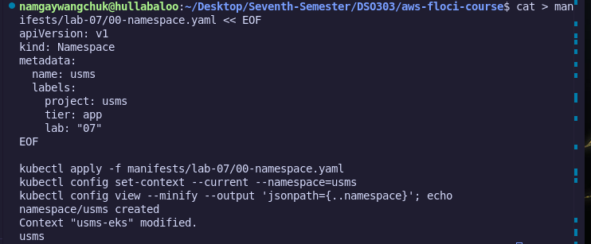

#### Step 13 - Deploy usms-enrolment

Applied the shared ConfigMap `usms-app-config`, then wrote and applied `20-enrolment.yaml` (ConfigMap, a 2-replica Deployment with a `RollingUpdate` strategy, and a ClusterIP Service). The rollout completed.

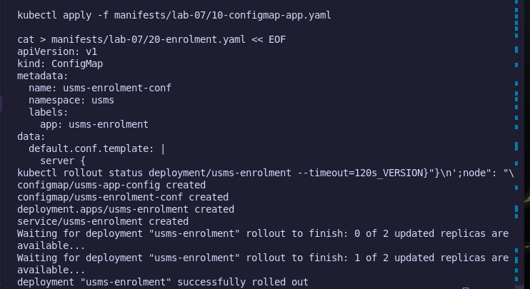

A busybox pod fetched `http://usms-enrolment.usms.svc.cluster.local/` and received JSON with the real pod name, node `b610a59037df`, `"env":"laboratory"` and `"version":"1.0.0"`.

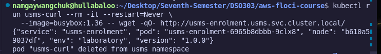

> **Observation:** the response also contained a `db_pwd_loaded` field echoing the Secret value, which is not in the lab's template. It is useful for demonstrating Step 17, but returning a secret in an HTTP response is itself an anti-pattern.

#### Step 14 - Deploy usms-results

Wrote and applied `30-results.yaml`. The Deployment rolled out to 2/2.

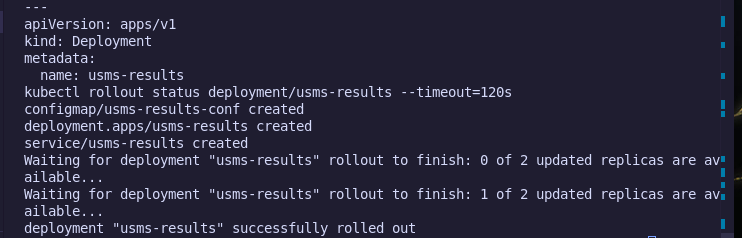

#### Step 15 - Deploy the gateway

Wrote and applied `40-gateway.yaml` after both backend Services existed, so nginx could resolve the upstream names at startup. The rollout completed.

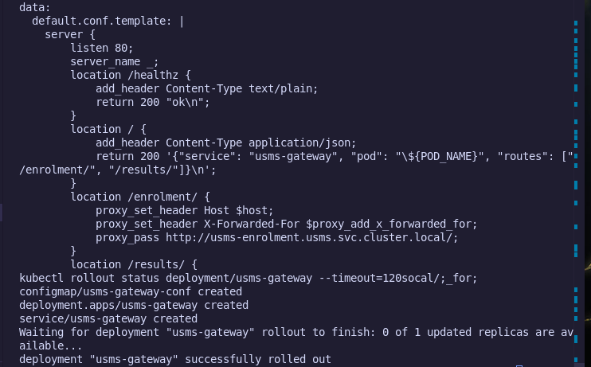

**Extra object:** a `usms-gateway-nodeport` Service (NodePort 30080) was also created from `50-gateway-nodeport.yaml`. External exposure is Lab 08's subject, not this lab's.

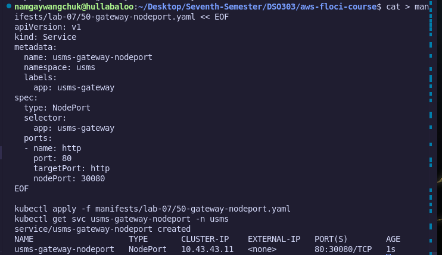

#### Step 16 - Prove service discovery from inside the cluster

**DNS resolution.** `nslookup` from a busybox pod resolved both Services through CoreDNS at `10.43.0.10`:

* `usms-enrolment.usms.svc.cluster.local` resolved to `10.43.55.254`
* `usms-results.usms.svc.cluster.local` resolved to `10.43.238.142`

These are virtual Service addresses, not pod addresses.

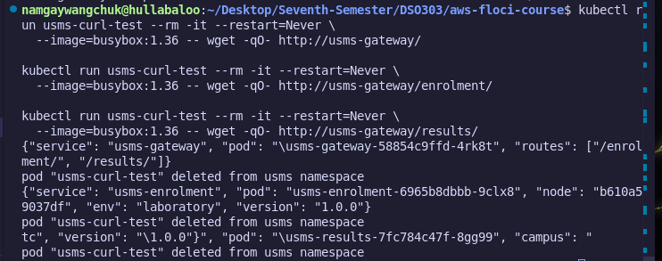

**Through the gateway.** Requests to `/`, `/enrolment/` and `/results/` all answered.

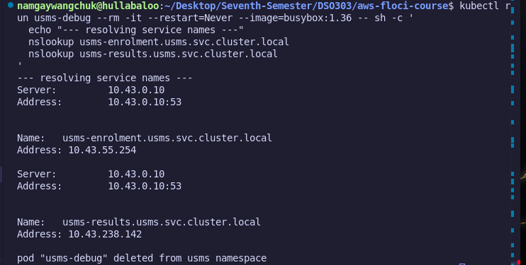

The short-name form (`http://usms-gateway/`) also worked, because the pod's DNS search path includes the `usms` namespace.

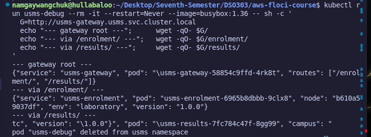

**Load spreading.** A 12-request tally through the gateway returned two distinct pods: `usms-enrolment-74dfb7b584-6cxct` (7 requests) and `usms-enrolment-74dfb7b584-bx95w`. (The screenshot was cut off before the second count, so only the 7 is quoted.)

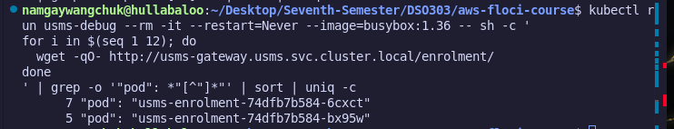

**Observation on response bodies:** the gateway and results responses contain a stray backslash before the interpolated values (for example `"pod": "\usms-gateway-..."`), and the results JSON appeared truncated. The enrolment response is clean. The likely cause is a backslash before `${...}` when the gateway and results templates were written. Routing still works, but the JSON is not well formed.

**Your turn:** deleted one `usms-enrolment` pod without restarting the gateway.

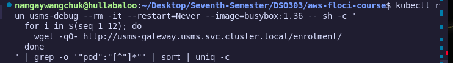

`kubectl get rs` showed `usms-enrolment-6965b8dbbb` at 2 desired / 2 current / 2 ready, and the events showed `SuccessfulCreate` from `replicaset/usms-enrolment-6965b8dbbb` creating the replacement pod.

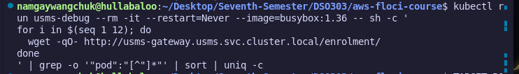

**Answer:** the replacement pod was created by the **ReplicaSet**, which keeps the pod count at the desired value of 2. It was not the Deployment directly and not the administrator.

#### Step 17 - ConfigMaps and Secrets

Created a Secret `usms-app-secrets` (type `Opaque`, 2 keys) from `manifests/lab-07/11-secret-app.yaml`.

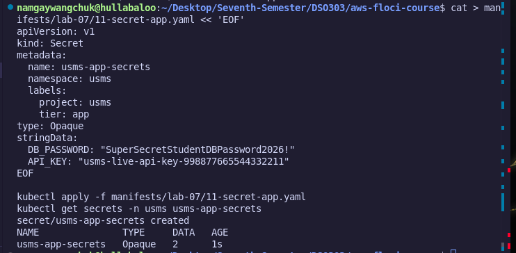

Retrieved the stored value and decoded it with `base64 --decode`, recovering the plain text. No key was needed beyond permission to read the Secret.

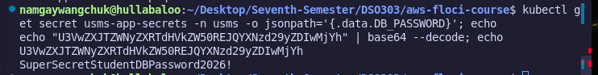

**Answer:** base64 is an encoding, not encryption. For production, enable encryption at rest in etcd (KMS), restrict access with RBAC, and ideally use an external secret manager. On real EKS, KMS envelope encryption is configured at cluster creation and IRSA replaces stored AWS credentials.

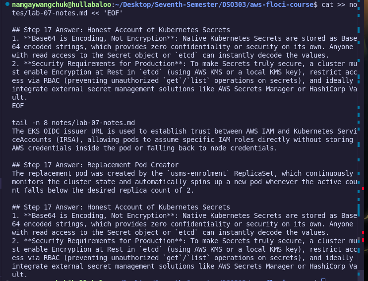

**Deviations from the lab text**

* The lab creates `usms-enrolment-secret` with keys `ENROLMENT_API_TOKEN` and `ENROLMENT_DB_PASSWORD` via `--dry-run=client`, saves it as `50-secret.yaml`, and consumes it with `kubectl set env`. This lab's Secret is `usms-app-secrets` with keys `DB_PASSWORD` and `API_KEY` in `11-secret-app.yaml`. The base64 demonstration is equivalent, but checks that look for the lab's names will not match.
* The value used looks like a realistic password. The lab stresses obviously fake values and keeping secret manifests out of the committed tree.

#### Step 18 - Roll out a change, then roll it back

**Configuration change.** Edited `10-configmap-app.yaml` with `sed -i.bak` to set `APP_VERSION` to `1.1.0` and applied it. A request still returned `"version":"1.0.0"`, confirming that **updating a ConfigMap does not restart running pods**. Annotating the Deployment's own metadata did not roll the pods, so `kubectl rollout restart` was used. The new pod (`usms-enrolment-98c877b7b-rw2nm`) returned `"version":"1.1.0"`, and the middle segment of the pod name (the ReplicaSet hash) changed.

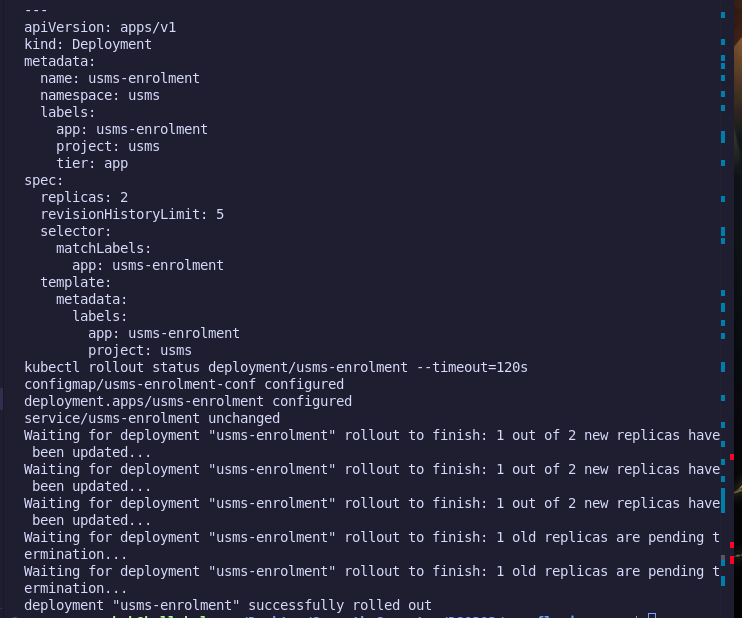

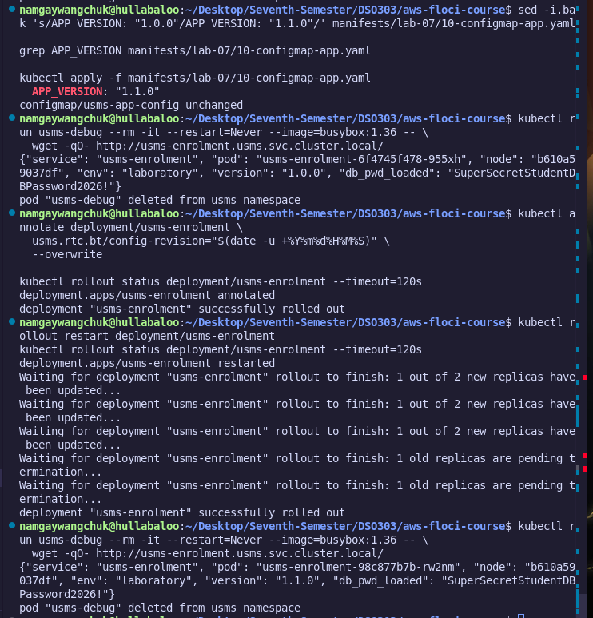

**History.** `kubectl rollout history` showed revisions 1 to 4, with the old ReplicaSets kept at 0 replicas and the newest serving 2.

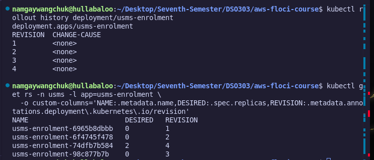

**Rollback.** `kubectl rollout undo` re-promoted the earlier ReplicaSet as revision 5, and the history then read 1, 2, 4, 5. kubectl warned that rolling back does not update the `last-applied-configuration` annotation of a resource managed with `kubectl apply`.

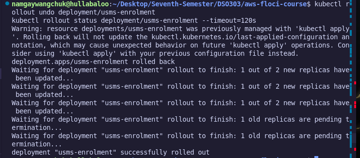

The response after the undo said `"version":"1.0.0"`. The live ConfigMap and the manifest file both held `1.0.0`, so the ConfigMap had already been restored to `1.0.0` before the undo. The ConfigMap was therefore consistent, but the point that **rollback reverts the pod template and not the ConfigMap** is evidenced by the earlier step (screenshot 41), where pods kept `1.0.0` after the ConfigMap changed.

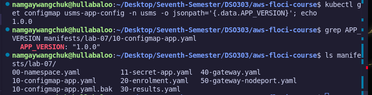

**Cleanup.** Removed the `.bak` file.

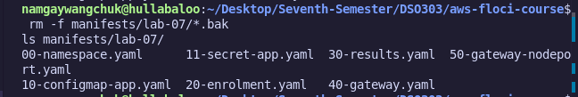

**Your turn: image-tag update and rollback of `usms-results`.** Ran `kubectl set image deployment/usms-results results=nginx:1.27` and watched the pods.

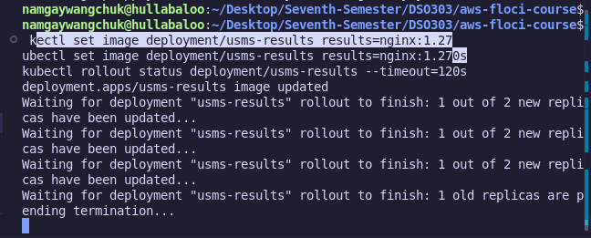

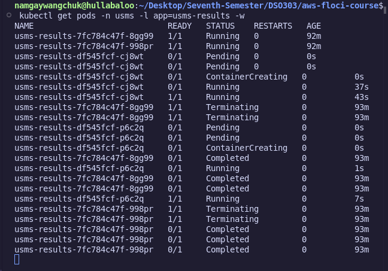

The new pod became `1/1 Running` before the first old pod began `Terminating`; the second new pod then started and the second old pod terminated. Ready pods stayed at two or more throughout, and there were **three live pods at the peak**.

`usms-results` uses the default strategy (25% / 25%). With two replicas, Kubernetes rounds `maxSurge` up to 1 and `maxUnavailable` down to 0, so the roll behaves like enrolment's `0 / +1`. This differs from the lab's statement that "one pod may be unavailable" during an update of two replicas, which does not hold at this size.

`rollout undo` then restored the original image. The history read **2, 3** (revision 1 was re-promoted as 3), and the Deployment ended at `2/2`.

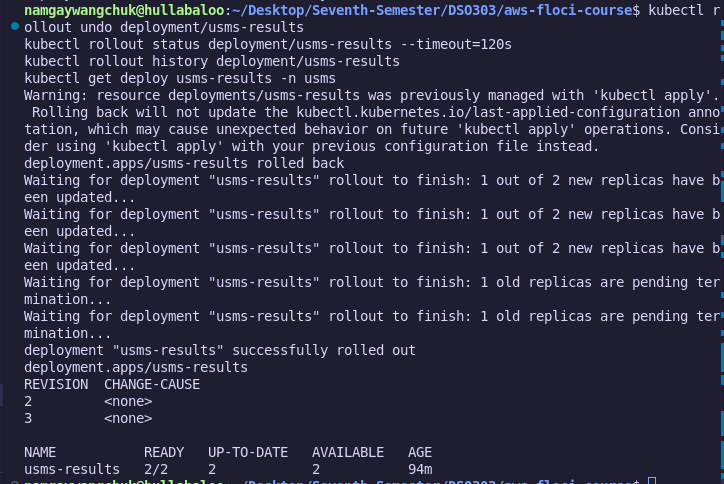

#### Step 19 - Break pods deliberately, and diagnose them

The diagnostic order was `get pods`, then `describe pod` (the Events), then `logs`.

**Failure 1: ImagePullBackOff.** Set the image to `nginx:this-tag-does-not-exist`. The new pod showed `0/1 ImagePullBackOff` while the two older pods stayed `1/1 Running`, so the rolling strategy kept the service up.

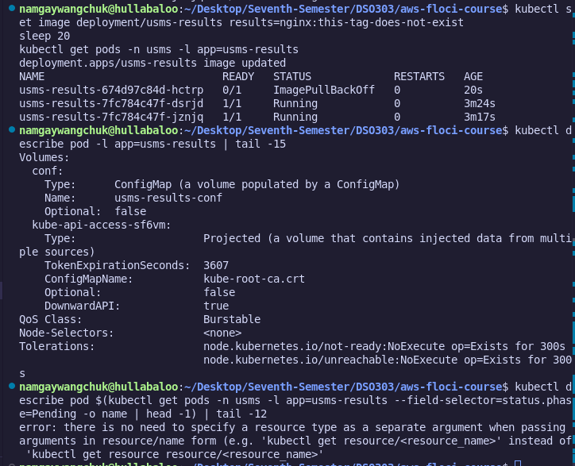

The Events listed `Failed to pull image "nginx:this-tag-does-not-exist"` with `NotFound`, then `ErrImagePull` and `Back-off pulling image`. This was diagnosed from `describe` alone, because the container never started and has no logs.


`kubectl rollout undo` restored the service, and `usms-results` returned to `2/2`.


**Failure 2: Pending / FailedScheduling.** Created `usms-toobig`, a pod requesting 64 CPUs and 256Gi of memory. It stayed `Pending`, and the Events showed `FailedScheduling: 0/1 nodes are available: 1 Insufficient cpu, 1 Insufficient memory`. The message says `0/1`, not the lab's `0/3`, because only one node exists. The pod was then deleted.


**Failure 3: CrashLoopBackOff.** Created `usms-crasher`, a container that prints a message and exits with code 1. It reached `CrashLoopBackOff`, and `kubectl logs` printed `usms-crasher starting` and `fatal: no database configured`. `Last State` was `Terminated` with `Exit Code: 1`. Because the container did start, `logs` is the right second command here, unlike the other two failures.


`kubectl logs --previous` returned "unable to retrieve container logs" because the container exited and was restarted within a second. The namespace events nevertheless show the `BackOff` for the crasher alongside the earlier image-pull events.


**Cleanup.** After deleting the temporary pods, `kubectl get pods -n usms` showed only the five application pods (2 enrolment, 1 gateway, 2 results), all `1/1 Running`.


#### Step 20 - ECS versus Kubernetes

Ran the ECS and EKS views side by side. The EKS half listed three Deployments (2/2, 1/1, 2/2) and four Services with ClusterIPs matching the earlier DNS lookups.


> **Evidence gap:** the ECS half of this command printed nothing, so a live ECS comparison was not captured. This is consistent with the failures seen earlier in `verify-lab-04.sh`. The comparison table in `notes/lab-07-notes.md` was written from the Lab 04 and 05 understanding rather than from a live ECS read-back.

**Comparison summary**

| Question | ECS | Kubernetes |
| --- | --- | --- |
| What holds the container spec? | Task definition (numbered revision) | Pod template inside a Deployment |
| What keeps N copies alive? | ECS service (`desiredCount`) | ReplicaSet owned by the Deployment |
| What gives it a stable name? | Target group / ALB DNS name | Service (ClusterIP and DNS name) |
| How does another service find it? | ALB or Cloud Map | CoreDNS |
| What does a rolling update create? | New deployment on a new task definition revision | New ReplicaSet; old one scaled to zero |
| Where does rollback state live? | Earlier task definition revisions | Old ReplicaSets |
| Which IAM role does the app use? | Task role | Node role here; IRSA role on real EKS |
| What changes to move cloud? | Nearly everything | Manifests mostly portable; IAM, VPC, node groups, load balancers change |

#### Step 21 - IRSA

Read the cluster's OIDC issuer (a real URL on this build) and registered it as an IAM OpenID Connect provider, which returned the ARN `arn:aws:iam::000000000000:oidc-provider/oidc.eks.us-east-1.amazonaws.com/id/4726E20D...`. Created the ServiceAccount `usms-enrolment-sa` in namespace `usms`, and `list-open-id-connect-providers` returned the same ARN.


#### Step 22 - Prove that all of this survives a restart

Stopped and started Floci with `floci-down.sh` and `floci-up.sh`. The stop reported `State preserved in /home/namgaywangchuk/floci-data`, but the restart failed:

```
Error response from daemon: Ports are not available: ... listen tcp 0.0.0.0:4566: bind: address already in use
```


**Diagnosis.** `docker ps -a` showed the `floci` container as `Exited (143)`, and `ss -ltnp` showed port 4566 still held by an orphaned `docker-proxy` process (pid 15616) belonging to no running container. The unrelated `kind-*` and `model-*` containers were left untouched. Killing only that one proxy process (`sudo kill 15616`) freed the port, and Floci then started normally.


After the restart, `kubectl get nodes` showed the same node `b610a59037df`, `Ready`, with an age of 121 minutes, which shows the Kubernetes side was not recreated.


**Read-back from the API.** The cluster and node group were re-derived from `list-clusters` and `list-nodegroups` rather than from shell variables. `usms-eks-cluster` was `ACTIVE 1.30`, the node group `usms-eks-nodes` was present, namespace `usms` was `Active`, the Deployments were at 2 / 1 / 2 ready, and the four `usms-*` ConfigMaps were present.


**A persistence gap was found.** When `configs/lab-07.env` was generated afterwards, four values were empty or `None`.


Direct checks showed that `usms-eks-cluster-role` and `usms-eks-node-role` returned `NoSuchEntity`, and the local policy list no longer contained `USMSEKSClusterPolicy` or `USMSEKSNodePolicy`, while Labs 01 to 06 IAM objects survived. The OIDC provider from Step 21 was also gone. By contrast, the security group (`sg-2b7c732eda65b86cc`), cluster, node group and all Kubernetes objects persisted.

**Repair.** Re-ran Steps 6 and 7 (the commands are re-runnable and the policy JSON files were still on disk). The verification then showed `USMSEKSClusterPolicy` on the cluster role, and `USMSEKSNodePolicy` plus `USMSStudentDataReadWrite` on the node role. `list-entities-for-policy` returned `UnsupportedOperation` after the restart, although it worked in Step 7, so the three-holder check was repeated by listing each role's attached policies, and `USMSStudentDataReadWrite` appeared on `usms-ec2-app-role`, `usms-ecs-task-role` and `usms-eks-node-role`.


> **Cause (unverified):** the most likely explanation is that IAM state created in this session had not been flushed to the bind-mounted data directory before the container stopped. This is a hypothesis. It was not tested, and the report claims only what was observed: the EKS IAM roles, the two policies and the OIDC provider did not survive, while the cluster, node group, security group and Kubernetes state did.

#### Step 23 - Write `configs/lab-07.env`

The file was generated with an unquoted heredoc so every `$(...)` runs at write time. The first generation (before the IAM repair) had four empty values, which the empty-value check caught (screenshot 66). After the OIDC provider and IAM objects were recreated, the file was regenerated.


*(Screenshot 69 should show `all values populated`, `cluster=usms-eks-cluster ns=usms lb_ports=8081,8082` and `21`.)*

The Deployment's CPU request was confirmed independently as `50m`, because Lab 08's HorizontalPodAutoscaler divides by it.

#### Step 24 - Commit


---

### 6.2 Console Verification

Floci provides no console, and Kubernetes objects are verified through `kubectl`. The equivalent evidence is in Steps 6 and 7 (IAM), Steps 9 and 10 (cluster and node group), and Steps 13 to 16 (workloads).

---

## 7. Verifications

#### 7.1 What `verify-lab-07.sh` checks

The script checks configuration as well as existence: the cluster role trusts `eks.amazonaws.com`, the node role trusts `ec2.amazonaws.com`, the node role carries `USMSStudentDataReadWrite`, the security group is in `usms-vpc`, the cluster and node group are `ACTIVE`, the `_lb_ports_` tag is present, the Deployments report the expected ready replicas, and `configs/lab-07.env` has no empty values. This is the check that the Step 22 persistence gap would have been caught by.

#### 7.2 Result


*(Pending: insert the final `PASS=… FAIL=…` line. The lab expects `PASS=30 FAIL=0` on Path A.)*

#### 7.3 Cleanup script


---

## 8. Analysis and Discussion

**Two identities, never interchangeable.** The cluster role trusts `eks.amazonaws.com` and the node role trusts `ec2.amazonaws.com`. The verify commands read the trusted service back from the API rather than assuming it.

**One policy, three holders.** Lab 01's `USMSStudentDataReadWrite` now sits on an EC2 instance role, a Fargate task role and an EKS node role, unchanged. On a node role it reaches every pod on every node, which is why IRSA is the finer-grained mechanism on real EKS.

**Service discovery by name.** The gateway holds DNS names only. CoreDNS resolved them to ClusterIPs, and deleting a backend pod did not require touching the gateway, because the Service's endpoints are rewritten automatically.

**ConfigMaps do not restart pods, and rollback does not revert them.** After `APP_VERSION` changed, running pods kept `1.0.0` until the pod template changed. Rolling back a Deployment recovers the pod template only, which is why configuration is versioned alongside the workload.

**Rolling strategies.** With two replicas the default 25% / 25% rounds to surge 1 and unavailable 0, so `usms-results` rolled the same way as `usms-enrolment` at this size. The difference would appear at other replica counts.

**Failure diagnosis.** The three failures are diagnosed with different commands: `describe` for `ImagePullBackOff` and `FailedScheduling` (the container never started), and `logs` for `CrashLoopBackOff` (it did start).

**A Secret is not a lock.** Decoding the stored value required nothing beyond permission to read the Secret.

**Persistence is not automatic.** The restart test found that the cluster, node group and Kubernetes state survived while the EKS IAM roles, policies and OIDC provider did not. A check that only confirmed the cluster would have passed. Re-deriving every identifier from the API, and checking each dependency, is what exposed the gap.

**Emulation boundaries.** The Kubernetes half is genuine k3s. The AWS half is recorded: IAM policies are stored but not evaluated, node group sizing is recorded but only one node exists, and instance types and AMIs have no effect. The AWS API reported Kubernetes 1.30 while k3s reported v1.34.1.

---

## 9. Review Questions (draft answers, edit in your own words)

1. **Cluster `ACTIVE` but pods `Pending`.** `ACTIVE` describes the control plane, which AWS runs, while pods need data-plane nodes to run on. With no nodes, or nodes that cannot fit the request, pods stay `Pending`. Two causes: no node group (or only a tainted control-plane node), and resource requests larger than any node (Step 19's `FailedScheduling`).
2. **Swapped trust policies.** The control plane could not assume the cluster role and the nodes could not assume the node role, so cluster creation or node registration would fail. Floci stores trust policies without evaluating them, so the problem would only appear on real AWS, at cluster creation (Step 8) or node registration (Step 10).
3. **Readiness versus liveness.** Readiness controls whether a pod receives Service traffic, and liveness controls whether the container is restarted. Wiring a load-sensitive check to liveness makes a busy service restart under load and get worse.
4. **Rollback and the ConfigMap.** Rollback reverts the pod template, not the ConfigMap, so a release that changes both is only half undone. Teams version configuration with the workload to resolve this.
5. **`maxUnavailable: 0` versus the default.** With two replicas the default rounds to a surge of 1 and unavailable of 0, so both rolled the same way here. The strategy that never drops capacity suits a service that must stay at full capacity, and ECS's `minimumHealthyPercent 100` is the closest equivalent.
6. **"A Secret is encrypted, so commit it".** A Secret is base64-encoded, which anyone can decode (shown in Step 17). It keeps values out of images and allows separate RBAC, but gives no confidentiality at rest unless etcd encryption is configured. On real EKS use KMS envelope encryption and IRSA, and keep secret manifests out of Git.
7. **ECS or Kubernetes for USMS.** For a small team with a quiet eight months and two busy months, ECS on Fargate is the better fit. This lab was harder than Lab 04 in having a node layer and two IAM roles to manage, and more objects to understand. Kubernetes gave per-pod IAM (IRSA), portable manifests, and namespaces with built-in DNS discovery.

---

## 10. Reflection

* I learned to separate the AWS plumbing (roles, security group, cluster, node group) from the portable Kubernetes objects.
* I saw that manifest order matters: nginx resolves upstream names once at startup, so the backend Services must exist first.
* The restart test showed that a persistence check must re-derive every dependency, not only the headline resource.
* I learned to report what was observed. Several things differed from the lab text (single node, a real OIDC issuer, different Secret names, malformed JSON, lost IAM state), and recording those is more useful than forcing the output to match.

---

## Conclusion

An EKS cluster and managed node group were created in Lab 02's network with separate IAM roles, `kubectl` was connected, and three microservices were deployed declaratively. Service discovery by DNS, pod self-healing, rolling updates and rollbacks, three failure modes, and the base64 weakness of Secrets were demonstrated. A Floci restart proved that the cluster and Kubernetes state persist but exposed a loss of the EKS IAM roles, policies and OIDC provider, which was diagnosed and repaired. The final verification score and commit are pending.

---
