# Lab 08 : EKS Scaling and Service Exposure

**Environment:** Floci (AWS emulator, account `000000000000`, `us-east-1`) with a **kind** Kubernetes cluster (`v1.36.1`, nodes `kind-control-plane` and `kind-worker`), namespace `usms`

## 1. Objectives and summary

| Objective | Result |
|---|---|
| Scale a Deployment by hand, by manifest and with an `autoscaling/v2` HPA | **Done.** Manual scale 2→5→2, drift 6 vs 2 shown, HPA scaled 2→3→2 under load |
| Change the node group's scaling config from the AWS side | **Attempted, blocked.** `update-nodegroup-config` fails on this Floci build (known issue); `describe-nodegroup` works |
| Requests, QoS classes, `nodeSelector`, PodDisruptionBudgets | **Done.** QoS Burstable→Guaranteed→Burstable; selector enforcement proven; eviction refused, delete allowed |
| Exposure ladder: port-forward, NodePort, LoadBalancer, Ingress | **Done.** LoadBalancer stayed `<pending>` (no controller); Ingress served by ingress-nginx |
| Persistence across a restart; `configs/lab-08.env` | **Done.** `PERSISTENCE PROVEN`; 19 exports |


## 3. Step-by-step implementation

### 3.1 Step 1 : Start the environment and check the two Lab 07 leftovers

`floci-up.sh` started Floci (storage mode `hybrid`) and all five env files were sourced. My first `cd ~/aws-floci-course` failed because the repository is at `~/Desktop/Seventh-Semester/DSO303/aws-floci-course`; I was already inside it, so every later command ran correctly.

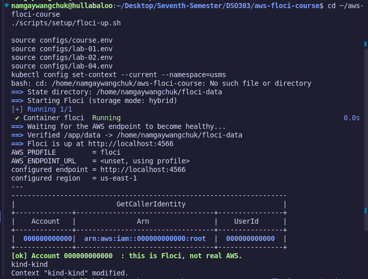

Checks: the enrolment CPU request is `{"cpu":"50m","memory":"32Mi"}` and the cluster tag `_lb_ports_` is `8081,8082` (both from `lab-07.env` and from the AWS API).

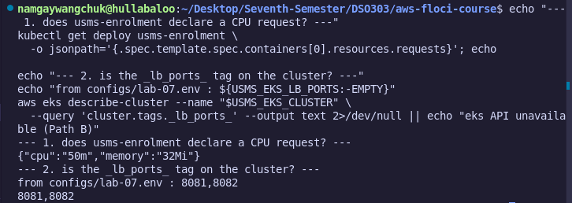

`verify-lab-07.sh` gave `PASS=30 FAIL=0` (Path A). Deployments 2/2, 1/1, 2/2; three ClusterIP Services with no external address; ConfigMaps present.

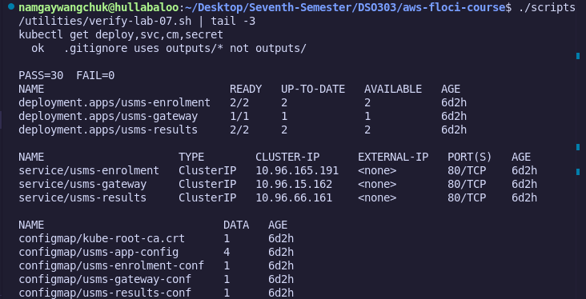

### 3.2 Step 2 : Baseline

Baseline saved to `outputs/lab-08-baseline.txt`: three Deployments at 2/1/2, endpoints listed, all Services ClusterIP with `<none>` external, and two Ready nodes. The cluster is **kind**, so the nodes are named `kind-control-plane` and `kind-worker` rather than `usms-eks-cluster-*`. The `v1 Endpoints is deprecated` warning comes from the newer Kubernetes version and is harmless.

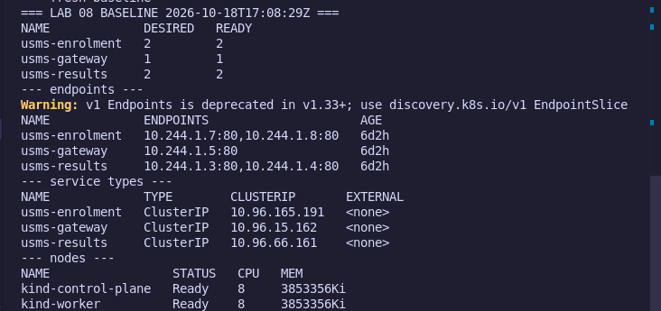

### 3.3 Step 3 : The four dimensions of scaling

1. **Horizontal workload:** `Deployment.spec.replicas` (you or an HPA).
2. **Vertical workload:** `requests`/`limits` (a pod is replaced when changed).
3. **Horizontal infrastructure:** node group `desiredSize` (you, Cluster Autoscaler or Karpenter).
4. **Vertical infrastructure:** instance types (needs a new node group, cannot change in place).

**Plan for ten times the traffic on `usms-enrolment`:** start with dimension 1 (raise replicas, ideally via the HPA) and check that new pods become Ready and endpoints grow. If pods are throttled or OOMKilled, use dimension 2, checking that a pod still fits on a node. If pods are Pending with `Insufficient cpu`, the cluster is out of room, so use dimension 3 (raise `desiredSize` or run Cluster Autoscaler/Karpenter) and confirm nodes are Ready. Only if a single pod needs more than any node offers do I use dimension 4, by creating a new node group and draining the old one.

### 3.4 Step 4 : Scale by hand

`kubectl scale deployment/usms-enrolment --replicas=5` wrote one field and the rollout finished at `5/5`; endpoints grew.

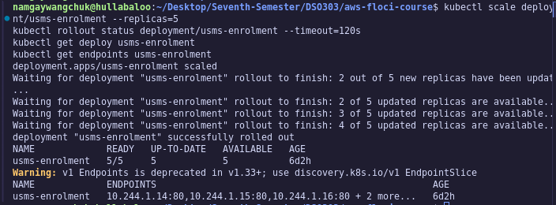

The watcher shows the new pods `Pending → ContainerCreating → Running` with `READY 0/1`, reaching `1/1` several seconds later: **endpoints grow only when pods become ready, not when they start.**

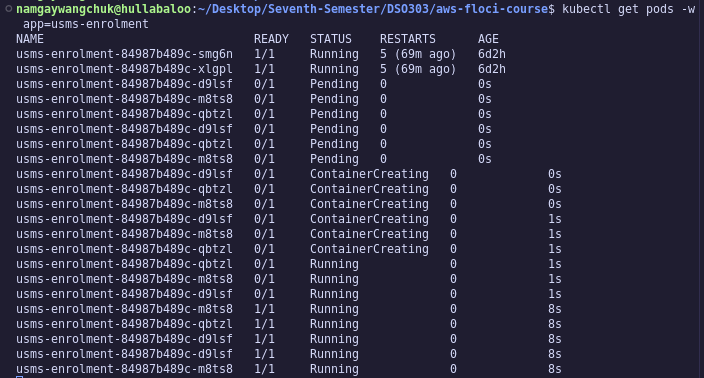

Traffic spread across five distinct pods (my first attempt with the PDF's `grep` printed nothing because this app's JSON has a space after the colon, so I used `"pod": *"[^"]*"`):

```
9 usms-enrolment-84987b489c-qbtzl
8 usms-enrolment-84987b489c-d9lsf
7 usms-enrolment-84987b489c-m8ts8
7 usms-enrolment-84987b489c-xlgpl
4 usms-enrolment-84987b489c-smg6n
```

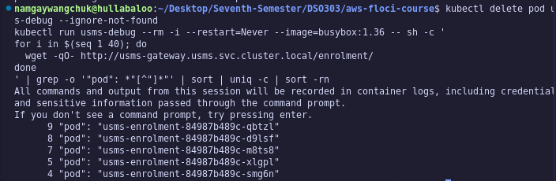

Scaled back to 2; endpoints returned to two addresses. Scale-in removes a pod from the endpoint list first, then sends SIGTERM with a 30 s grace period before SIGKILL, the Kubernetes equivalent of Lab 5's deregistration delay.

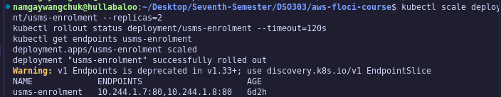

### 3.5 Step 5 : Declarative scaling and configuration drift

Part 1: after `kubectl scale --replicas=6` the cluster reports `6` while the manifest says `replicas: 2` (line 29).

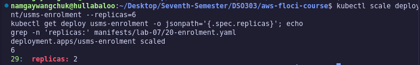

Part 2: `kubectl apply` silently reset it to `2`. This is the most common way a deployment causes an outage.

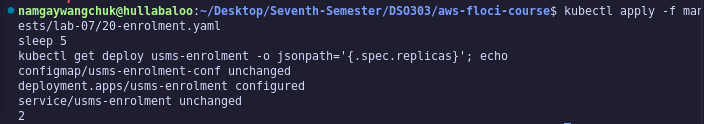

Part 3: with the file edited to 3, `kubectl diff` showed `- replicas: 2` / `+ replicas: 3` before the apply. `kubectl diff` exits 1 when there is a difference; that is a feature, hence `|| true`.

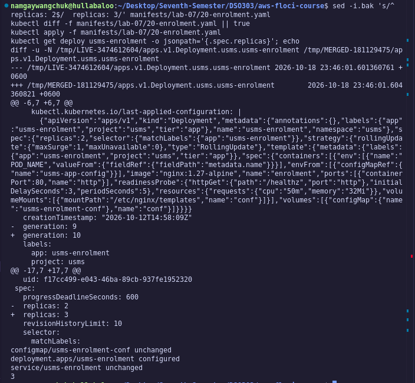

Part 4: restored to 2/2 and removed the `.bak` file.

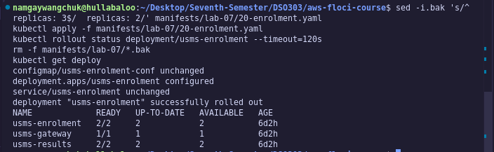
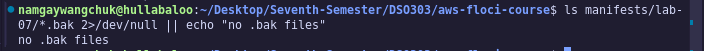

**Checkpoint 2 met.**

### 3.6 Step 6 : Requests, limits and QoS

All pods were `Burstable` with request `50m`, but the two `usms-enrolment` pods had **no CPU limit** (`<none>`), unlike the PDF's expected `200m`.

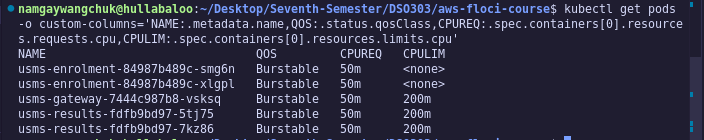

Node `kind-worker` allocated resources: CPU requests 1650m (20%), limits 3700m (46%); memory requests 1836Mi (48%), limits 3506Mi (93%). Percentages are of **allocatable**, not capacity, and limits may be overcommitted.

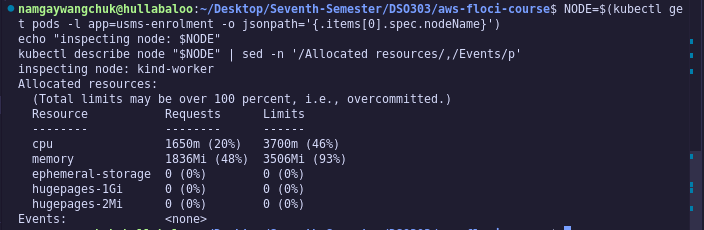

HPA denominator: request `50m`, so a 50% target means 25m average per pod, not 50% of a node or of the limit.

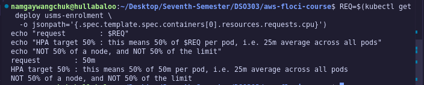

**Fix.** As Step 1 allows, I set the missing limits and rolled out; both new pods show `50m/200m`. I then added `limits:` to `manifests/lab-07/20-enrolment.yaml` so the repository matches the cluster.

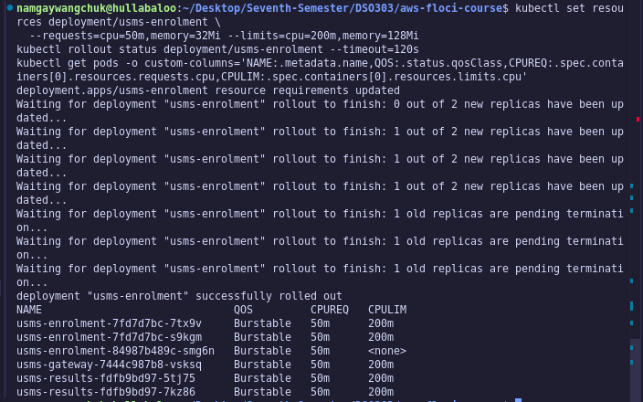
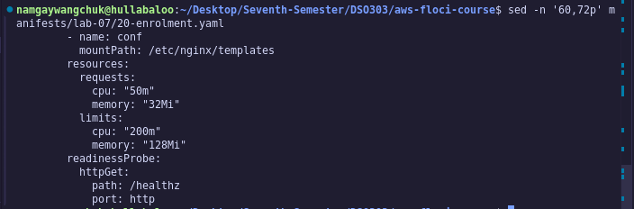

**Your turn : make the gateway Guaranteed, then restore.**

| Stage | QoS | Request | Limit |
|---|---|---|---|
| Before | Burstable | 50m / 32Mi | 200m / 128Mi |
| After setting requests = limits | **Guaranteed** | 200m / 128Mi | 200m / 128Mi |
| Restored | Burstable | 50m / 32Mi | 200m / 128Mi |

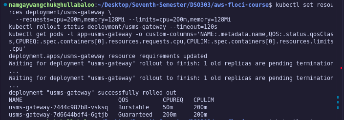
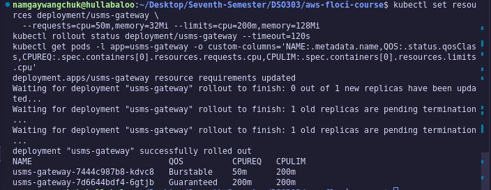

The pod was **replaced**, not adjusted, each time. Resources live in the pod template, so a change triggers a rollout, and a pod's QoS class is fixed for its lifetime. This is dimension 2, and the reason the VerticalPodAutoscaler is used far less than the HPA. I would want Guaranteed for latency-critical or stateful workloads (for example a database) that must be evicted last and never throttled below what they reserved, accepting that reserved capacity is paid for even when idle.

### 3.7 Step 7 : The metrics pipeline

Part 1: no APIService and no metrics-server, so `metrics API: NOT AVAILABLE` (kind does not ship it, unlike k3s).

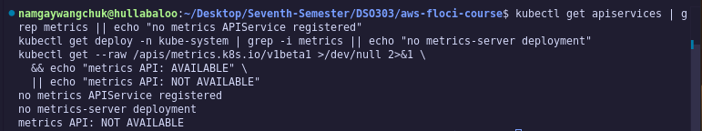

Part 2: applied the upstream manifest; all objects were created but the rollout timed out (`0 of 1 updated replicas are available`).

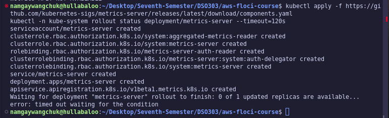

Cause from the logs: `x509: cannot validate certificate for 172.20.0.2 because it doesn't contain any IP SANs` (kind kubelets use self-signed certificates).

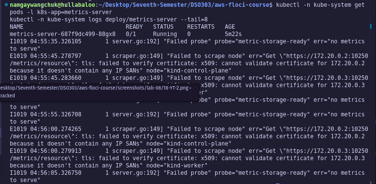

Applied the lab-only `--kubelet-insecure-tls` patch; rollout succeeded.

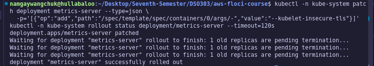

**Security note:** this flag skips verification of the kubelet certificate, so anything impersonating a kubelet could feed the autoscaler invented metrics. Real EKS never needs it.

`kubectl top` now works: nodes at 109m (1%) and 56m (0%), each pod about **1m** idle (2% of the 50m request), and `metrics API: AVAILABLE`.

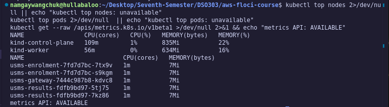

### 3.8 Step 8 : Create the HorizontalPodAutoscaler

`manifests/lab-08/10-hpa-enrolment.yaml` (autoscaling/v2, min 2, max 8, CPU 50%, with a `behavior` block). Immediately after creation TARGETS read `<unknown>/50%` (the first poll had not happened); after 30 s it read `cpu: 2%/50%`. Conditions: `AbleToScale True (ScaleDownStabilized)`, `ScalingActive True (ValidMetricFound)`, `ScalingLimited False`.

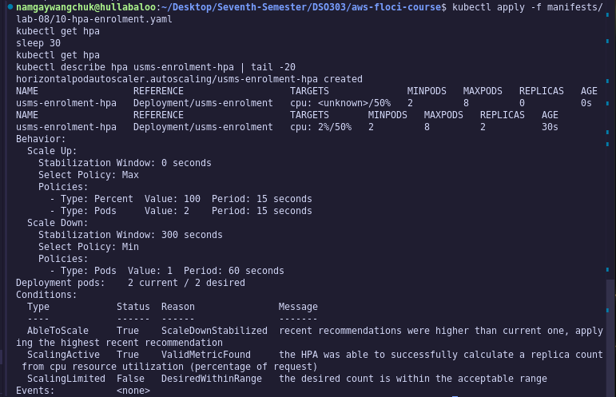

**Mapping to Lab 06:**

| Lab 06 (Application Auto Scaling) | Here |
|---|---|
| `RegisterScalableTarget` | `spec.scaleTargetRef` (typed reference) |
| `MinCapacity` / `MaxCapacity` | `minReplicas` / `maxReplicas` |
| TargetTracking on `ECSServiceAverageCPUUtilization` | `metrics[].resource` cpu `averageUtilization` (different denominator: request, not reserved task CPU) |
| `ScaleInCooldown: 300` | `behavior.scaleDown.stabilizationWindowSeconds: 300` |
| `ScaleOutCooldown` | `behavior.scaleUp` window plus rate-limit policies |
| Two CloudWatch alarms created for you | None; the controller polls every 15 s |

**Arithmetic by hand:** two pods at 40m with a 50m request: utilisation = 40/50 = 80%; desired = ceil(2 × 80 / 50) = ceil(3.2) = **4**.

### 3.9 Step 9 : Load and the autoscaler

`hpa-watch.sh` and `20-loadgen.yaml` (3 replicas) were created and applied.

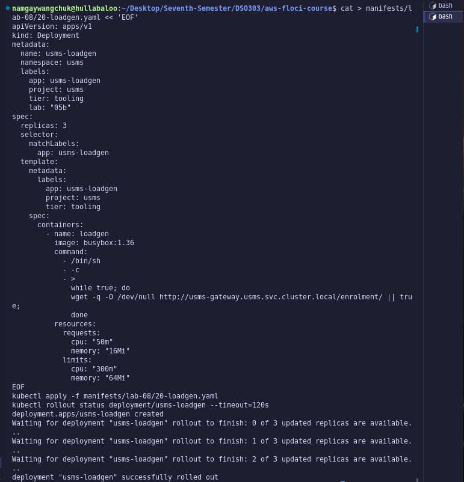

| Time (UTC) | CPU/TARGET | Replicas |
|---|---|---|
| 05:11–05:13:24 | 2–3% / 50% | 2 |
| 05:13:34 | **57% / 50%** | **3** |
| 05:16:49 | 2% / 50% | 3 (load removed) |
| 05:18:42 | 2% / 50% | **2** |

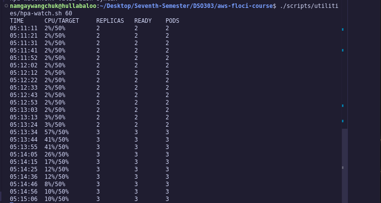
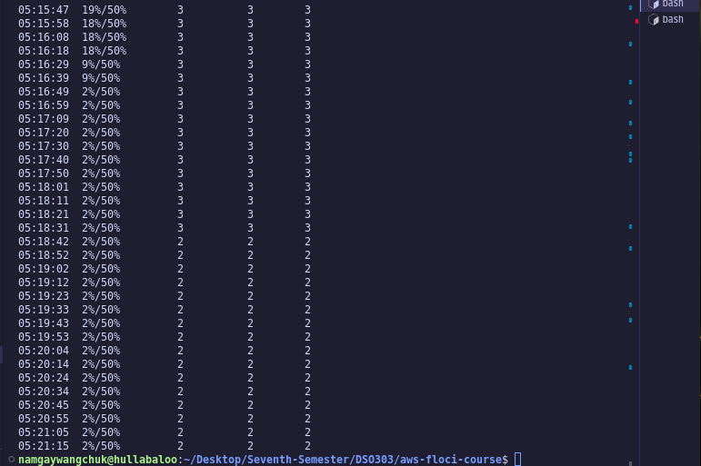

Arithmetic check: ceil(2 × 57 / 50) = ceil(2.28) = 3, matching the observation. After the load stopped, replicas stayed at 3 until the 300 s stabilisation window had aged out the high recommendation, then dropped to `minReplicas` 2. Events quoted verbatim:

- `SuccessfulRescale … New size: 3; reason: cpu resource utilization (percentage of request) above target`
- `SuccessfulRescale … New size: 2; reason: All metrics below target`

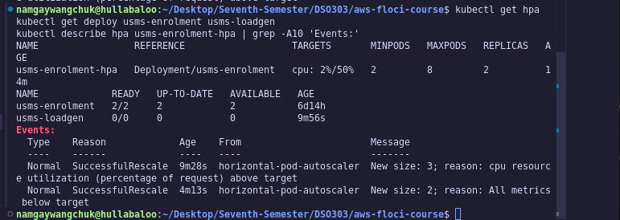

`usms-loadgen` is scaled to 0 and remains for Step 12; it is deleted in the clean-up section. **Checkpoint 3 met.**

### 3.10 Step 10 : Scale the node group from the AWS side

My first attempt failed with `NoRegion` because this terminal had not sourced the env files (shell variables die with the terminal). After re-sourcing, `describe-nodegroup` returned `usms-eks-nodes`: ACTIVE, min 2 / max 4 / desired 2, `t3.small`, labels `tier=app` and `workload=usms`.

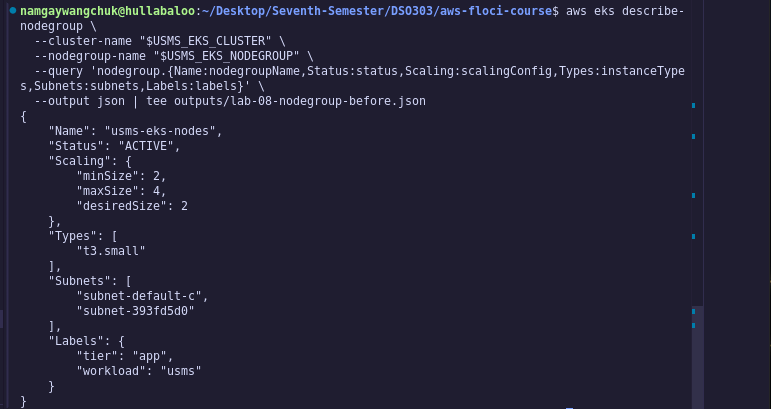

`update-nodegroup-config --scaling-config minSize=2,maxSize=6,desiredSize=3` failed with `400 InvalidArgument … POST requires either ?uploads, ?uploadId, ?restore or ?select parameter`, reproduced on a second attempt. This is the **known Floci 2.0.1 issue** described in the lab's troubleshooting section. No update was created (`list-updates` was empty), the AWS side stayed at 2/4/2, and Kubernetes still showed only two nodes.

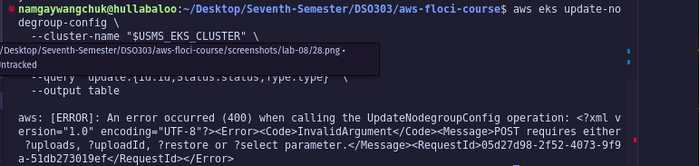
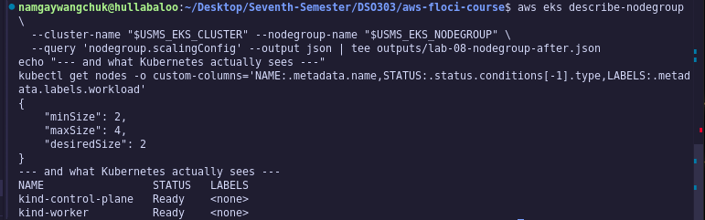

**Limitation:** I could not reach 6/3 on this build, so the "node group rescaled to min 2 / max 6 / desired 3" claim is **not demonstrated**. Even a successful call would only record `desiredSize`; Floci starts no third node because nothing connects the AWS node group to the kind nodes. This is the two-control-loops point: the HPA writes replicas, the node group's `desiredSize` is a different integer, and nothing links them unless a Cluster Autoscaler or Karpenter is installed.

### 3.11 Step 11 : Cluster Autoscaler, Karpenter and the nodeSelector

- **Cluster Autoscaler** watches Pending pods and raises an Auto Scaling group's desired capacity, from node groups you pre-declared.
- **Karpenter** watches the same Pending pods but launches right-sized EC2 instances directly from a NodePool.
- Neither is installed here (both need IRSA and a real ASG).

The node group's labels did not reach the kind nodes, so I applied `workload=usms tier=app` by hand to both.

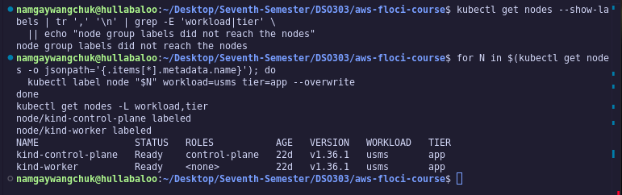

Applying `nodeSelector workload=usms` rolled out successfully on `kind-worker`.

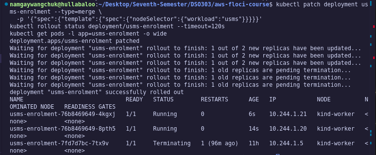

**Enforcement proof:** with `workload=nonexistent`, the new pod stayed `Pending` while the two running pods kept serving (`maxUnavailable: 0`).

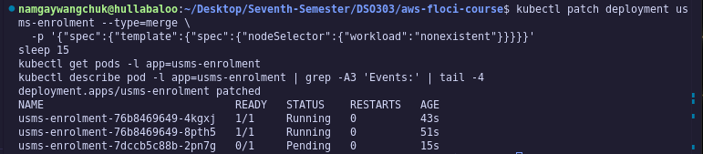

Event: `0/2 nodes are available: 1 node(s) didn't match Pod's node affinity/selector, 1 node(s) had untolerated taint(s)` (the control plane is tainted, so the wording differs slightly from the PDF).

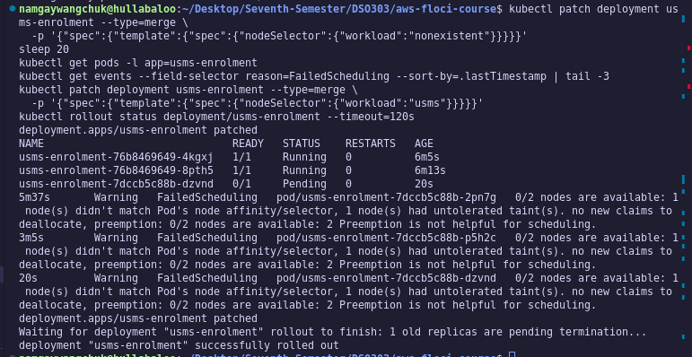

Restored the good selector and added `nodeSelector` to `manifests/lab-07/20-enrolment.yaml`; `kubectl diff` was clean.

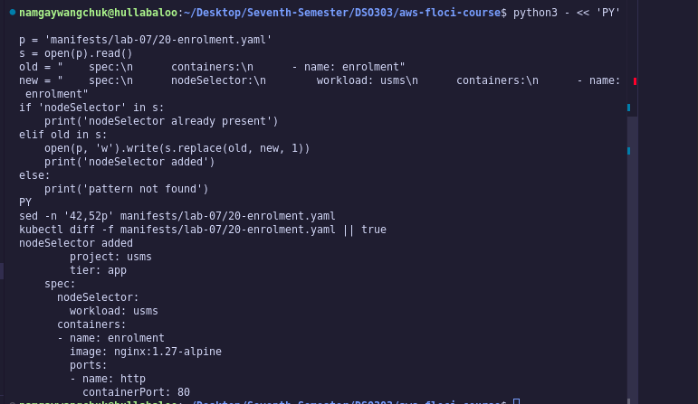

### 3.12 Step 12 : PodDisruptionBudgets

| PDB | Setting | ALLOWED DISRUPTIONS |
|---|---|---|
| `usms-gateway-pdb` | `minAvailable: 1` | **0** (single replica) |
| `usms-enrolment-pdb` | `maxUnavailable: 1` | **1** |

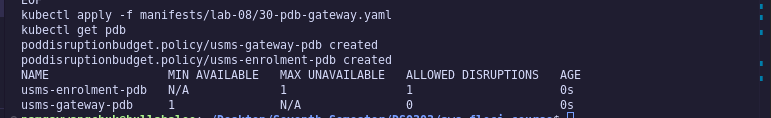

The eviction API refused: `Error from server (TooManyRequests): Cannot evict pod as it would violate the pod's disruption budget.`

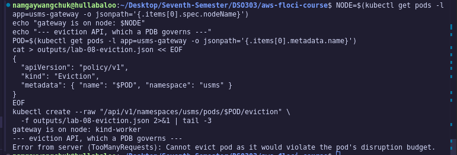

A plain `kubectl delete pod` succeeded immediately and a replacement started: a PDB constrains cooperative (voluntary) evictions; it is not a lock.

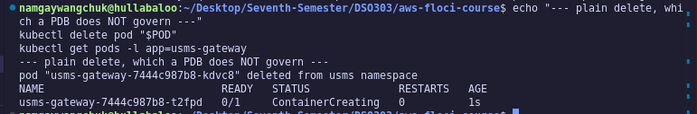

The drain was a `--dry-run=client` only: it listed enrolment, gateway and two results pods on `kind-worker`. A real drain would hang on `usms-gateway-pdb`. No node was cordoned.

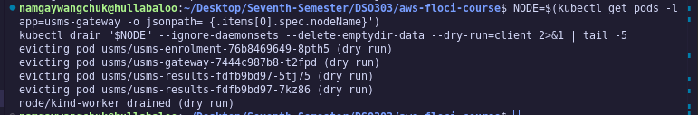

**Checkpoint 4 partly met:** everything except the node group resize to 6/3 (see 3.10).

### 3.13 Step 13 : ClusterIP and port-forward

`curl` to the gateway ClusterIP `10.96.15.162` failed, as expected: it is not routable from the host.

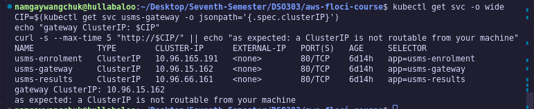

`kubectl port-forward svc/usms-gateway 18080:80` reached all three services. The results output looks garbled (`"\usms-results-…"`, `^M` in the campus value): `cat -v` shows a carriage return and stray backslashes, a quirk of the Lab 07 results ConfigMap, not of this lab.

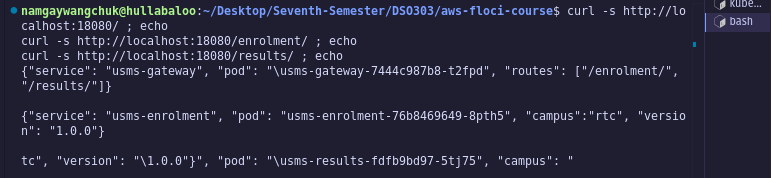

Port-forward is debugging only: it tunnels to **one pod** with no load balancing, and it exists only while the command runs, with every byte passing through the API server.

### 3.14 Step 14 : NodePort

`usms-results-np` was created as a **second Service on the same pods**, pinned to `30080`.

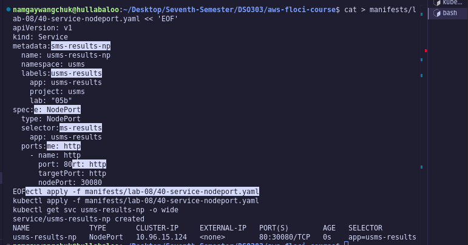

Both node IPs (`172.20.0.2` control-plane, `172.20.0.3` worker) answered on 30080, including the node that runs no results pod.

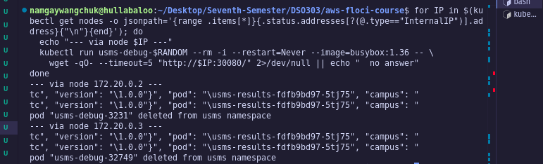

`curl localhost:30080` returned nothing (the node containers do not publish the port: Floci limitation). The fallback `port-forward svc/usms-results-np 30080:80` worked. **This proves the Service works, not that the NodePort is externally reachable.**

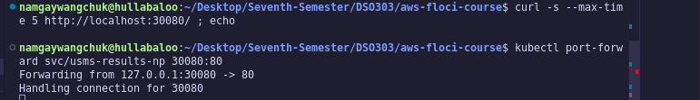

**Checkpoint 5 met.**

### 3.15 Step 15 : LoadBalancer

`usms-gateway` was promoted by re-applying a **full manifest** (not a patch), with the three AWS annotations. It shows `LoadBalancer`, nodePort `32290` (auto-allocated) and EXTERNAL-IP `<pending>`.

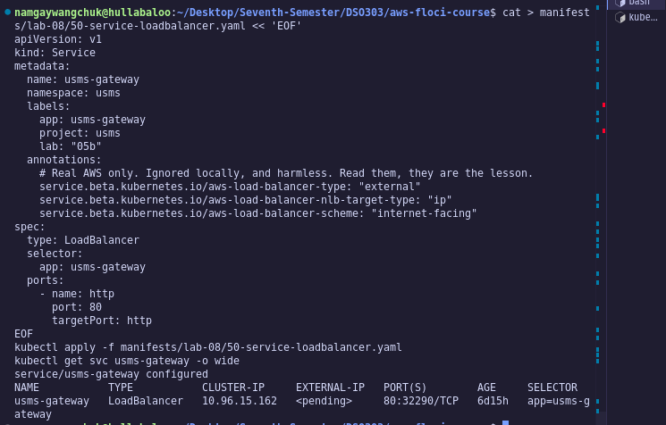

Ports 8081/8082 are listening on the host (the `_lb_ports_` tag), but `curl localhost:8081/` and `:8082/` printed nothing, and there is no external IP. The ladder line:

```
type=LoadBalancer  clusterIP=10.96.15.162  nodePort=32290  external=
```

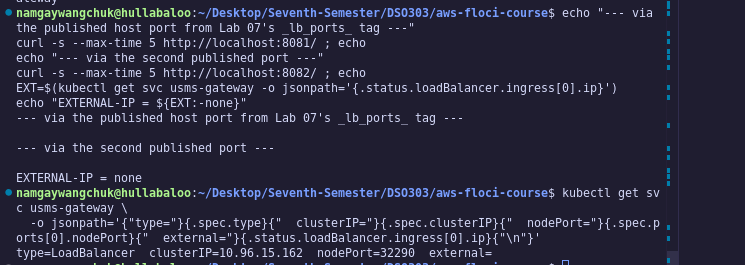

`port-forward … 8080:80` failed (`address already in use`: another local app, a "titanic-survival-prediction-service", owns 8080; that response is **not** from USMS and is not used as evidence). Using port `18081` returned genuine gateway and enrolment responses. `describe svc` shows `Events: <none>`: nothing even attempted to provision a load balancer.

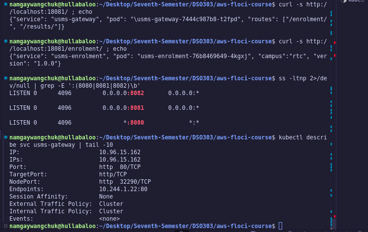

**Annotations:** `aws-load-balancer-type: external` hands the Service to the AWS Load Balancer Controller; `nlb-target-type: ip` registers pod IPs directly, the same as Lab 5's target type `ip`; `scheme: internet-facing` places the NLB in the public subnets. **Observed:** the Service type with clusterIP and nodePort, and access by port-forward. **Reasoned only:** the NLB itself.

### 3.16 Step 16 : Ingress

Unlike the PDF's "no controller" case, this cluster has **ingress-nginx** (IngressClass `nginx`, pod `ingress-nginx-controller-…` Running).


`usms-portal-ingress` was created with three prefix paths resolving to pod IPs: `/enrolment`→usms-enrolment, `/results`→usms-results, `/`→usms-gateway.


It initially had CLASS `<none>`. I set `ingressClassName: nginx` (and synced the manifest); it then showed ADDRESS `localhost`.


Routing proof: through the host port 8081 there was no answer, but from inside the cluster via the controller Service, `/` returned the gateway and `/enrolment/` returned the enrolment service. (`ingress-nginx-controller` is itself a LoadBalancer Service with `<pending>` external IP, for the same reason as the gateway.)


> Note: the `/results/` response was cut off in my screenshot; I should re-capture it before submitting.

**Annotation → Lab 05 `elbv2` mapping:** `scheme` → `create-load-balancer --scheme internet-facing`; `target-type: ip` → `create-target-group --target-type ip`; `listen-ports` → `create-listener --port 80`; `healthcheck-path` → target group health check; `tags` → `--tags`; each path → `create-rule`. The four commands the AWS Load Balancer Controller would run, in order: `create-load-balancer`, `create-target-group`, `create-listener`, `create-rule`. Lab 05 disambiguated rules by numeric `--priority`; here the **longest matching prefix** wins. The `alb.ingress.kubernetes.io/*` annotations are inert on ingress-nginx.

**Checkpoint 6 met.**

### 3.17 Step 17 : Practical 2 / Practical 4 comparison

ECS: scalable target `service/usms-ecs-cluster/usms-enrolment-svc` (min 2, max 10) and three policies (`cpu-target-tracking`, `queue-step-out`, `requests-target-tracking`). The `describe-services` call printed `null` (I need to re-run it with the cluster name hard-coded). EKS: HPA 2% / 50%, min 2, max 8; gateway LoadBalancer; results-np NodePort; Ingress `nginx`; PDBs 1 and 0.


| Scaling | ECS + Application Auto Scaling | Kubernetes + HPA |
|---|---|---|
| Integer written | `desiredCount` | `spec.replicas` |
| Who writes it | Application Auto Scaling service | HPA controller |
| Where it runs | AWS-managed, outside my workload | Controller manager in the cluster |
| Metric source | CloudWatch | metrics-server |
| "50% CPU" is 50% of | the task's reserved CPU | the container's CPU **request** (25m of 50m) |
| Slowing scale-in | `ScaleInCooldown: 300` | scaleDown window 300 s, 1 pod/min |
| No capacity | Fargate effectively never runs out | pods stay Pending until nodes are added |
| Alarms | two CloudWatch alarms created for you | none; the controller polls |

| Exposure | ECS + ALB (Lab 5) | Kubernetes + Ingress |
|---|---|---|
| Objects created by hand | ALB, target group, listener, rules, registrations | one Ingress object |
| Target type | `ip` (tasks have VPC addresses) | `ip` via annotation (same reason, for pods) |
| Registration | ECS registers/deregisters tasks | controller watches Endpoints |
| Rule disambiguation | numeric priority | longest matching prefix |
| Moving clouds | rebuild the ALB wiring | keep the Ingress; swap controller and annotations |
| Ten services | one ALB, ten rules | one Ingress, one load balancer (ten LoadBalancer Services = ten NLBs) |

*Prose to be completed in my own words:* (1) behaviour if the AWS control plane has a bad afternoon, and which arrangement I can still debug; (2) which I would choose for USMS and the strongest argument against that choice.

### 3.18 Step 18 : Persistence across a restart

Before and after tables are identical:

| Object | Value before and after |
|---|---|
| HPA | min 2, max 8, target 50 |
| `usms-enrolment-pdb` | maxUnavailable 1 |
| `usms-gateway-pdb` | minAvailable 1 |
| `usms-gateway` | LoadBalancer, nodePort **32290** (unchanged) |
| `usms-results-np` | NodePort **30080** (pinned) |
| Ingress | `/enrolment,/results,/` |
| Node group | `2 4 2` (the update to 6/3 never applied) |


During the restart, `floci-up.sh` printed `Error response from daemon: Ports are not available: exposing port TCP 0.0.0.0:4566 … address already in use`. The AWS API still answered and `kubectl` reconnected (`Context "kind-kind" modified`).


Result: **`PERSISTENCE PROVEN - scaling and exposure configuration identical`**. Caveat: the kind cluster is not controlled by the Floci container, so Kubernetes objects would survive a Floci restart regardless; the AWS-side node group read back identically.


**Checkpoint 7 met.**

### 3.19 Step 19 : `configs/lab-08.env`

```
hpa: 2..8 at 50% cpu, scale-in window 300s
nodeport: 30080   gateway: LoadBalancer
19 exports
```


### 3.20 Step 20 : Commit

`git status` listed `manifests/lab-07/20-enrolment.yaml`, `labs/lab-08-eks-scaling/`, `manifests/lab-08/`, `notes/lab-08-notes.md` and `../../screenshots/lab-08/`. `git check-ignore -v` reported `.gitignore:35:outputs/ outputs/lab-08-baseline.txt`, so `outputs/` is protected.


**The commit did not succeed.** `git add` failed with `fatal: pathspec 'scripts/utilities/verify-lab-08.sh' did not match any files` (the verification script had not been created yet), so nothing was staged.


`git log` still ends at `practical-07 updated`, and `git ls-files | grep -c '^outputs/'` printed `0`.


*To do:* create `configs/lab-08.env` and the cleanup script if missing, then re-run the `git add` and `git commit` and capture a fresh `git log` showing the Lab 08 commit.

---

## 4. Verification

`verify-lab-08.sh` ran with **`PASS=32 FAIL=2`**.


| Failed check | Explanation |
|---|---|
| `Floci container running` | Not yet explained. The Floci restart in Step 18 reported that port 4566 was already in use, yet the AWS CLI works. I need to check `docker ps` and `FLOCI_CONTAINER_NAME` to determine whether the check or the environment is at fault |
| `node group maxSize was raised to 6` | Expected: `update-nodegroup-config` fails on this Floci build (3.10) |

All autoscaling, PDB, exposure and file-hygiene checks passed. (The command line at the top of the screenshot appears garbled because of a paste mishap while creating the script; the script itself ran.)

End-to-end smoke test: gateway, enrolment and results all answered, ending in `SMOKE TEST PASSED`, with HPA, PDBs, Services and Ingress listed.


---

## 5. Differences from the PDF (kind instead of k3s/EKS)

| Topic | PDF expectation | What I observed |
|---|---|---|
| Node names | `usms-eks-cluster-*` | `kind-control-plane`, `kind-worker` |
| Enrolment CPU limit | `200m` | `<none>` until fixed in Step 6 |
| metrics-server | present on k3s | absent; needed install plus `--kubelet-insecure-tls` |
| HPA peak | 4 replicas | 3 (lighter load, 57%) |
| Node labels | from node group | applied by hand |
| FailedScheduling text | "2 node(s) didn't match" | one node tainted, one didn't match |
| Ingress controller | none or Traefik | ingress-nginx present, class needed naming |
| `update-nodegroup-config` | works | fails (known issue) |
| Endpoints API | silent | deprecation warning on v1.33+ |

## 6. Floci versus real AWS

Observed: HPA, `kubectl scale`, PDBs, eviction API, Service types, `nodeSelector`. Recorded but not enacted: node group `desiredSize` (and here not even recorded), AWS annotations, EXTERNAL-IP. Conceptual only: AWS Load Balancer Controller, Cluster Autoscaler, Karpenter, custom metrics, real cost. Floci is kinder than reality: pods start in a second (an EKS node takes 60–120 s), nothing costs money (ten LoadBalancer Services would be ten NLBs), and nothing is eventually consistent.

## 7. Review questions (Section 14)

1. **HPA is not a node percentage.** `averageUtilization: 50` is 50% of the container's CPU *request*. Halving the request without changing the HPA means the same usage is a higher percentage, so the HPA scales out sooner; the workload ends up with *more* pods, but the same usage, so each pod has less reserved headroom and the scheduler reserves less per pod.
2. **Ten times by Monday.** Dimension 1 (replicas via HPA, raise `maxReplicas`; check readiness and endpoints), dimension 2 if pods are throttled (check `kubectl top`), dimension 3 if pods are Pending (check `Insufficient cpu`, raise the node group), dimension 4 last. Dimension 4 cannot change in place: create a new node group, cordon and drain the old one, delete it.
3. **Outside versus inside.** Application Auto Scaling is an AWS service: it survives my cluster failing but I cannot inspect or debug it, and an AWS outage stops scaling. The HPA lives in the cluster's controller manager: I can debug it with `describe hpa`, but if the control plane is down it stops, and it shares fate with the cluster.
4. **Pending pods.** The HPA writes replicas; the node group's `desiredSize` is a separate integer on the AWS side. With no spare capacity the extra pods stay Pending. A Cluster Autoscaler or Karpenter would watch the Pending pods and add nodes. Lowering the CPU request is a bad fix because it changes the HPA's denominator, making recorded percentages incomparable and scaling more aggressive.
5. **NodePort versus LoadBalancer.** NodePort opens one port on every node; LoadBalancer adds a cloud load balancer with a stable address on top. A requirement that fails with NodePort and passes with LoadBalancer: a single stable address on a normal HTTP port for external users.
6. **Ingress `/enrolment` bypasses the gateway.** I would keep one route. Routing through the gateway keeps its prefix handling and headers in one place; routing straight to the service removes a hop. I would choose the gateway path for consistency and delete the direct `/enrolment` rule, accepting the extra hop, because the gateway strips prefixes and adds headers the Ingress rule does not.
7. **PDB and `kubectl delete`.** A PDB governs only voluntary disruptions through the eviction API (drains, autoscaler scale-in). `kubectl delete pod` is not an eviction, and involuntary disruptions (node crash, OOM) ignore it. A realistic save: a node upgrade drains nodes one at a time and the PDB stops the drain from evicting the last gateway replica.


## 8. Sources

Lab 08 documentation (this course); Kubernetes documentation (HPA, Services, Ingress, disruptions, resource management); metrics-server repository; Amazon EKS User Guide; AWS Load Balancer Controller documentation.
