# Lab 10: Edge Functions with AWS Lambda

**Course:** DSO303 — Cloud Architecture & AWS Infrastructure Emulation   
**Account / Endpoint:** `000000000000` (`http://localhost:4566`, `us-east-1`)  
**Storage Mode:** `FLOCI_STORAGE_MODE=hybrid` (`/home/namgaywangchuk/floci-data`)  
**Verification Result:** `PASS=51 FAIL=0`  

---

## 1. Executive Summary & Objectives

This lab implements and validates an event-driven edge and regional serverless pipeline for the University Student Management System (USMS) transcript delivery service. Specifically, this implementation accomplishes five architectural objectives:

1. **Origin Storage Provisioning:** Creates and tags the S3 origin bucket `usms-student-data` in `us-east-1`, resolving the resource ARNs referenced by Lab 01's `USMSStudentDataReadWrite` policy.
2. **IAM Edge Trust Policy:** Extends `usms-lambda-exec-role` to trust both `lambda.amazonaws.com` and `edgelambda.amazonaws.com` so CloudFront can replicate and execute functions at edge locations.
3. **Lambda@Edge Request/Response Pipeline:** Deploys and versions two Node.js 20.x edge handlers (`usms-edge-viewer-request:1` and `usms-edge-origin-response:1`), verifies strict Lambda@Edge constraints (no environment variables, `128 MB` memory, `5 s` timeout, version-qualified ARNs), and associates both with CloudFront distribution `E3LYH2JGZMN80X` (`E3LYH2JGZMN80X.cloudfront.net`).
4. **End-to-End Edge Composition:** Demonstrates full request-path chaining via `scripts/utilities/usms-edge-simulate.sh` across both the authenticated `ALLOW` path (`200 OK` with URI normalization and security headers) and the unauthenticated `DENY` path (`403 Forbidden` at the edge without touching the origin).
5. **Regional S3-Triggered Notifier & Persistence:** Deploys the Python 3.12 regional function `usms-transcript-notifier` with environment variables, immutable version `1`, movable alias `live`, a confused-deputy-safe resource policy (`AWS:SourceArn`), and an S3 `ObjectCreated:*` notification filtered to `transcripts/*.json`, then verifies full state survival across a Floci stop/start cycle.

---

## 2. Architecture Overview

The system separates synchronous **edge request-path processing** from asynchronous **regional post-upload processing**:

```text
STUDENT'S BROWSER
  GET /transcripts/2026/STU-00417.json
         │
         ▼
CLOUDFRONT EDGE LOCATION (usms-transcript-cdn / E3LYH2JGZMN80X.cloudfront.net)
  (1) viewer-request ──► usms-edge-viewer-request:1 (nodejs20.x, 128 MB, 5 s)
                           ├─ Normalizes URI to lowercase (/transcripts/2026/stu-00417.json)
                           ├─ Missing x-usms-student header ──► 403 Forbidden (origin never hit)
                           └─ Authenticated ──► stamps X-USMS-Edge header & continues
         │
         ▼ (cache miss)
ORIGIN: usms-student-data (S3 bucket, us-east-1)
  transcripts/2026/*.json
         │
         ▼
  (3) origin-response ──► usms-edge-origin-response:1 (nodejs20.x, 128 MB, 5 s)
                            ├─ Injects HSTS, X-Content-Type-Options, X-Frame-Options, Referrer-Policy
                            ├─ Sets Cache-Control: public, max-age=300, s-maxage=3600
                            └─ Stamps X-USMS-Edge-Chain proving composition with viewer-request
         │
         ▼
  Response returned to viewer and cached at edge

SEPARATE REGIONAL EVENT PATH (Asynchronous, post-upload)
  s3:ObjectCreated:* (prefix: transcripts/, suffix: .json)
         │
         ▼
  usms-transcript-notifier:live -> version 1 (python3.12, 256 MB, 30 s)
    ├─ Uses USMS_BUCKET & USMS_NOTIFY_CHANNEL environment variables
    ├─ Scoped resource policy (Principal: s3.amazonaws.com, AWS:SourceArn)
    └─ Emits structured USMS_NOTIFY JSON records to CloudWatch Logs
```

---

## 3. Step-by-Step Implementation & Evidence

### Step 1–2: Environment Initialization, Persistence Verification & Identity

Floci was started via `./scripts/setup/floci-up.sh` and audited with `./scripts/utilities/floci-storage-check.sh`, confirming `FLOCI_STORAGE_MODE=hybrid` backed by the host bind mount `/home/namgaywangchuk/floci-data` (`2.1M` persisted state). Cumulative environment files (`configs/course.env` and `configs/lab-01.env` through `configs/lab-09.env`) were sourced, and `./scripts/utilities/whoami.sh` confirmed active account `000000000000` at `http://localhost:4566`.

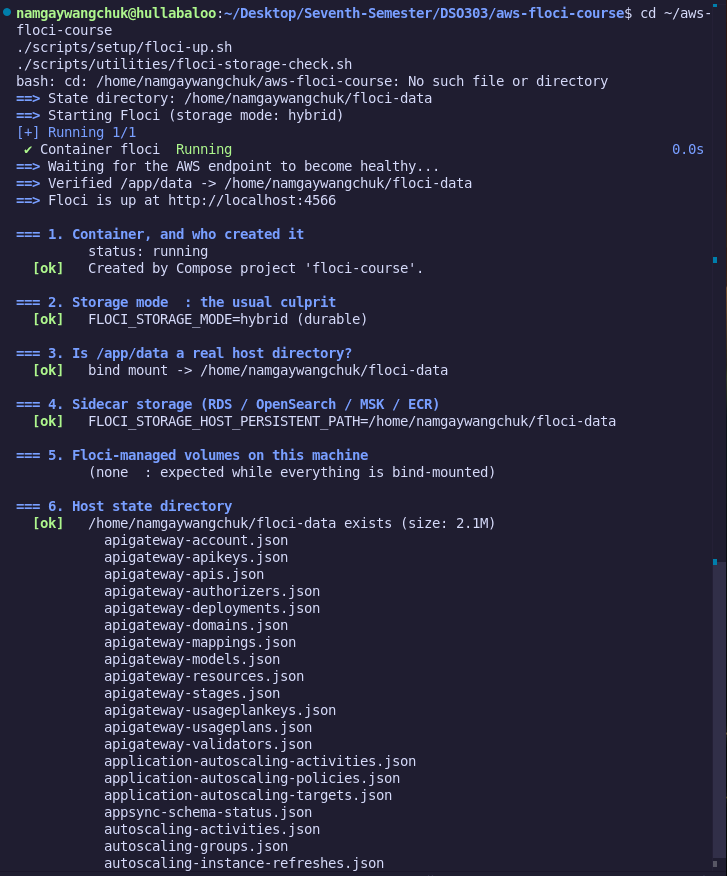

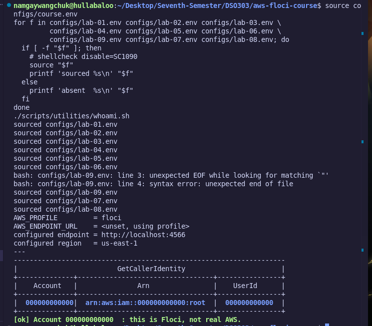

---

### Step 3–4: Source Directory Scaffolding & Floci Service Capability Probe

The Lab 10 function source directories were created under `labs/lab-10-lambda-edge/` (`edge-viewer-request/`, `edge-origin-response/`, and `transcript-notifier/`). A read-only capability probe recorded in `outputs/lab-10-support-probe.txt` confirmed support for `lambda (list-functions)`, `lambda (list-layers)`, `s3 (list-buckets)`, `logs (describe-log-groups)`, and `cloudfront (list-distributions)`.

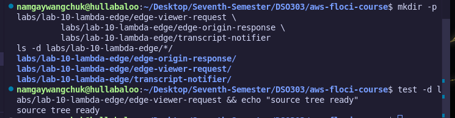

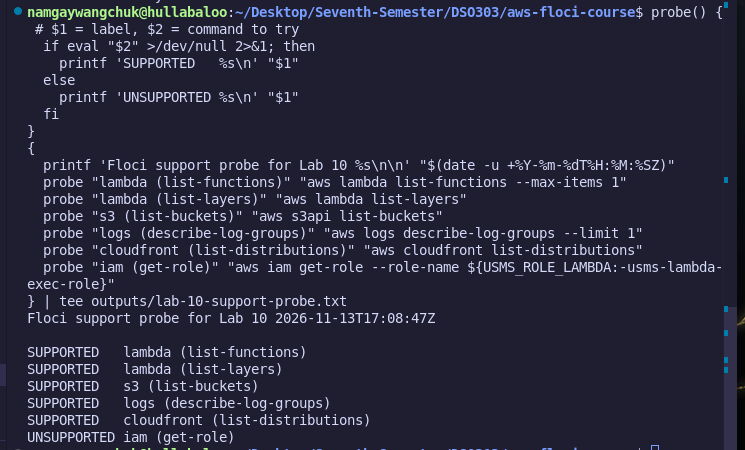

---

### Step 5: Creating the Origin S3 Bucket (`usms-student-data`)

The origin bucket `usms-student-data` was created in `us-east-1` and tagged with `Project=USMS`, `Tier=data`, and `Lab=06`. Verification via `head-bucket`, `get-bucket-tagging`, and `iam get-policy-version` confirmed that the bucket exists and resolves the exact ARNs (`arn:aws:s3:::usms-student-data` and `arn:aws:s3:::usms-student-data/*`) defined in Lab 01's `USMSStudentDataReadWrite` policy.

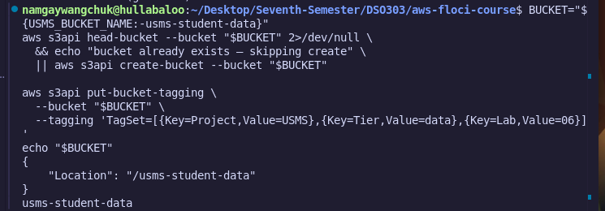

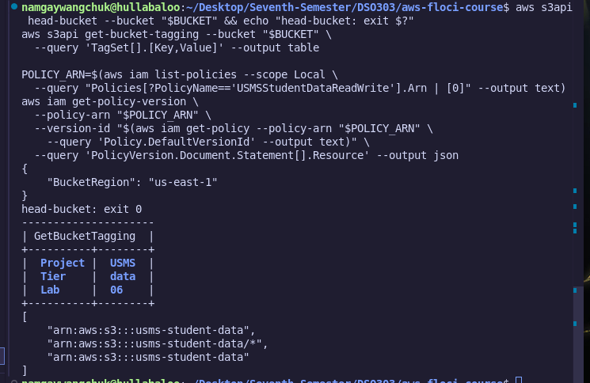

---

### Step 6: Updating `usms-lambda-exec-role` with the `edgelambda` Trust Principal

Inspecting `usms-lambda-exec-role` confirmed it initially trusted only `lambda.amazonaws.com` with `USMSLambdaBasic` attached. Because CloudFront replicates and executes Lambda@Edge functions under a separate service principal, `policies/trust-lambda-edge.json` was written and applied via `aws iam update-assume-role-policy` to allow both `lambda.amazonaws.com` and `edgelambda.amazonaws.com`.

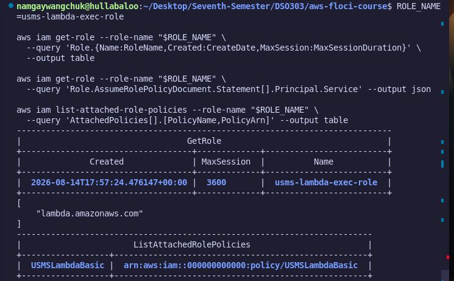

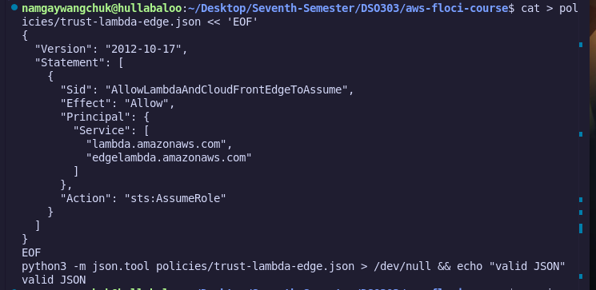

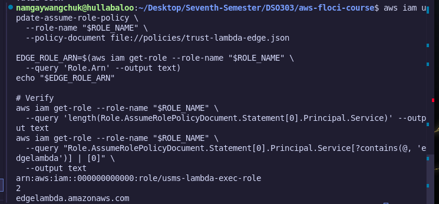

---

### Step 7–8: Writing, Packaging & Deploying `usms-edge-viewer-request`

The `viewer-request` handler (`labs/lab-10-lambda-edge/edge-viewer-request/index.mjs`, 55 lines) normalizes request URIs to lowercase, bypasses paths outside `/transcripts/`, enforces presence of the `x-usms-student` header (returning `403 Forbidden` with `Cache-Control: no-store` if absent), and stamps `X-USMS-Edge: viewer-request-allow; student=<id>` on authenticated requests.

Using a quoted heredoc (`<< 'EOF'`) preserved the JavaScript template literal `${studentId.toLowerCase()}` verbatim. The handler was archived at the ZIP root (`index.mjs`, `2113` bytes) into `outputs/usms-edge-viewer-request.zip` and created as a `nodejs20.x` function (`128 MB`, `5 s` timeout).

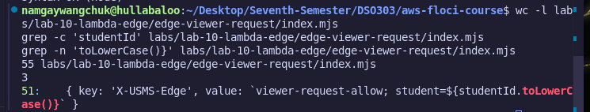

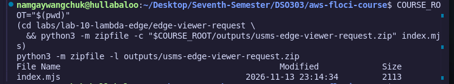

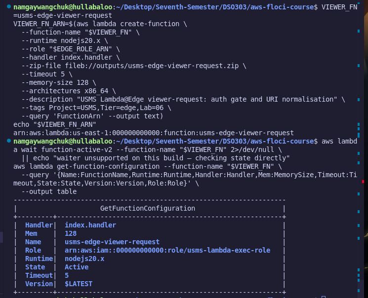

---

### Step 9–11: Invoking Allow/Deny Paths, Checking Logs & Publishing Version 1

`usms-edge-viewer-request` was tested against two CloudFront `viewer-request` payloads:

1. **Allow Path (`templates/lab-10-viewer-request-event.json`):** Normalized `/transcripts/2026/STU-00417.json` to `/transcripts/2026/stu-00417.json` and stamped `X-USMS-Edge: viewer-request-allow; student=stu-00417`.
2. **Deny Path (`templates/lab-10-viewer-request-denied.json`):** Returned HTTP `403 Forbidden` with `X-USMS-Edge: viewer-request-deny` and JSON error payload without contacting the origin.

After checking CloudWatch Logs (`/aws/lambda/usms-edge-viewer-request`), immutable **version `1`** was published (`arn:aws:lambda:us-east-1:000000000000:function:usms-edge-viewer-request:1`), satisfying Lambda@Edge's requirement for version-qualified ARNs.

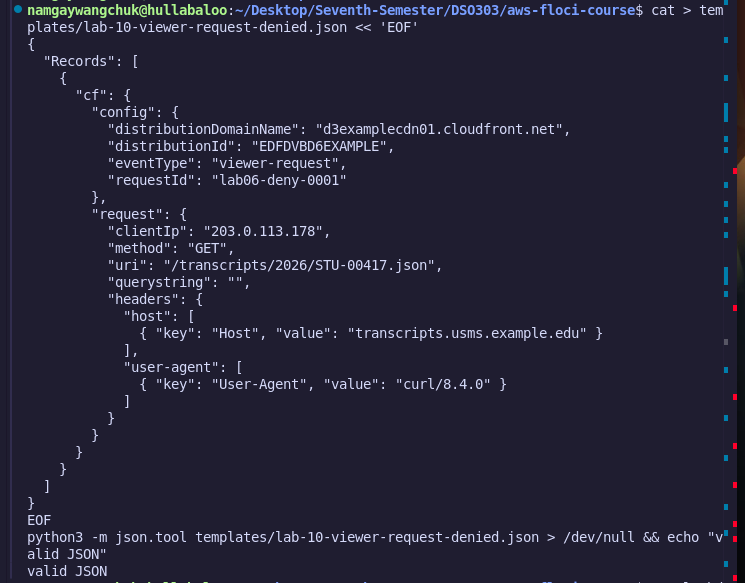

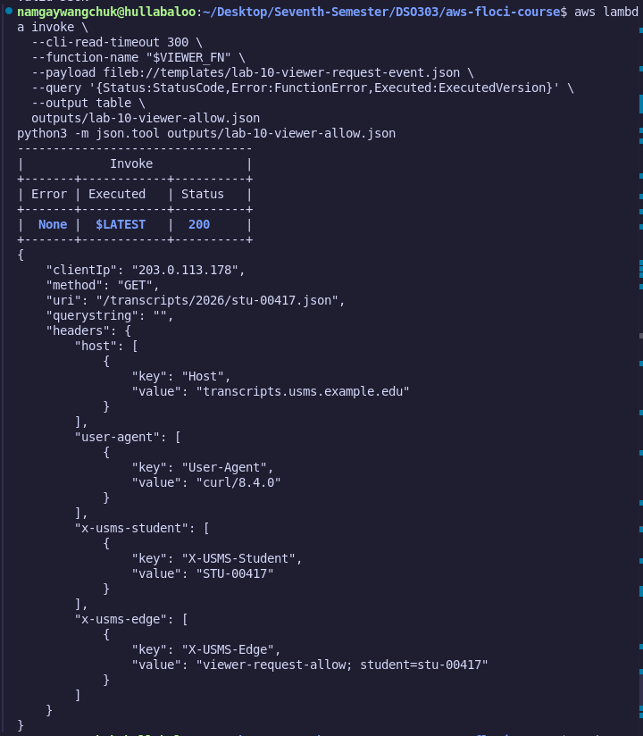

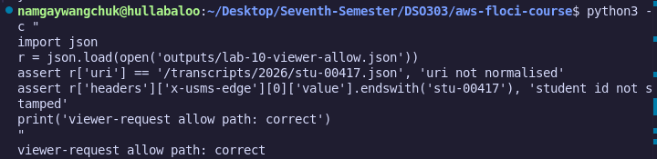

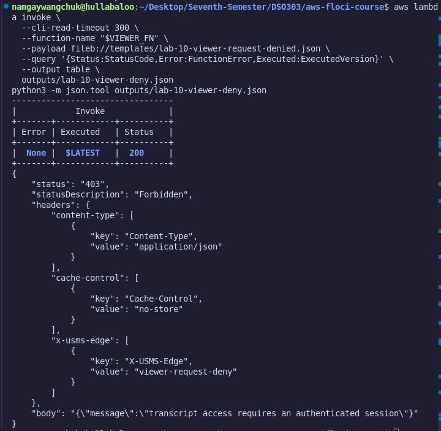

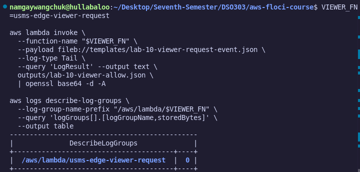

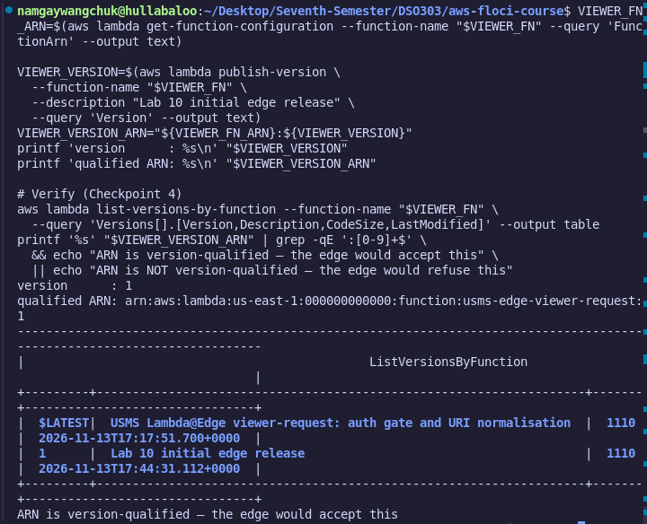

---

### Step 12–13: Deploying, Invoking & Versioning `usms-edge-origin-response`

The `origin-response` handler (`labs/lab-10-lambda-edge/edge-origin-response/index.mjs`) runs after S3 responds and before CloudFront caches the object. It injects four security headers (`Strict-Transport-Security`, `X-Content-Type-Options`, `X-Frame-Options`, and `Referrer-Policy`), sets `Cache-Control: public, max-age=300, s-maxage=3600` for `/transcripts/*`, and appends `;origin-response` to `X-USMS-Edge-Chain`.

After resolving host bind-mount write permissions on `~/floci-data/lambda-code`, `usms-edge-origin-response` was created (`nodejs20.x`, `128 MB`, `5 s`), verified against `templates/lab-10-origin-response-event.json`, and published as immutable **version `1`** (`arn:aws:lambda:us-east-1:000000000000:function:usms-edge-origin-response:1`).

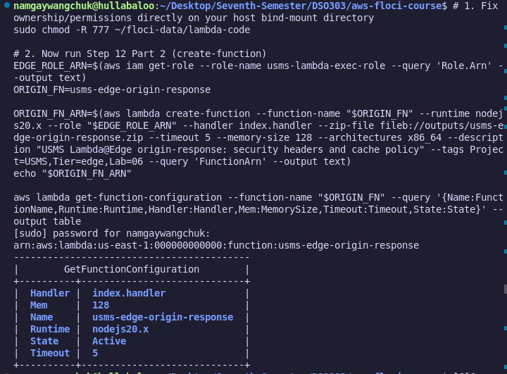

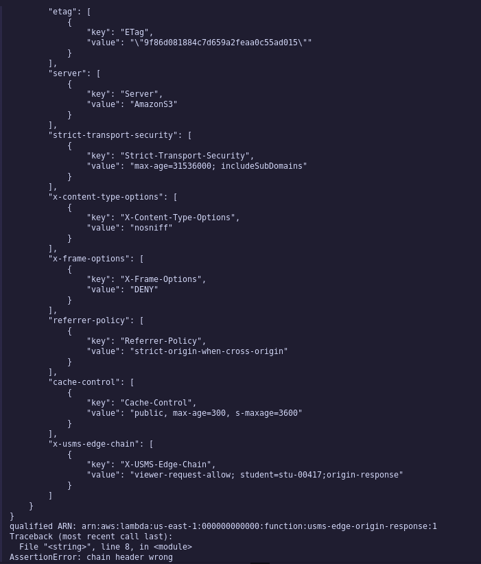

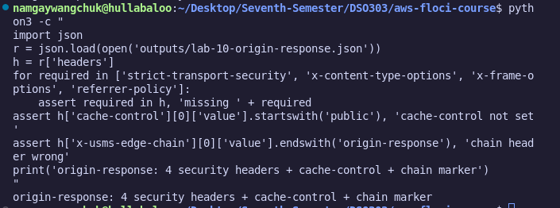

---

### Step 14: Static Audit Against Lambda@Edge Restrictions

Because Lambda APIs permit configuration features that CloudFront later rejects at association time, environment variables (`USMS_STAGE=lab06,USMS_AUTH_HEADER=x-usms-student`) were deliberately added to `usms-edge-viewer-request` and then cleared (`Variables={}`). Both functions were then audited via `edge_eligibility` into `outputs/lab-10-function-inventory.json`, passing all six edge checks with `0` failures.

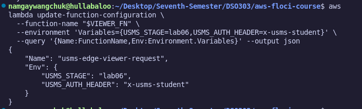

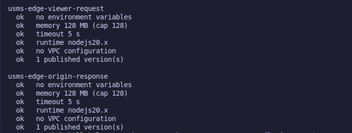

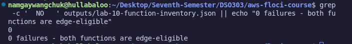

---

### Step 15: Associating Edge Functions with CloudFront (`usms-transcript-cdn`)

`templates/lab-10-distribution-config.json` was generated with `usms-student-data.s3.us-east-1.amazonaws.com` as the origin, cache-key forwarding restricted exclusively to the `x-usms-student` header (no cookies, no query strings), and two version-qualified `LambdaFunctionAssociations` (`viewer-request` -> `:1`, `origin-response` -> `:1`). Both **Path A** (creating distribution `E3LYH2JGZMN80X` / `E3LYH2JGZMN80X.cloudfront.net` in `Deployed` status) and **Path B** (11-point structural validation with `"errors": []`) succeeded.

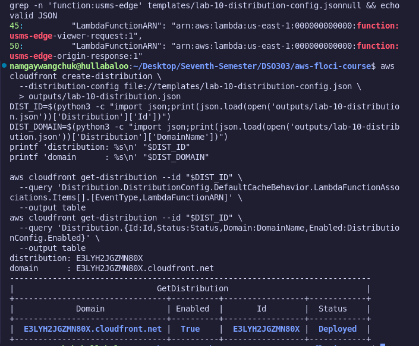

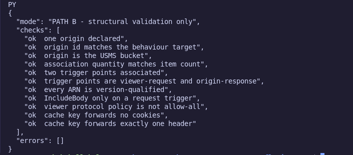

---

### Step 16: End-to-End Edge Chain Composition (`usms-edge-simulate.sh`)

To validate live runtime composition across the request path, `scripts/utilities/usms-edge-simulate.sh` chains `usms-edge-viewer-request` -> simulated S3 origin -> `usms-edge-origin-response`:

* **Allow Trace:** Produced a 3-stage chain (`viewer-request` -> `origin` -> `origin-response`), normalized the URI to `/transcripts/2026/stu-00417.json`, returned HTTP `200`, and recorded `x-usms-edge-chain: viewer-request-allow; student=stu-00417;origin-response`.
* **Deny Trace:** Terminated at stage 1 (`viewer-request`) with HTTP `403` and `x-usms-edge: viewer-request-deny`, proving unauthenticated requests never reach the origin. The allow trace was subsequently restored to `outputs/lab-10-edge-trace.json`.

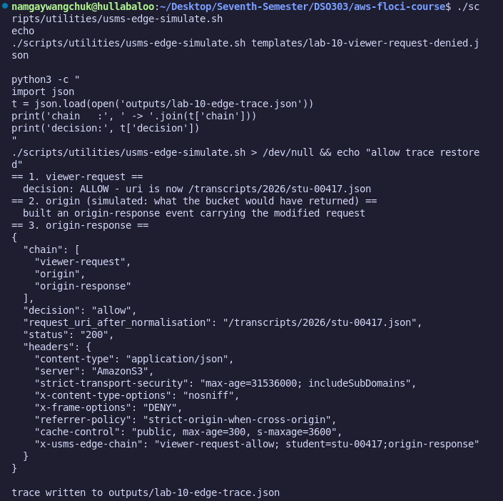

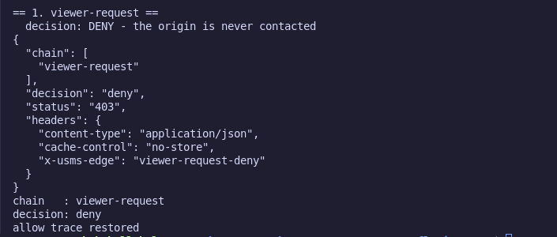

---

### Step 17–21: Regional S3-Triggered Notifier (`usms-transcript-notifier`)

Unlike edge functions, `labs/lab-10-lambda-edge/transcript-notifier/notifier.py` runs regionally in `us-east-1` (`python3.12`, `256 MB`, `30 s`) and reads `USMS_BUCKET` and `USMS_NOTIFY_CHANNEL` from environment variables.

1. **Deployment & Aliasing (Steps 17–18):** Packaged `notifier.py`, created `usms-transcript-notifier`, published immutable version `1`, and created movable alias `live` pointing to version `1`.
2. **Resource-Based Policy (Step 19):** Scoped `lambda:InvokeFunction` on `:live` to `Principal: s3.amazonaws.com` with `AWS:SourceArn` restricted to `arn:aws:s3:::usms-student-data` to prevent confused-deputy invocations.
3. **Bucket Notification & Invocation Proof (Steps 20–21):** Configured `usms-transcript-upload` on `usms-student-data` for `s3:ObjectCreated:*` matching `prefix=transcripts/` and `suffix=.json`, uploaded `transcripts/evidence/lab-10-edge-trace.json`, and verified execution against `templates/lab-10-s3-event.json` via `--qualifier live` (`{"processed": 1, "keys": ["transcripts/evidence/synthetic-probe.json"]}`).

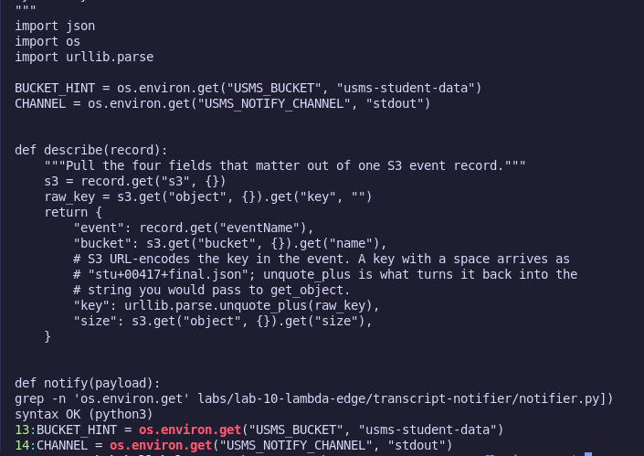

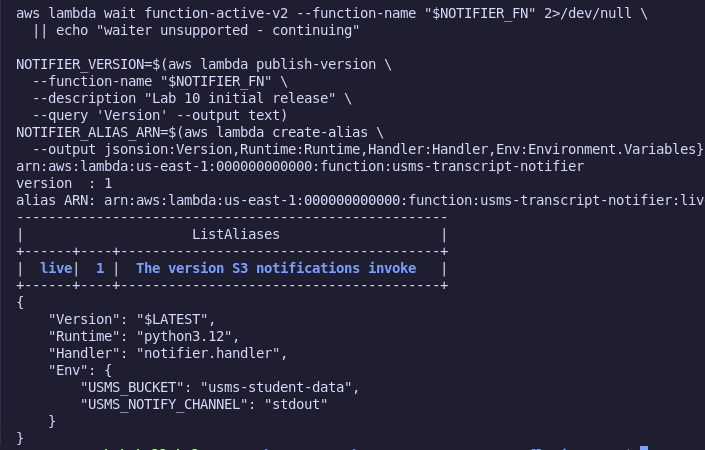

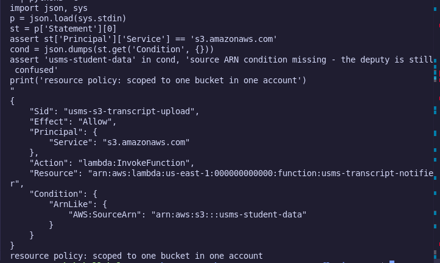

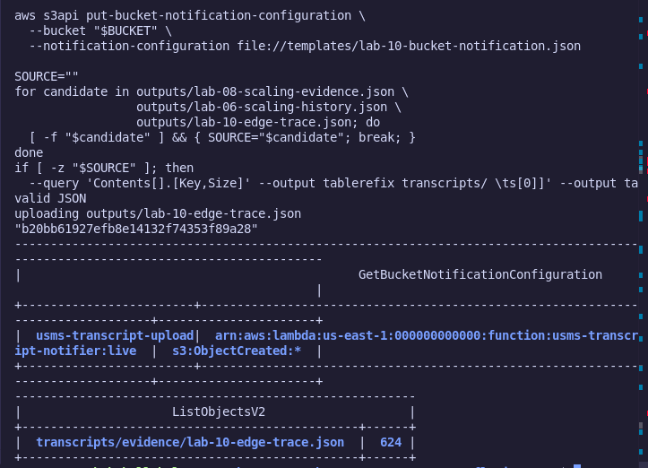

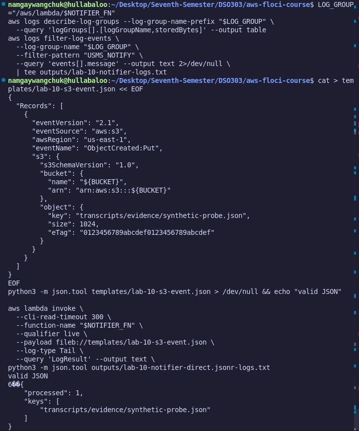

---

### Step 22–24 & Section 8: Persistence Restart Proof, `configs/lab-10.env` & 51-Point Verification

To verify durability, all Lab 10 resources were inventoried into `outputs/lab-10-pre-restart.txt`, Floci was stopped (`./scripts/setup/floci-down.sh`) and restarted (`./scripts/setup/floci-up.sh`), and `outputs/lab-10-post-restart.txt` was compared via `diff`, confirming `IDENTICAL - every Lab 10 artefact survived the restart` and that `usms-edge-simulate.sh` continued executing cleanly.

Finally, `configs/lab-10.env` (25 populated exports), `scripts/utilities/verify-lab-10.sh`, and `scripts/cleanup/lab-10-cleanup.sh` (written, not executed) were created, achieving **`PASS=51 FAIL=0`**.

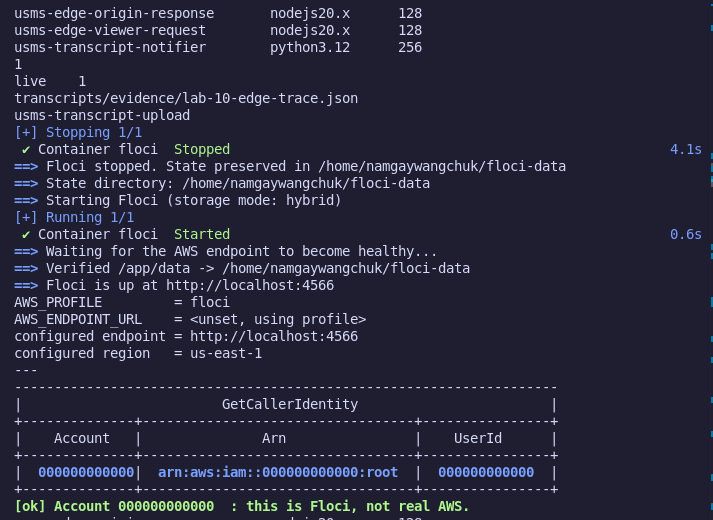

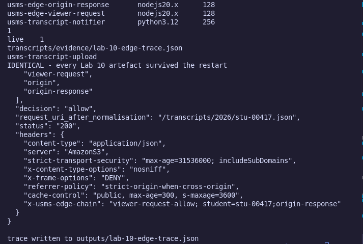

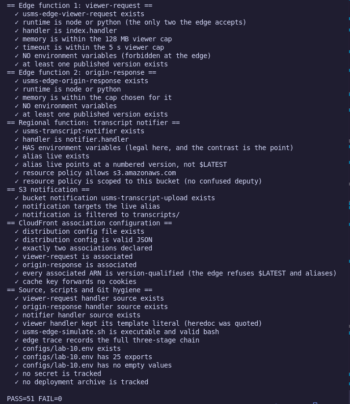

---

## 4. Floci vs. Real AWS Behavioral Comparison

| Capability / Rule | Real AWS Behavior | Floci Emulation Behavior | Lab Verification Method |
| :--- | :--- | :--- | :--- |
| **Lambda Lifecycle & Versioning** | Full lifecycle; immutable numbered versions and movable aliases. | Implemented; versions and `:live` alias resolve via `--qualifier`. | Direct `publish-version`, `create-alias`, and qualified `invoke`. |
| **IAM Trust & Resource Policies** | Strictly enforces `edgelambda.amazonaws.com` trust and S3 `AWS:SourceArn` conditions. | Stores and returns policy documents faithfully without runtime enforcement. | Static JSON inspection and assertion checks in `verify-lab-10.sh`. |
| **Lambda@Edge Restrictions** | Rejects env vars, VPCs, layers, `>128 MB`/`>5 s` viewer caps, and `$LATEST`/aliases at association time. | Accepts non-compliant configs without rejecting `create-distribution`. | Static audit via `edge_eligibility` (`outputs/lab-10-function-inventory.json`). |
| **CloudFront Edge Replication** | Replicates functions globally across PoPs and intercepts live HTTPS viewer/origin traffic. | Records distribution metadata (`E3LYH2JGZMN80X`) without executing edge request routing. | End-to-end event chaining via `scripts/utilities/usms-edge-simulate.sh`. |
| **Persistence Across Restarts** | Managed cloud control-plane state persists across sessions. | Preserved via `FLOCI_STORAGE_MODE=hybrid` bound to `/home/namgaywangchuk/floci-data`. | Pre/post `floci-down.sh` & `floci-up.sh` diff (`IDENTICAL`). |

---

## 5. Summary of Generated Artefacts

| Artefact Path | Type | Purpose |
| :--- | :--- | :--- |
| `labs/lab-10-lambda-edge/edge-viewer-request/index.mjs` | Source (Node.js 20) | `viewer-request` handler for URI lowercasing & `x-usms-student` auth gating |
| `labs/lab-10-lambda-edge/edge-origin-response/index.mjs` | Source (Node.js 20) | `origin-response` handler for security headers, cache TTLs & chain stamping |
| `labs/lab-10-lambda-edge/transcript-notifier/notifier.py` | Source (Python 3.12) | Regional S3 `ObjectCreated` notifier emitting structured `USMS_NOTIFY` logs |
| `policies/trust-lambda-edge.json` | IAM Policy | Dual-principal trust policy (`lambda.amazonaws.com` + `edgelambda.amazonaws.com`) |
| `templates/lab-10-distribution-config.json` | CloudFront Config | Distribution `usms-transcript-cdn` associating `:1` edge functions |
| `templates/lab-10-bucket-notification.json` | S3 Notification | Event rule targeting `usms-transcript-notifier:live` for `transcripts/*.json` |
| `scripts/utilities/usms-edge-simulate.sh` | Utility Script | Local end-to-end CloudFront request/response chain simulator |
| `scripts/utilities/verify-lab-10.sh` | Verification Script | Automated 51-check audit suite (`PASS=51 FAIL=0`) |
| `scripts/cleanup/lab-10-cleanup.sh` | Cleanup Script | Inside-out teardown script (retained unexecuted for end-of-course cleanup) |
| `configs/lab-10.env` | Environment Config | 25 exported resource names, versions, and ARNs for downstream labs |