# Lab 11 — CI/CD: Source, Build, and the Pipeline That Joins Them

**Course:** DSO303 — Cloud Infrastructure & DevOps (AWS Emulation with Floci)  
**Target Location:** `labs/lab-11-cicd/README.md`  
**Environment:** Floci (`http://localhost:4566`, `FLOCI_STORAGE_MODE=hybrid`, Account `000000000000`, Region `us-east-1`)  
**Support Path:** Path A (CodeBuild and CodePipeline APIs both present)  

---

## 1. Executive Summary

This lab implements the continuous integration and build half of the University Student Management System (USMS) release pipeline on Floci, spanning from a versioned S3 source archive through an automated AWS CodeBuild project orchestrated by a two-stage AWS CodePipeline (`Source` $\rightarrow$ `Build`). Rather than treating CI/CD as a monolithic script, the architecture separates responsibilities across four explicit boundaries:

1. **Immutable Source & Artifact Storage (`usms-pipeline-artifacts`):** A versioned, private Amazon S3 bucket storing packaged source archives under `source/usms-enrolment-src.zip` and pipeline artifacts under `usms-enrolment-pipeline/BuildOutput/`.
2. **Least-Privilege Service Identities (`usms-codebuild-role` & `usms-codepipeline-role`):** Distinct IAM service roles separating untrusted build execution permissions from pipeline stage orchestration and scoped `iam:PassRole` delegation.
3. **Declarative Build Specification (`buildspec.yml`):** A four-phase build pipeline (`install`, `pre_build`, `build`, `post_build`) that validates configuration invariants, stamps release metadata (`VERSION`, UTC build timestamp, build ID, and resolved source version), runs automated smoke tests (`tests/smoke.sh`), and emits a deployment-ready `imagedefinitions.json` contract for Lab 12.
4. **Two-Stage Orchestration (`usms-enrolment-pipeline`):** An AWS CodePipeline coupling the S3 source stage (`FetchSource`) to the CodeBuild build stage (`BuildArtifact`).

All 46 automated checks in `scripts/utilities/verify-lab-11.sh` passed (`PASS=46  FAIL=0`), and all five independent lab exercises were completed and verified.

---

## 2. Architecture & Resource Inventory

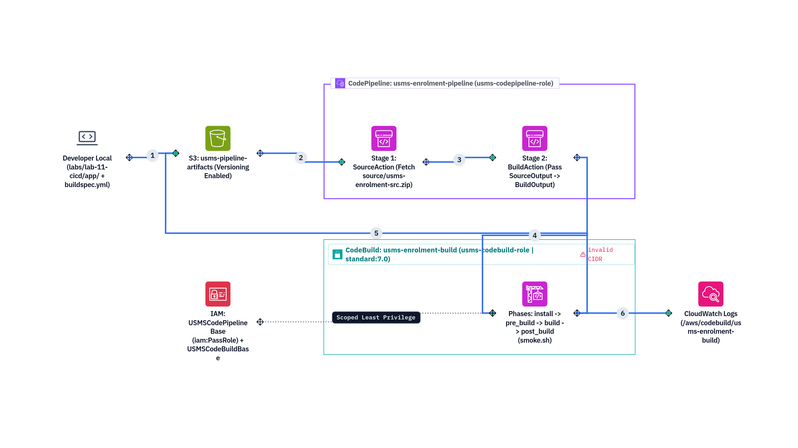

| Component | Identifier / Path | Key Configuration / Role |
| :--- | :--- | :--- |
| **Artifact Bucket** | `usms-pipeline-artifacts` | Versioning `Enabled`, Public Access Blocked (`All 4 flags true`), Tags: `Project=USMS`, `Tier=pipeline`, `Lab=11` |
| **Source Archive Key** | `source/usms-enrolment-src.zip` | Flat zip archive (`buildspec.yml` at root), versioned across `r3`, `r4`, and `r5` |
| **CodeBuild Role** | `usms-codebuild-role` | Trusts `codebuild.amazonaws.com` (`aws:SourceAccount` + `aws:SourceArn`); Policy: `USMSCodeBuildBase` |
| **CodeBuild Project** | `usms-enrolment-build` | Image: `aws/codebuild/standard:7.0`, Compute: `BUILD_GENERAL1_SMALL`, Timeout: `15m`, Handed over to `CODEPIPELINE` |
| **Secondary Build Project** | `usms-results-build` | Standalone S3 project (`source/usms-results-src.zip` $\rightarrow$ `build/usms-results-build.zip`), reuses `usms-codebuild-role` |
| **CodePipeline Role** | `usms-codepipeline-role` | Trusts `codepipeline.amazonaws.com` (`aws:SourceAccount`); Policy: `USMSCodePipelineBase` (`iam:PassRole` scoped to `usms-codebuild-role`) |
| **CodePipeline** | `usms-enrolment-pipeline` | 2 Stages: `Source` (`S3` / `FetchSource`) $\rightarrow$ `Build` (`CodeBuild` / `BuildArtifact`) |
| **Deployment Contract** | `dist/imagedefinitions.json` | Single-element JSON array `[{"name": "enrolment-api", "imageUri": "nginx:alpine"}]` for Lab 12 ECS deploy |

---

## 3. Step-by-Step Implementation & Evidence

### Phase 1: Environment Readiness, Support Probe, and Directory Scaffold (Steps 1–4)

#### Step 1 — Start Floci and Verify Durable Storage
Floci was started via `./scripts/utilities/floci-up.sh` and verified using `floci-check.sh`. The container confirmed `FLOCI_STORAGE_MODE=hybrid` bound to `/home/namgaywangchuk/floci-data` and authenticated against local account `000000000000` in `us-east-1`.

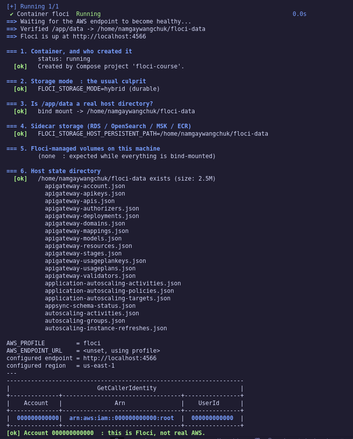
*Figure 1: Floci startup verification showing `FLOCI_STORAGE_MODE=hybrid`, bind-mounted host persistence directory, and `sts get-caller-identity` returning account `000000000000`.*

#### Step 2 — Load Earlier-Lab Dependencies
Environment files `configs/lab-01.env` through `configs/lab-10.env` were sourced to confirm the upstream ECS deployment target (`usms-ecs-cluster`, service `usms-enrolment-svc`, container `enrolment-api`, ALB target group ARN, and ECS execution role ARN).

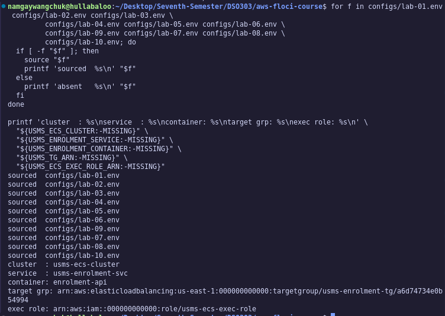
*Figure 2: Sourcing `configs/lab-01.env` through `configs/lab-10.env` and confirming active ECS cluster, service, container name (`enrolment-api`), target group ARN, and execution role ARN.*

#### Step 3 — Probe CI/CD Service Support
`scripts/utilities/cicd-support-probe.sh` was created and executed to verify API support for CodeBuild, CodePipeline, ECR, and CodeDeploy. Both `codebuild` and `codepipeline` responded cleanly, establishing **Path A**.

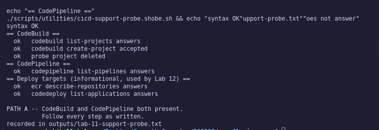
*Figure 3: Output of `cicd-support-probe.sh` confirming `PATH A -- CodeBuild and CodePipeline both present` and recording results to `outputs/lab-11-support-probe.txt`.*

#### Step 4 — Create Directory Layout and Initialize Notes
The Lab 11 workspace directories (`labs/lab-11-cicd/app/{src,config,tests}`, `policies`, `templates`, `scripts/{utilities,cleanup}`, `outputs`, and `notes`) were created and `notes/lab-11-notes.md` was initialized with the support probe output.

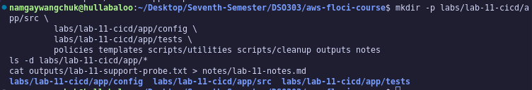
*Figure 4: Creation of the Lab 11 application, policy, template, script, output, and notes directories.*

---

### Phase 2: Versioned S3 Artifact Store (Steps 5–6)

#### Step 5 — Create and Configure `usms-pipeline-artifacts`
The S3 bucket `usms-pipeline-artifacts` was created, tagged (`Project=USMS`, `Tier=pipeline`, `Lab=11`), configured with `Versioning=Enabled`, and locked down with all four S3 Public Access Block settings set to `true`.

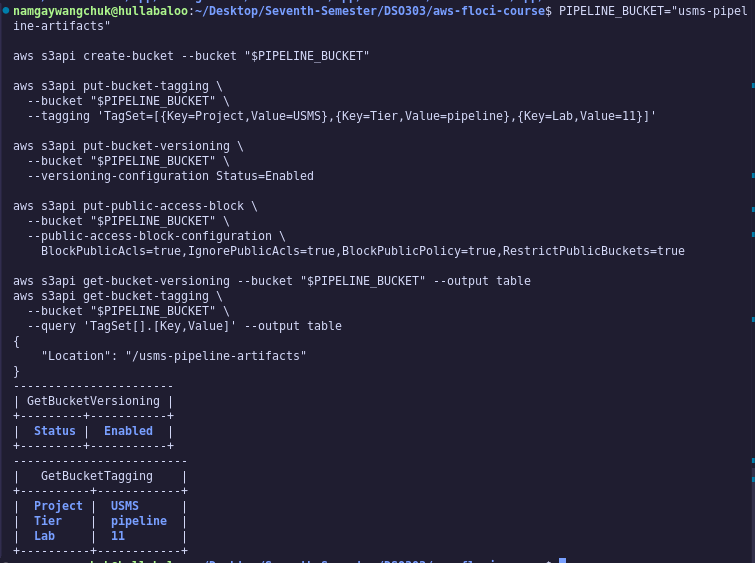
*Figure 5: Creation and verification of `usms-pipeline-artifacts` showing `GetBucketVersioning` (`Enabled`) and `GetBucketTagging` metadata.*

#### Step 6 — Prove S3 Object Versioning and Clean Up Probe Objects
Two consecutive uploads (`first` and `second`) were written to `probe/versioning.txt` to confirm distinct `VersionId` generation (`198f322f-...` as latest and `119b4858-...` as previous), followed by explicit deletion of every object version so zero probe artifacts remained.

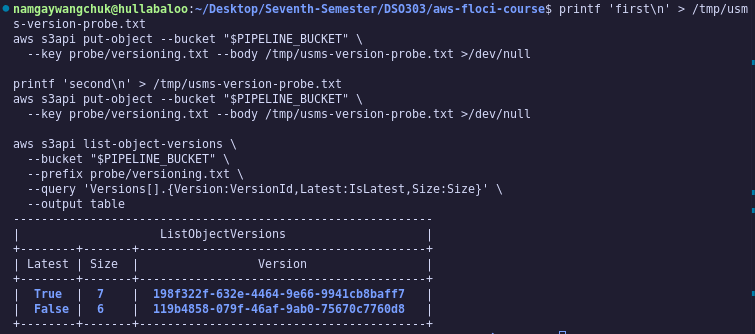
*Figure 6: `ListObjectVersions` confirming two distinct `VersionId` entries (`198f322f-632e-4464-9e66-9941cb8baff7` and `119b4858-079f-46af-9ab0-75670c7760d8`) under `probe/versioning.txt`.*

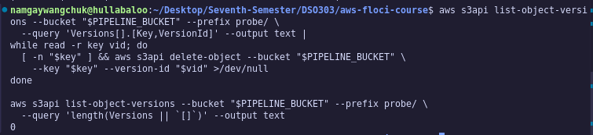
*Figure 7: Cleanup of `probe/` object versions returning `0` remaining versions in `usms-pipeline-artifacts`.*

---

### Phase 3: Enrolment Application Source Tree and Buildspec (Steps 7–8)

#### Step 7 — Author the Enrolment Application Tree and Smoke Tests
The enrolment service source files were authored under `labs/lab-11-cicd/app/`: `VERSION` (`r3`), `src/index.html` (with `__RELEASE__` and `__BUILT_AT__` placeholders), `src/healthz.html` (`ok`), `config/service.json` (`container: "enrolment-api"`, `port: 80`), and `tests/smoke.sh` (7 automated artifact assertions).

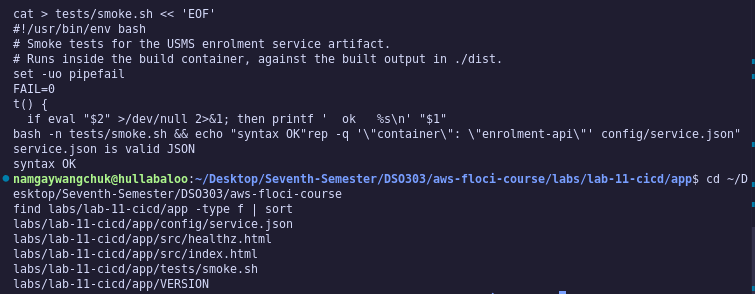
*Figure 8: Validation of `config/service.json` and `tests/smoke.sh` syntax (`syntax OK`) and listing of all five source files under `labs/lab-11-cicd/app`.*

#### Step 8 — Author and Validate `buildspec.yml`
A CodeBuild `version: 0.2` specification (`labs/lab-11-cicd/app/buildspec.yml`) was created with four phases (`install`, `pre_build`, `build`, `post_build`) and `artifacts.base-directory: dist`, validated via PyYAML.

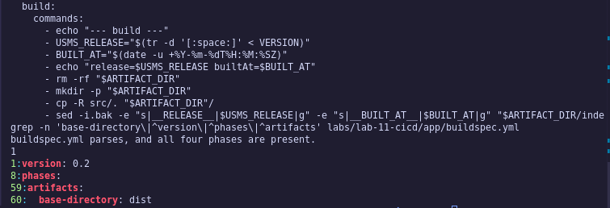
*Figure 9: PyYAML parse verification confirming `version: 0.2`, all four build phases, and `base-directory: dist` in `labs/lab-11-cicd/app/buildspec.yml`.*

---

### Phase 4: Standalone CodeBuild Identity, Project, and Local Fallback Runner (Steps 9–14)

#### Step 9 — Create `usms-codebuild-role` and `USMSCodeBuildBase`
The CodeBuild trust policy (`policies/trust-codebuild.json`) and least-privilege permissions policy (`policies/usms-codebuild-policy.json`) were created and attached to `usms-codebuild-role`.

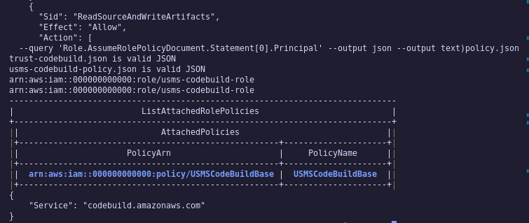
*Figure 10: Verification of `usms-codebuild-role` trust principal (`codebuild.amazonaws.com`) and attached `USMSCodeBuildBase` managed policy.*

#### Step 10 — Create Standalone CodeBuild Project `usms-enrolment-build`
`templates/lab-11-codebuild-project.json` was authored and registered via `aws codebuild create-project`, configuring `aws/codebuild/standard:7.0`, `BUILD_GENERAL1_SMALL`, 15-minute timeout, and S3 source/artifact locations.

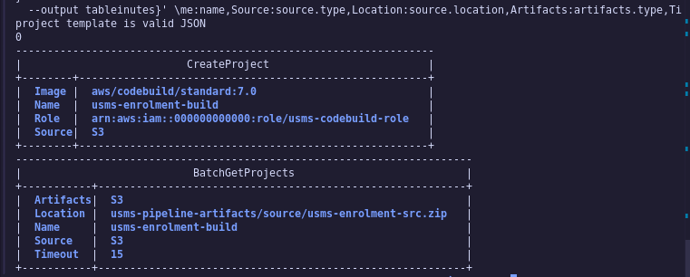
*Figure 11: `CreateProject` and `BatchGetProjects` tables confirming `usms-enrolment-build` with image `aws/codebuild/standard:7.0`, role `usms-codebuild-role`, and S3 source/artifact bindings.*

#### Step 11 — Package Source Archive and Upload Initial Version (`r3`)
`scripts/utilities/usms-pack-source.sh` packaged `labs/lab-11-cicd/app` with `buildspec.yml` at the archive root (9 entries), uploaded it to `s3://usms-pipeline-artifacts/source/usms-enrolment-src.zip` (`VersionId: dc149454-f1b0-4f04-9735-2c2dad75bf80`), and confirmed `outputs/` is git-ignored.

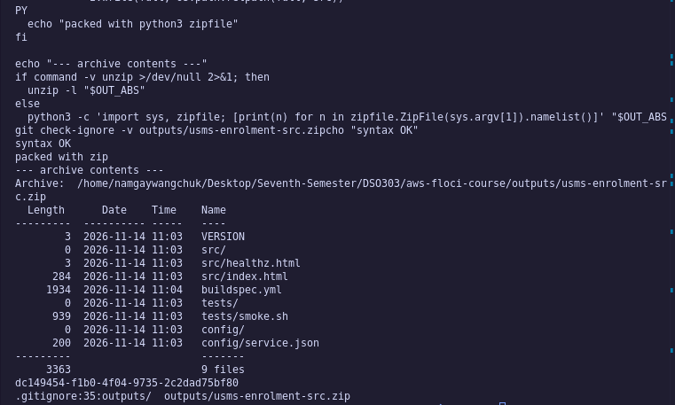
*Figure 12: Archive listing showing `buildspec.yml` at zip root, uploaded S3 `VersionId` `dc149454-f1b0-4f04-9735-2c2dad75bf80`, and `.gitignore` verification for `outputs/`.*

#### Steps 12–13 — Run Standalone Build and Diagnose Floci 2.0.1 Image Pull Issue
Triggering `usms-enrolment-build:1` progressed through `SUBMITTED`, `QUEUED`, `PROVISIONING`, and `DOWNLOAD_SOURCE` (`SUCCEEDED`) before terminating in `COMPLETED` (`FAILED` / `FAULT`). Inspecting `batch-get-builds` revealed the documented Floci 2.0.1 limitation: Docker cannot pull AWS's private ECR Public image `aws/codebuild/standard:7.0` (`Status 404: pull access denied for aws/codebuild/standard`).

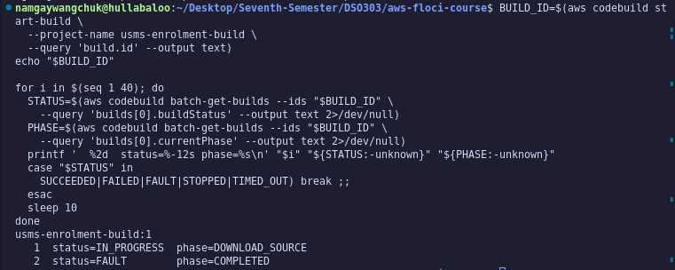
*Figure 13: Polling loop output for `usms-enrolment-build:1` transitioning from `DOWNLOAD_SOURCE` (`IN_PROGRESS`) to `COMPLETED` (`FAULT`).*

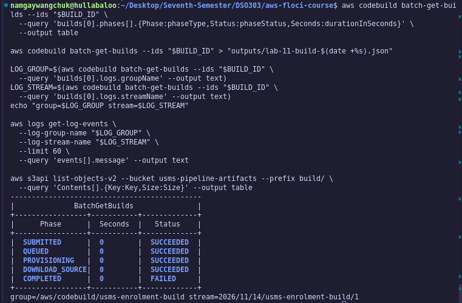
*Figure 14: `BatchGetBuilds` phase breakdown showing `SUBMITTED`, `QUEUED`, `PROVISIONING`, and `DOWNLOAD_SOURCE` succeeding before `COMPLETED` failed on the `aws/codebuild/standard:7.0` image pull.*

#### Step 14 — Execute Buildspec Locally via `usms-buildspec-run.sh`
To verify the build commands and smoke tests directly on the host, `scripts/utilities/usms-buildspec-run.sh` parsed `buildspec.yml` and executed all four phases, stamping `release=r3`, passing all 7 smoke tests (`smoke tests failed: 0`), and confirming `dist/` is git-ignored.

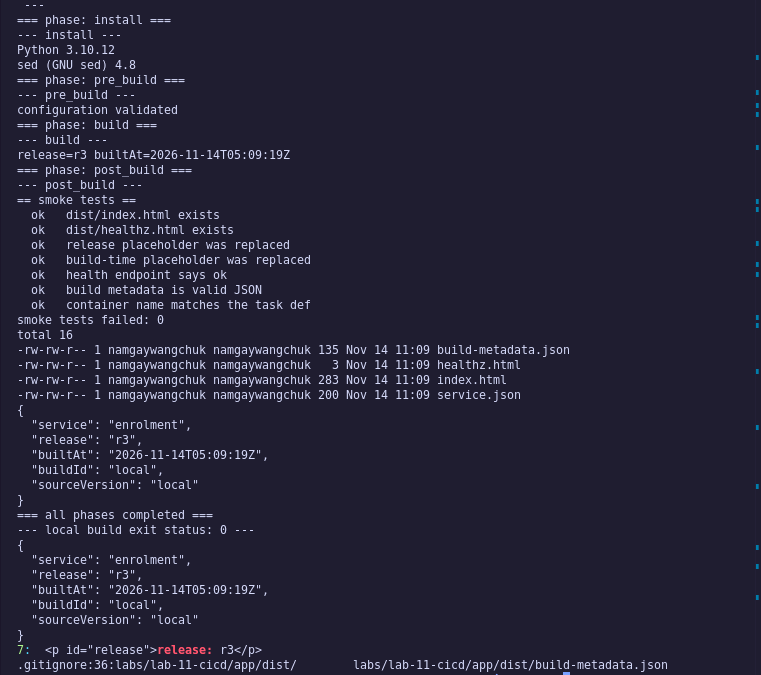
*Figure 15: Local build runner output for `r3` showing all 4 phases succeeding, 0 smoke test failures, generated `build-metadata.json`, and git-ignored `dist/` output.*

---

### Phase 5: CodePipeline Identity, Two-Stage Pipeline, and End-to-End Runs (Steps 15–19)

#### Step 15 — Create `usms-codepipeline-role` and `USMSCodePipelineBase`
`policies/trust-codepipeline.json` and `policies/usms-codepipeline-policy.json` (scoping `iam:PassRole` strictly to `usms-codebuild-role` with `iam:PassedToService: codebuild.amazonaws.com`) were created and attached to `usms-codepipeline-role`.

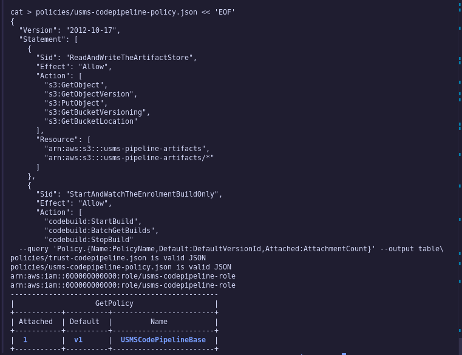
*Figure 16: Policy validation and `GetPolicy` output confirming `USMSCodePipelineBase` (`v1`, `Attached: 1`) attached to `usms-codepipeline-role`.*

#### Step 16 — Author and Validate Pipeline Template (`lab-11-pipeline.json`)
`templates/lab-11-pipeline.json` was authored with two stages (`Source` using `S3` provider `FetchSource` $\rightarrow$ `Build` using `CodeBuild` provider `BuildArtifact`) and validated with zero unexpanded `$` variables.

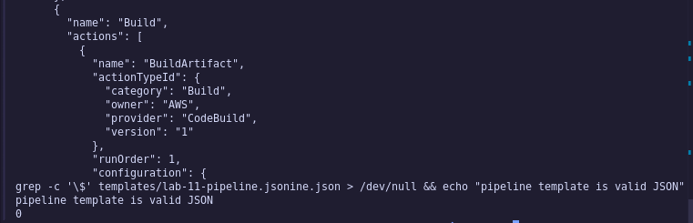
*Figure 17: JSON validation of `templates/lab-11-pipeline.json` confirming valid syntax and `0` unexpanded `$` tokens.*

#### Step 17 — Create `usms-enrolment-pipeline` and Inspect Initial State
`aws codepipeline create-pipeline` created the 2-stage pipeline `usms-enrolment-pipeline` bound to `usms-codepipeline-role`.

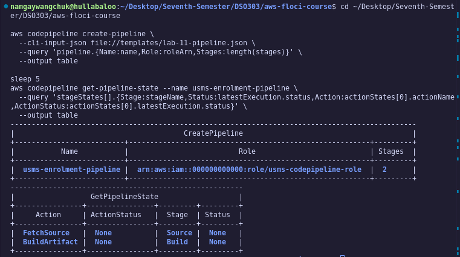
*Figure 18: `CreatePipeline` (`Stages: 2`) and `GetPipelineState` tables showing the `Source` (`FetchSource`) and `Build` (`BuildArtifact`) stages.*

#### Step 18 — Hand Over CodeBuild Project to `CODEPIPELINE` and Test Override
`aws codebuild update-project` switched `usms-enrolment-build` to `Source: CODEPIPELINE` and `Artifacts: CODEPIPELINE`. Both direct `start-build` (`usms-enrolment-build:2`, permitted by Floci's permissive validation) and `--source-type-override S3` (`usms-enrolment-build:3`) were tested and documented.

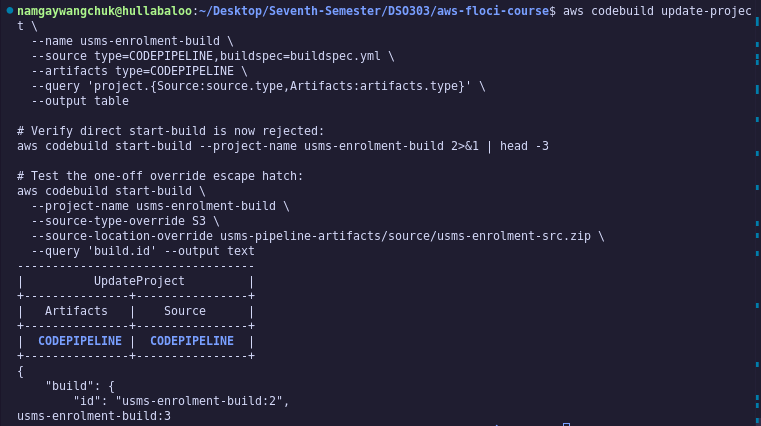
*Figure 19: `UpdateProject` confirming `CODEPIPELINE` source and artifact types alongside standalone and `--source-type-override S3` build triggers.*

#### Step 19 — Roll Forward Releases (`r4` and `r5`) Through the Pipeline
`VERSION` was bumped to `r4`, repacked, uploaded (`VersionId: e27372af-6b56-44ce-be23-02eaba35c372`), and executed through `usms-enrolment-pipeline` (`09e499f9-36cb-489b-98ee-c71f7ed47eea`), followed by local verification of `r4` (`dist/build-metadata.json`). `VERSION` was then rolled forward to `r5` (`VersionId: 159ef677-fbdd-4955-9712-3b92286ec34c`), bringing total source versions to `3` while `BuildOutput` objects remained `0` due to the Floci 2.0.1 `standard:7.0` pull fault.

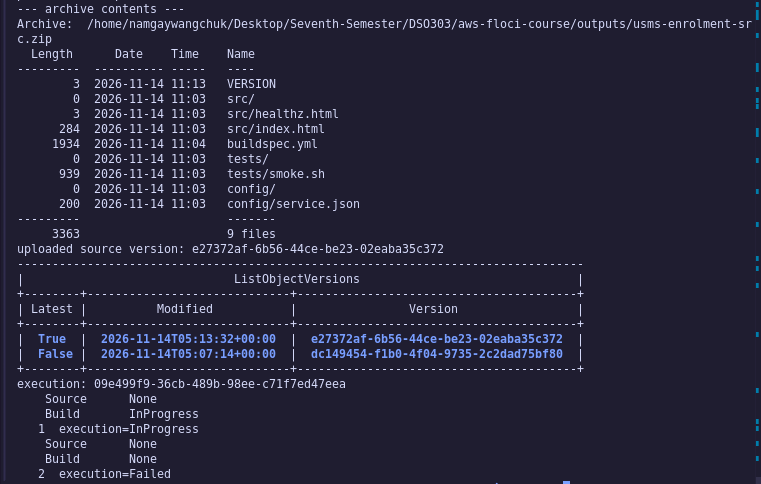
*Figure 20: Upload of `r4` (`e27372af-6b56-44ce-be23-02eaba35c372`), `ListObjectVersions` showing two versions, and pipeline execution `09e499f9-36cb-489b-98ee-c71f7ed47eea`.*

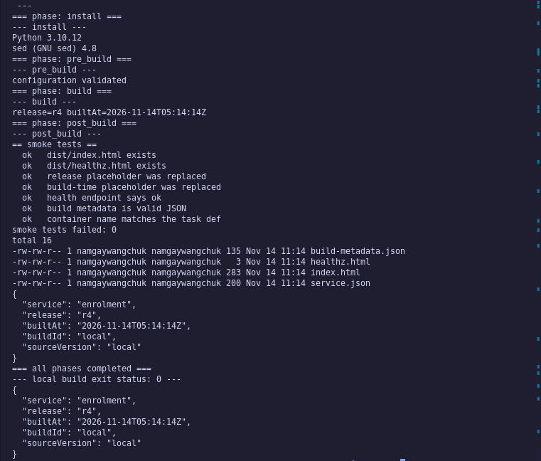
*Figure 21: Local build runner output for `r4` confirming all 7 smoke tests passed and `build-metadata.json` recorded `"release": "r4"`.*

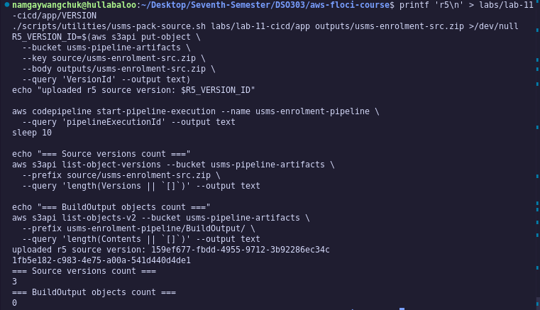
*Figure 22: Upload of `r5` (`159ef677-fbdd-4955-9712-3b92286ec34c`), confirming `3` source object versions in S3 and `0` `BuildOutput` objects.*

---

### Phase 6: Deliberate Failure Diagnosis, State Recording, and Verification (Steps 20–21)

#### Step 20 — Break `config/service.json` Deliberately, Diagnose, and Restore
`config/service.json` was modified to `"container": "enrolment-api-v2"`, repacked, uploaded (`e2a604e1-...`), and triggered (`a7310afd-e5e8-4f69-90d1-3e3a5bc8da90`). Both pipeline state inspection and `usms-buildspec-run.sh` isolated the failure to `pre_build` (`config/service.json names the wrong container`, exit status `1`). Restoring `"container": "enrolment-api"` returned the local build and pipeline upload (`3e0c7096-...`) to a passing state.

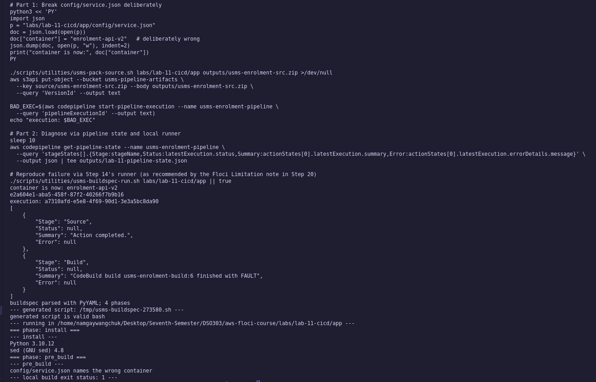
*Figure 23: Pipeline state JSON (`outputs/lab-11-pipeline-state.json`) and local runner failure in `pre_build` (`config/service.json names the wrong container`, exit status `1`).*

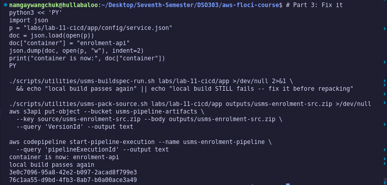
*Figure 24: Restoration of `"container": "enrolment-api"`, confirming `local build passes again` and triggering pipeline execution `76c1aa55-d9bd-4fb3-8ab7-b0a00ace3a49`.*

#### Step 21 — Record Outputs (`configs/lab-11.env`) and Verify All 46 Checks
All 26 environment exports were written to `configs/lab-11.env` with zero empty or `None` values, and `./scripts/utilities/verify-lab-11.sh` confirmed `PASS=46  FAIL=0`.

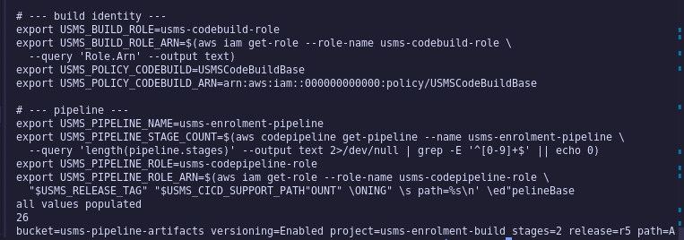
*Figure 25: Verification of `configs/lab-11.env` confirming `all values populated`, `26` export statements, `versioning=Enabled`, `stages=2`, `release=r5`, and `path=A`.*

---

## 4. Independent Lab Exercises Summary (Section 12)

All five exercises were implemented and documented in `labs/lab-11-cicd/exercises.md`:

- **Exercise 1 (Basic — Second Build Project `usms-results-build`):** Created `labs/lab-11-cicd/app-results/`, packaged `source/usms-results-src.zip`, registered `usms-results-build` reusing `usms-codebuild-role`, and verified `build-metadata.json` (`"service": "results", "release": "r1"`).
- **Exercise 2 (Intermediate — `finally` Block & Build Summary):** Added a `finally` block under `post_build` in `buildspec.yml` writing `release`, `smoke_exit`, and UTC `timestamp` to `dist/build-summary.txt` even on test failure.
- **Exercise 3 (Problem Solving — JSON Container Validation & `aws:SourceArn`):** Replaced whitespace-sensitive `grep` container checks in `pre_build` with an inline `python3 -c` JSON comparison (verified against 4-space indented JSON) and tightened `policies/trust-codebuild.json` with `"aws:SourceArn": "arn:aws:codebuild:us-east-1:000000000000:project/usms-enrolment-build"`.
- **Exercise 4 (Challenge — EventBridge S3 Trigger Templates):** Authored and registered `templates/lab-11-eventbridge-rule.json` (`usms-enrolment-src-trigger`) and `templates/lab-11-eventbridge-target.json` (`FailedEntryCount: 0`) to eliminate S3 polling latency on real AWS.
- **Exercise 5 (Integration — Lab 12 Deployment Contract):** Extended `buildspec.yml` to emit `dist/imagedefinitions.json` (`[{"name": "enrolment-api", "imageUri": "nginx:alpine"}]`), added an 8th assertion to `tests/smoke.sh`, and wrote `outputs/lab-11-lab08b-readiness.txt` for Lab 12 Step 1.

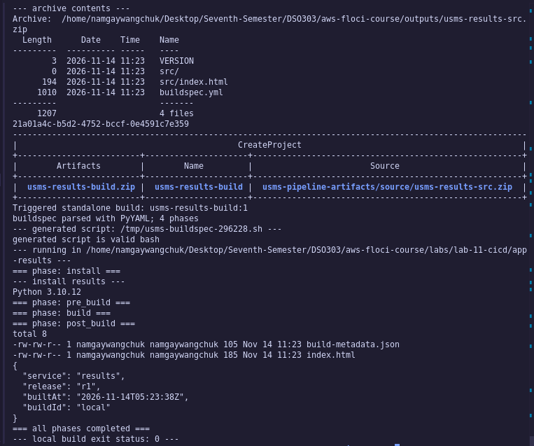
*Figure 26: Creation of CodeBuild project `usms-results-build` (`usms-results-build.zip`) and local build execution producing `"service": "results", "release": "r1"`.*

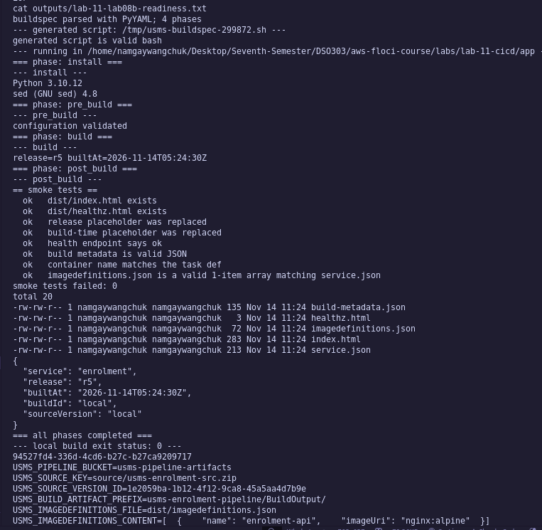
*Figure 27: Execution of updated `buildspec.yml` passing all 8 smoke tests (including `dist/imagedefinitions.json`) and populating `outputs/lab-11-lab08b-readiness.txt`.*

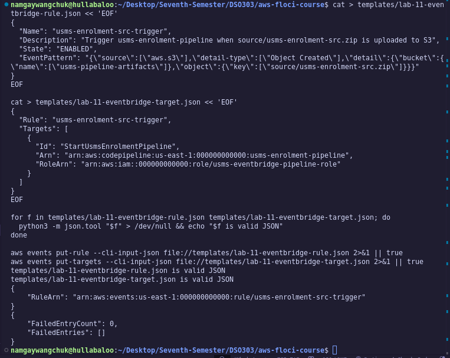
*Figure 28: JSON validation and registration of `usms-enrolment-src-trigger` (`RuleArn` created, `FailedEntryCount: 0`) in Floci.*

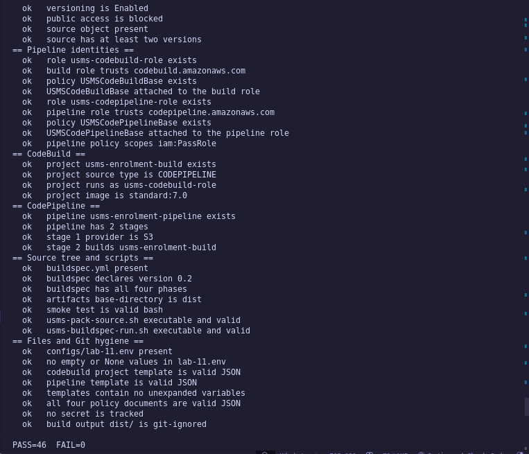
*Figure 29: Final execution of `./scripts/utilities/verify-lab-11.sh` confirming `PASS=46  FAIL=0` across environment, dependencies, S3, IAM, CodeBuild, CodePipeline, scripts, and Git hygiene.*

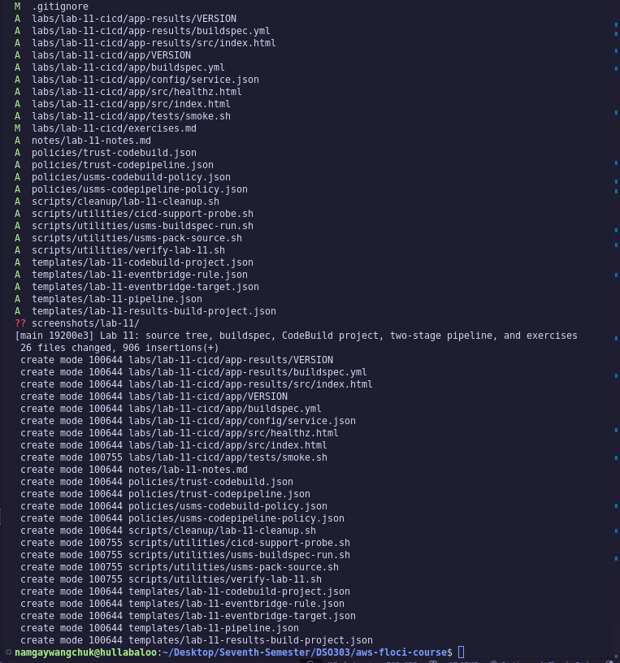
*Figure 30: Git commit `19200e3` recording all 26 Lab 11 source files, policies, templates, scripts, and notes while excluding `outputs/` and `dist/`.*

---

## 5. Key Findings, Limitations, and Security Analysis

1. **Floci 2.0.1 CodeBuild Image Limitation (`aws/codebuild/standard:7.0`):** While Floci's CodeBuild and CodePipeline control planes accept project/pipeline definitions and transition builds through `DOWNLOAD_SOURCE`, the Docker engine cannot pull AWS's managed `aws/codebuild/standard:7.0` image from Docker Hub (`404 pull access denied`). Using `scripts/utilities/usms-buildspec-run.sh` executes the exact `buildspec.yml` commands and smoke tests locally to validate build logic and artifact contents.
2. **Permissive `CODEPIPELINE` Direct Build Validation in Floci:** After `update-project` switched `usms-enrolment-build` to `Source: CODEPIPELINE`, Floci allowed `aws codebuild start-build` without `--source-type-override` (`usms-enrolment-build:2`) instead of raising `InvalidInputException` as real AWS does.
3. **Confused-Deputy & Privilege-Escalation Hardening:**
   - Scoping `iam:PassRole` in `USMSCodePipelineBase` to `arn:aws:iam::000000000000:role/usms-codebuild-role` with `iam:PassedToService: codebuild.amazonaws.com` prevents a compromised pipeline definition from passing an administrative IAM role into a build container.
   - Adding `aws:SourceArn` alongside `aws:SourceAccount` in `policies/trust-codebuild.json` ensures only `usms-enrolment-build`—and not other CodeBuild projects in account `000000000000`—can assume `usms-codebuild-role`.