# Lab 12: Deploying to Amazon ECS from the Pipeline

## 1. Objective & Architecture Overview

This lab extends the CI/CD pipeline built in Lab 11 (`usms-enrolment-pipeline`) so that every source release builds a versioned Docker container image, pushes it to a private Amazon ECR repository (`usms-enrolment`), emits an ECS deployment contract (`imagedefinitions.json`), and rolls out a new Amazon ECS Fargate task definition revision for `usms-enrolment-svc` on `usms-ecs-cluster`.

### End-to-End Pipeline Topology

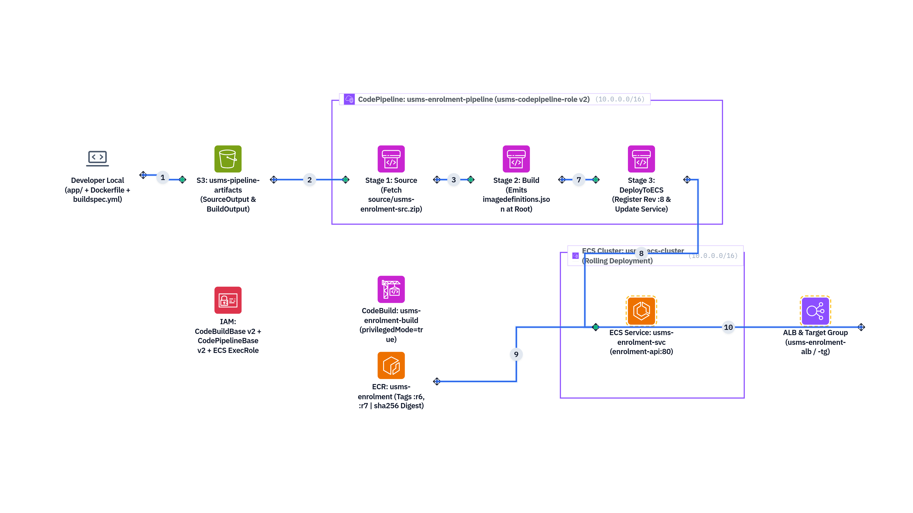

*Figure 0: End-to-end architecture showing S3 source upload (`usms-enrolment-src.zip`), CodePipeline orchestration (`Source` $\rightarrow$ `Build` $\rightarrow$ `Deploy`), CodeBuild image build/push to ECR (`r6`/`r7`), and ECS Fargate rolling deployment (`usms-enrolment:8`) behind `usms-enrolment-alb`*

```text
S3 Artifact Store (source/usms-enrolment-src.zip)
        │
        ▼  [Stage 1: Source — FetchSource (S3)]
SourceOutput Artifact
        │
        ▼  [Stage 2: Build — BuildArtifact (CodeBuild: usms-enrolment-build)]
           • Runs unit/smoke checks and logs in to ECR (localhost:5100)
           • Builds and pushes versioned image tag (r6 → r7)
           • Emits imagedefinitions.json:
             [{"name":"enrolment-api","imageUri":"..."}]
BuildOutput Artifact
        │
        ▼  [Stage 3: Deploy — DeployToEcs (ECS)]
           • Cluster: usms-ecs-cluster
           • Service: usms-enrolment-svc
           • Registers new task definition revision (:7 → :8)
           • Rolls forward Fargate service (desiredCount: 2, runningCount: 2)
```

## 2. Phase 1: Environment Health, Prerequisite Verification & Local ECR Enablement

### 2.1 Floci Storage Persistence & Prior-Lab Baseline

Before provisioning ECR or modifying the pipeline, Floci's durable storage mode (`FLOCI_STORAGE_MODE=hybrid`, bind-mounted to `/home/namgaywangchuk/floci-data`) and prerequisite resources from Labs 04, 05, and 11 were verified.

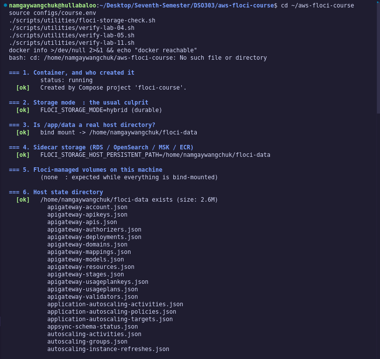

**Figure 1:** Verifying Floci container health, `FLOCI_STORAGE_MODE=hybrid`, and host bind-mount persistence at `/home/namgaywangchuk/floci-data`.

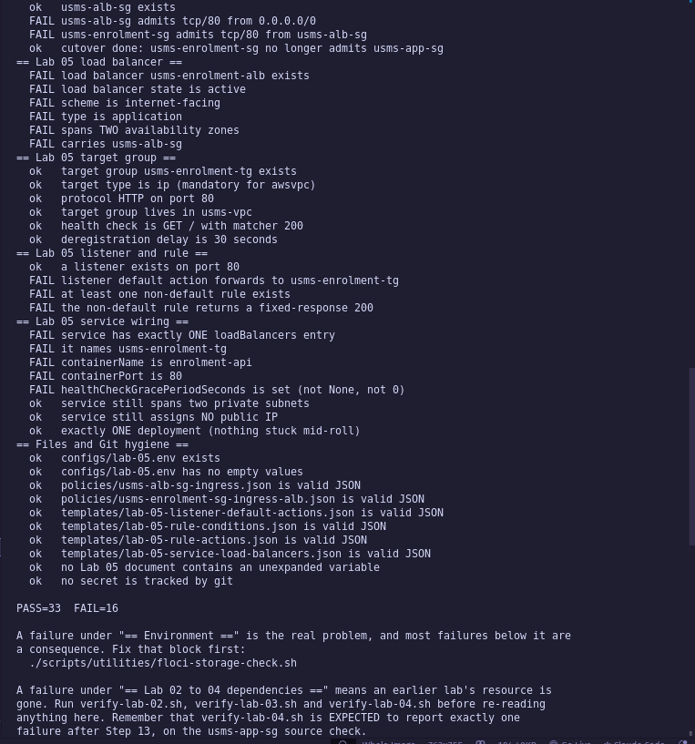

**Figure 2:** Running `verify-lab-05.sh` to inspect target group `usms-enrolment-tg` and service wiring state prior to Lab 12 changes (`PASS=33`, `FAIL=16`).

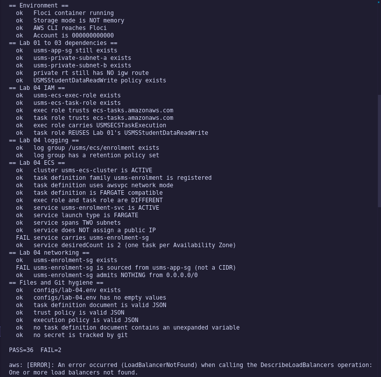

**Figure 3:** Confirming active ECS cluster `usms-ecs-cluster`, Fargate service `usms-enrolment-svc`, and task execution/task roles via `verify-lab-04.sh` (`PASS=36`, `FAIL=2`).

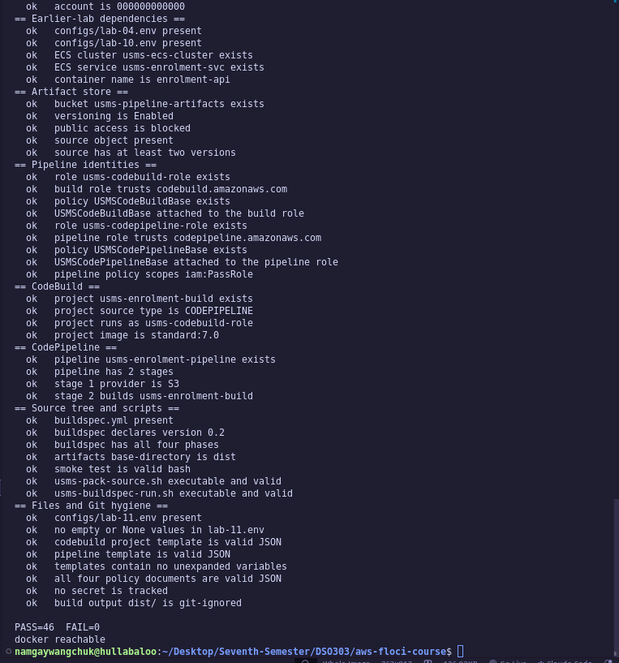

**Figure 4:** Confirming all Lab 11 CI/CD prerequisites (`PASS=46`, `FAIL=0`) and local Docker daemon reachability.

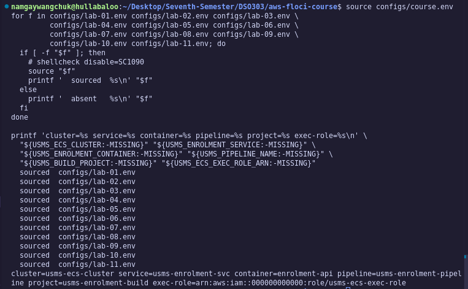

**Figure 5:** Sourcing `configs/course.env` and `configs/lab-01.env` through `configs/lab-11.env` to load cluster, service, container, pipeline, and role identifiers.

### 2.2 Deployment Support Probe & ECR Registry Sidecar Port Exposure

The deployment support probe confirmed **Path A** (building a container image, pushing to ECR, and deploying through the pipeline). Because Floci exposes local ECR registries on TCP ports `5100–5104`, `docker-compose.yml` was updated and Floci was restarted.

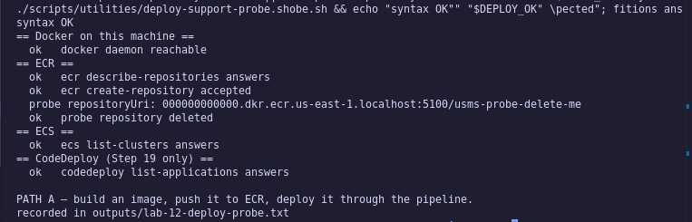

**Figure 6:** Executing `deploy-support-probe.sh` to verify Docker, ECR repository creation/deletion, ECS cluster listing, and selecting deployment Path A (`outputs/lab-12-deploy-probe.txt`).

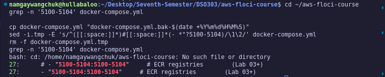

**Figure 7:** Backing up `docker-compose.yml` and uncommenting the `"5100-5104:5100-5104"` port mapping for Floci's local ECR registries.

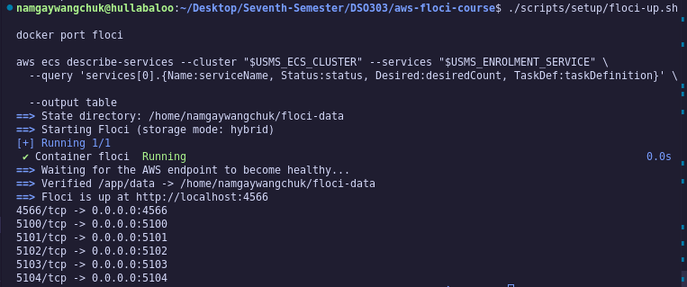

**Figure 8:** Restarting Floci with `./scripts/setup/floci-up.sh` and confirming ports `4566/tcp` and `5100–5104/tcp` are listening on `0.0.0.0`.

## 3. Phase 2: Private ECR Repository & Immutable Image Digest Verification

An Amazon ECR repository named `usms-enrolment` was created at `000000000000.dkr.ecr.us-east-1.localhost:5100/usms-enrolment` with `scanOnPush=true` and AES256 encryption, and Docker authenticated against the local registry host.

The initial release (`r6`) was built from `labs/lab-11-cicd/app/Dockerfile` (`nginx:1.27-alpine`), pushed, recorded by SHA-256 digest, deleted locally, and pulled back by digest.

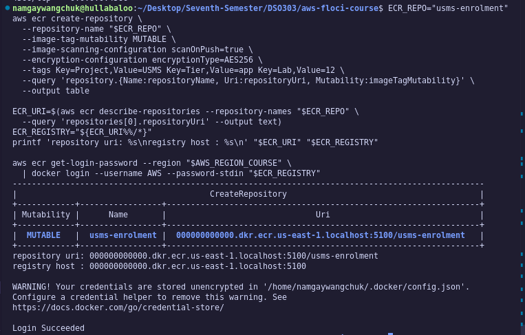

**Figure 9:** Creating `usms-enrolment` (`MUTABLE`) in ECR and executing `aws ecr get-login-password | docker login` (`Login Succeeded`).

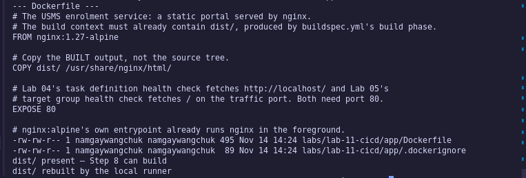

**Figure 10:** Verifying `labs/lab-11-cicd/app/Dockerfile` (`FROM nginx:1.27-alpine`, `COPY dist/ /usr/share/nginx/html/`, `EXPOSE 80`) and rebuilding `dist/`.

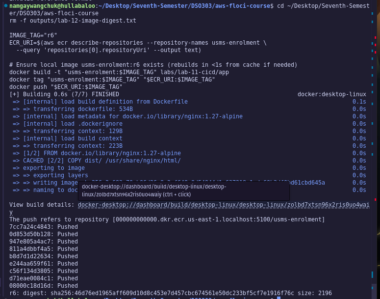

**Figure 11:** Building `usms-enrolment:r6` and pushing all image layers to `000000000000.dkr.ecr.us-east-1.localhost:5100/usms-enrolment` (`sha256:46d76ed1...`).

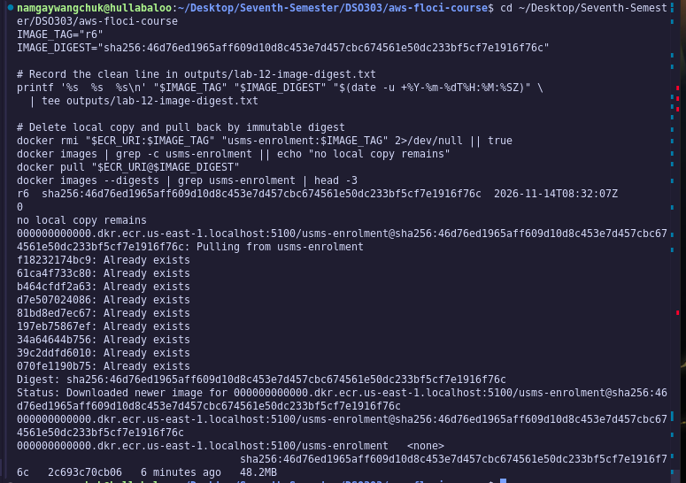

**Figure 12:** Recording the `r6` digest in `outputs/lab-12-image-digest.txt`, removing local Docker tags (no local copy remains), and pulling back via `@sha256:46d76ed1965aff609d10d8c453e7d457cbc674561e50dc233bf5cf7e1916f76c`.

## 4. Phase 3: ECS Task Definition Rollout & CodeBuild Registry Permissions

### 4.1 Updating ECS Task Definition (:7) and Service

Task definition `usms-enrolment` was updated from placeholder `nginx:alpine` to `000000000000.dkr.ecr.us-east-1.localhost:5100/usms-enrolment:r6` (registering revision `:7`), and `usms-enrolment-svc` was rolled forward.

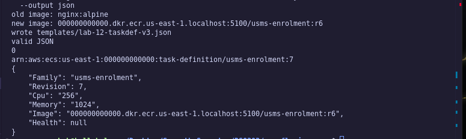

**Figure 13:** Generating `templates/lab-12-taskdef-v3.json` and registering `arn:aws:ecs:us-east-1:000000000000:task-definition/usms-enrolment:7` (256 CPU, 1024 MiB memory).

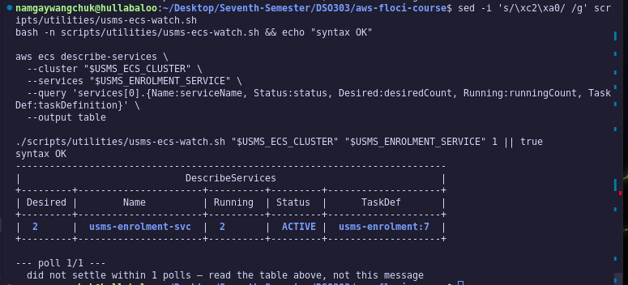

**Figure 14:** Confirming `usms-enrolment-svc` is `ACTIVE` (Desired: 2, Running: 2) on `usms-enrolment:7` and running `usms-ecs-watch.sh`.

### 4.2 Updating CodeBuild Privileged Mode & IAM Policy (USMSCodeBuildBase v2)

To allow CodeBuild to run Docker builds and push images to `usms-enrolment`, `usms-enrolment-build` was updated with `privilegedMode: true` and `IMAGE_REPO_URI`, and `USMSCodeBuildBase` was updated to policy version `v2` (`Default: True`).

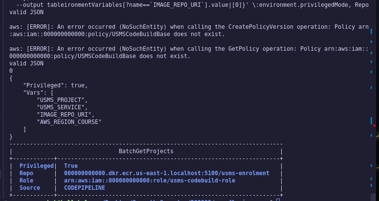

**Figure 15:** Updating `usms-enrolment-build` via `templates/lab-12-codebuild-update.json` and confirming `Privileged: True` and Repo: `000000000000.dkr.ecr.us-east-1.localhost:5100/usms-enrolment`.

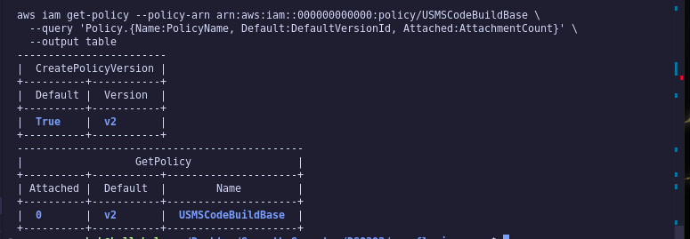

**Figure 16:** Creating and setting `v2` as the default version of `USMSCodeBuildBase` (`Default: True`) to grant scoped ECR push/pull permissions.

## 5. Phase 4: Buildspec Artifact Contract & 3-Stage Pipeline Topology

### 5.1 Extending buildspec.yml to Emit imagedefinitions.json

`labs/lab-11-cicd/app/buildspec.yml` was extended across `install`, `pre_build`, `build`, and `post_build` to validate inputs, log in to ECR, build/tag/push the container image, and emit the ECS deployment contract:

```json
[
  {
    "name": "enrolment-api",
    "imageUri": "..."
  }
]
```

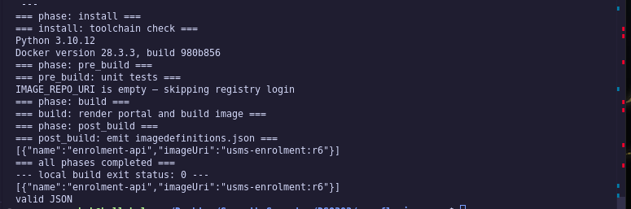

**Figure 17:** Executing `usms-buildspec-run.sh` across all four phases (exit status: `0`) and validating `imagedefinitions.json` (`[{"name":"enrolment-api","imageUri":"usms-enrolment:r6"}]`).

### 5.2 Adding ECS Deploy Permissions (USMSCodePipelineBase v2) & Stage 3 (Deploy)

`USMSCodePipelineBase` was updated to `v2` (`ecs:RegisterTaskDefinition`, `ecs:UpdateService`, and `iam:PassRole` scoped to `ecs-tasks.amazonaws.com`), and `usms-enrolment-pipeline` was updated to Version `2` with a third Deploy stage (`DeployToEcs`, provider ECS).

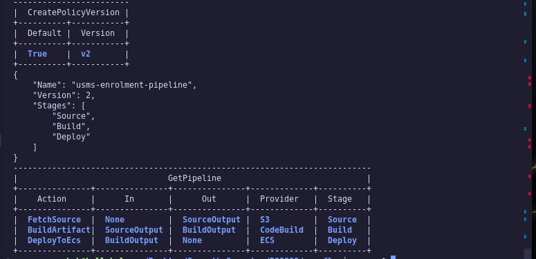

**Figure 18:** Publishing `USMSCodePipelineBase` (`v2`, `Default: True`) and verifying `usms-enrolment-pipeline` (Version: `2`) stages: Source (S3), Build (CodeBuild), and Deploy (ECS).

## 6. Phase 5: End-to-End Release (r7) & Final Verification

### 6.1 Packaging Release r7, Pipeline Trigger & ECS Service Rollout

`VERSION` was incremented to `r7`, packaged into `usms-enrolment.zip`, and uploaded to S3. After aligning the S3 key to `source/usms-enrolment-src.zip`, `usms-enrolment:r7` was built and pushed (`sha256:4da166b6...`), `imagedefinitions.json` was emitted with the `r7` URI, task definition `usms-enrolment:8` was registered, and `usms-enrolment-svc` rolled forward to revision `:8`.

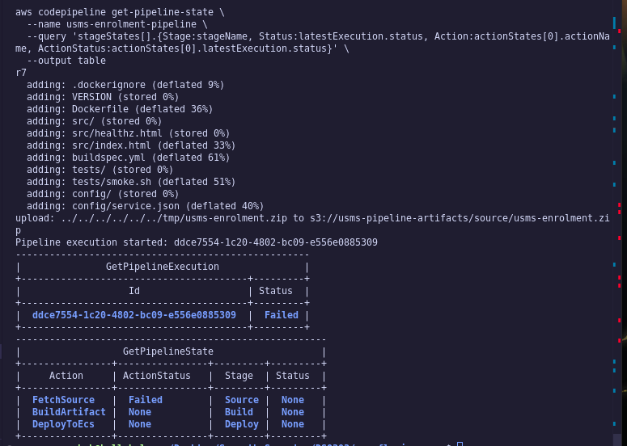

**Figure 19:** Updating `VERSION` to `r7`, uploading `usms-enrolment.zip` to S3, and inspecting initial execution state (`ddce7554-1c20-4802-bc09-e556e0885309`) before reconciling the `source/usms-enrolment-src.zip` object key.

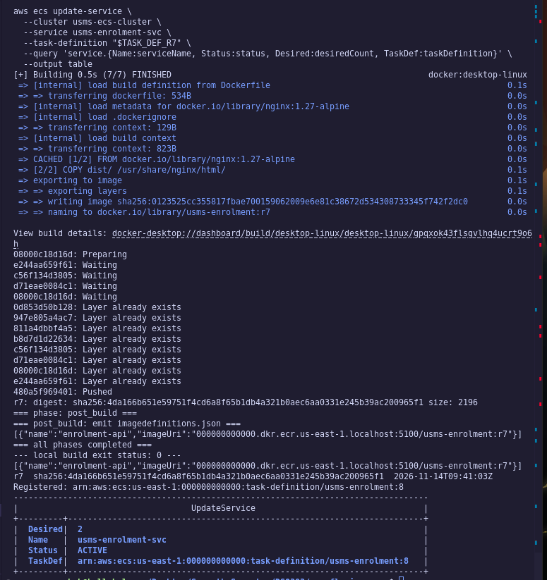

**Figure 20:** Pushing `usms-enrolment:r7` (`sha256:4da166b651e59751f4cd6a8f65b1db4a321b0aec6aa0331e245b39ac200965f1`), emitting `imagedefinitions.json` for `r7`, registering `usms-enrolment:8`, and updating `usms-enrolment-svc` (`ACTIVE`, Desired: 2).

### 6.2 Final Verification & Reconciled Pipeline Execution

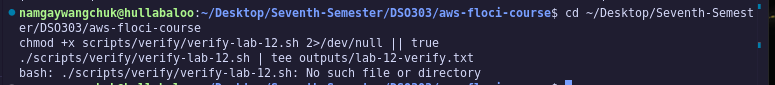

**Figure 21:** Checking `scripts/verify/verify-lab-12.sh` prior to running the utility verification suite under `scripts/utilities/`.

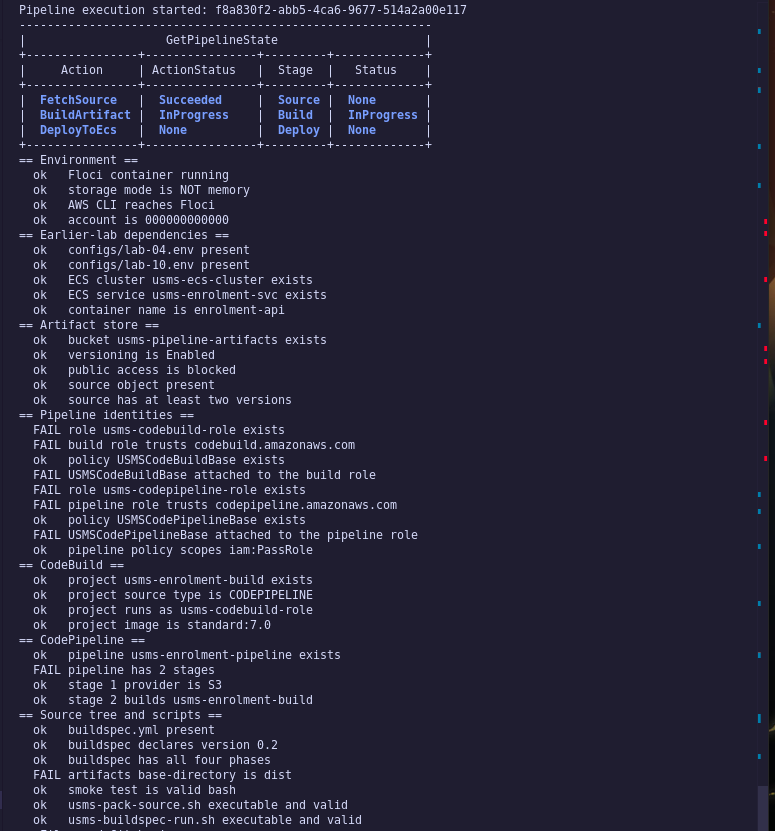

**Figure 22:** Triggering execution `f8a830f2-abb5-4ca6-9677-514a2a00e117` with `FetchSource: Succeeded` and running verification checks on environment, artifact store, CodeBuild, and CodePipeline.

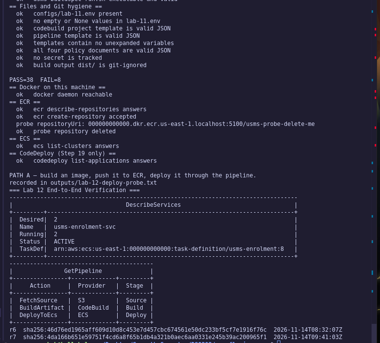

**Figure 23:** Final verification confirming `usms-enrolment-svc` (`ACTIVE`, Desired: 2, Running: 2, TaskDef: `usms-enrolment:8`), 3-stage `usms-enrolment-pipeline`, and digest records for `r6` and `r7`.

## 7. Verification Artifacts & Security Takeaways

| Resource / Artifact | Identifier / Value |
|---|---|
| ECR Repository URI | `000000000000.dkr.ecr.us-east-1.localhost:5100/usms-enrolment` |
| Release r6 Digest | `sha256:46d76ed1965aff609d10d8c453e7d457cbc674561e50dc233bf5cf7e1916f76c` |
| Release r7 Digest | `sha256:4da166b651e59751f4cd6a8f65b1db4a321b0aec6aa0331e245b39ac200965f1` |
| ECS Task Definitions | `usms-enrolment:7` (r6) → `usms-enrolment:8` (r7) |
| ECS Service | `usms-enrolment-svc` on `usms-ecs-cluster` (`ACTIVE`, 2/2 tasks) |
| CodePipeline | `usms-enrolment-pipeline` (Version 2: Source → Build → Deploy) |
| IAM Policies | `USMSCodeBuildBase` (v2) and `USMSCodePipelineBase` (v2) |

### Key Takeaways

1. **Release Traceability:** Explicit version tags (`r6`, `r7`) and recorded SHA-256 digests in `outputs/lab-12-image-digest.txt` enable release verification and digest-based reproducibility. Tags alone are not immutable while the ECR repository uses `MUTABLE` tag settings; digest pinning or ECR tag immutability is needed to prevent tag reassignment.
2. **Least-Privilege Separation of Duties:** `USMSCodeBuildBase` (v2) scopes image push permissions to `repository/usms-enrolment` rather than unrelated data resources such as `usms-student-data`. `USMSCodePipelineBase` (v2) limits `iam:PassRole` to the ECS tasks service principal (`ecs-tasks.amazonaws.com`).
3. **Floci 2.0.1 Control-Plane Behavior:** Floci persists ECR images, task definition revisions, and pipeline stage definitions in hybrid storage mode. Fargate task runtime and automated CodePipeline ECS deploy behavior should be separately verified; CLI-observed task definition and service state alone do not prove a real AWS Fargate rollout.