# Lab 13 – CloudWatch, X-Ray & Observability: Engineering Lab Report

**Student:** Namgay Wangchuk  
**Course:** DSO303 – Cloud Engineering (`aws-floci-course`)  
**Environment:** Floci `2.0.1` (`http://localhost:4566`, `FLOCI_STORAGE_MODE=hybrid`, Account `000000000000`, Region `us-east-1`)

---

## 1. Executive Summary

This lab established unified observability across the University Student Management System (USMS) serverless and container workload stack without altering functional business logic. Using Amazon CloudWatch Logs, CloudWatch Metrics, CloudWatch Alarms, IAM least-privilege policies, Lambda versioning/aliases, and AWS X-Ray segment structures on Floci `2.0.1`, the pipeline was instrumented across all three telemetry pillars (logs, metrics, and traces) and verified to survive a full container restart under durable `hybrid` persistence.

### Key Deliverables & Artefacts
* **Environment Configuration:** `configs/lab-13.env`
* **IAM Least-Privilege Policy:** `policies/usms-observability-write-policy.json` (`USMSObservabilityWrite`)
* **Instrumented Lambda Function:** `labs/lab-13-cloudwatch-xray/transcript-notifier-v2/notifier.py` (versions `2` and `3`, active tracing enabled behind alias `live`)
* **Cross-Signal Telemetry Emitter:** `scripts/utilities/usms-emit-telemetry.sh`
* **Templates & Schemas:** `templates/lab-13-metric-data.json`, `templates/lab-13-segment-parent.json`, `templates/lab-13-segment-subsegments.json`, `templates/lab-13-segment-downstream.json`, `templates/lab-13-sampling-rule.json`, `templates/lab-13-dashboard.json`
* **Verification & Diagnostic Evidence:** `outputs/lab-13-support-probe.txt`, `outputs/lab-13-filter-test.json`, `outputs/lab-13-metric-readback.json`, `outputs/lab-13-trace-ids.txt`, `outputs/lab-13-trace-summaries.json`, `outputs/lab-13-service-graph.json`, `outputs/lab-13-alarm-history.json`, `outputs/lab-13-pre-restart.txt`, `outputs/lab-13-post-restart.txt`
* **Exercises & Review Notes:** `labs/lab-13-cloudwatch-xray/exercises.md` and `notes/lab-13-review.md`

---

## 2. Phase 1: Preflight, Capability Probe & Log Group Governance (Steps 1–6)

### Step 1 – Floci Startup & Durable Storage Verification
The local Floci container was started via `./scripts/setup/floci-up.sh`, verified with `./scripts/utilities/floci-storage-check.sh` to confirm `FLOCI_STORAGE_MODE=hybrid` bind-mounted to `/home/namgaywangchuk/floci-data`, and validated against baseline Lab 10 infrastructure (`PASS=51 FAIL=0`).

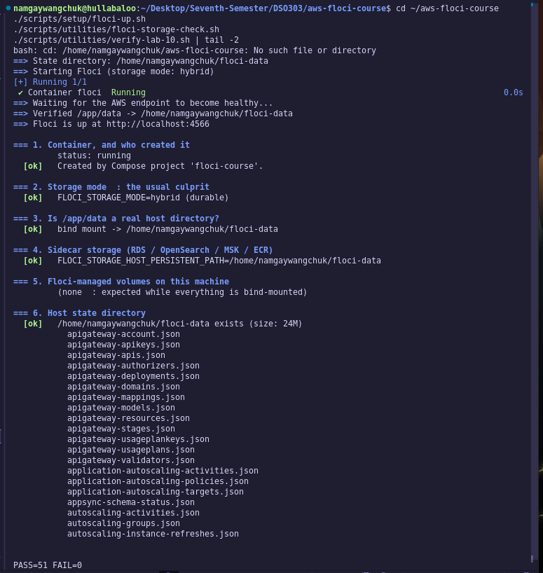
*Figure 1: Starting the Floci container via `floci-up.sh`, verifying `FLOCI_STORAGE_MODE=hybrid` bind-mounted to `/home/namgaywangchuk/floci-data`, and confirming baseline `verify-lab-10.sh` (`PASS=51 FAIL=0`).*

### Step 2 – Environment Configuration & Caller Identity
Shared course settings (`configs/course.env`) and prior lab environment files (`configs/lab-01.env` through `configs/lab-11.env`) were sourced into the shell, and `./scripts/utilities/whoami.sh` confirmed active credentials against local account `000000000000`.

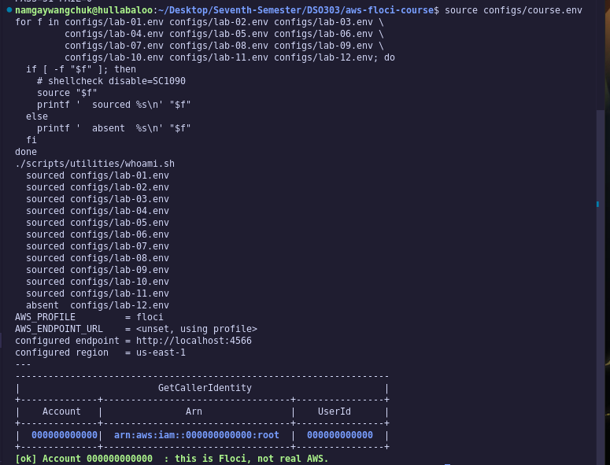
*Figure 2: Sourcing `configs/course.env` and `configs/lab-01.env` through `configs/lab-11.env` and verifying local Floci STS identity (`Account 000000000000`).*

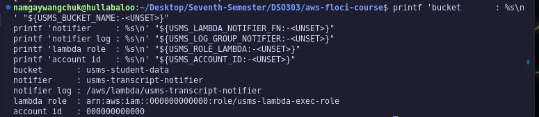
*Figure 3: Confirming inherited environment variables for `usms-student-data`, `usms-transcript-notifier`, `/aws/lambda/usms-transcript-notifier`, `usms-lambda-exec-role`, and account `000000000000`.*

### Step 3 – Lab Directory Structure Initialization
The Lab 13 source tree (`labs/lab-13-cloudwatch-xray/transcript-notifier-v2` and `project/checkpoint-01`) was created to isolate the instrumented Lambda package and checkpoint artefacts.

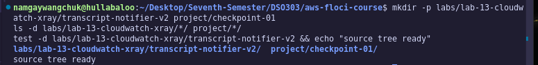
*Figure 4: Creating `labs/lab-13-cloudwatch-xray/transcript-notifier-v2` and `project/checkpoint-01` (`source tree ready`).*

### Step 4 – Floci 2.0.1 Observability API Capability Probe
A capability probe was executed across CloudWatch Logs, CloudWatch Metrics/Alarms/Dashboards, X-Ray, and Lambda APIs and recorded in `outputs/lab-13-support-probe.txt`.

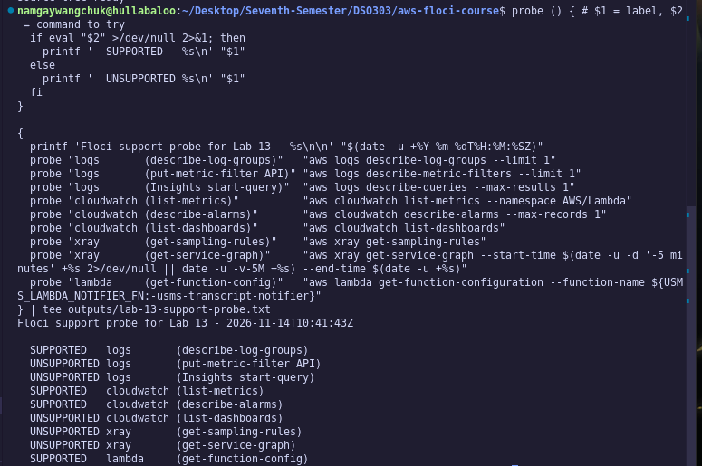
*Figure 5: Running the capability probe (`outputs/lab-13-support-probe.txt`) showing supported core Logs/Metrics/Alarms/Lambda APIs and unsupported metric-filter, Logs Insights, dashboard, and X-Ray endpoints on Floci 2.0.1.*

| Capability / API | Floci 2.0.1 Status | Lab Fallback / Handling Strategy |
| :--- | :--- | :--- |
| `DescribeLogGroups`, `PutRetentionPolicy`, `TagResource` | **Supported** | Executed natively across all USMS log groups. |
| `CreateLogStream`, `PutLogEvents`, `FilterLogEvents` | **Supported** | Executed natively with millisecond timestamps and JSON payloads. |
| `TestMetricFilter`, `PutMetricFilter` | **Unsupported** | Analytical pattern evaluation documented; synthetic `NotifyCount` and `CentralErrorCount` published via `PutMetricData`. |
| `PutMetricData`, `ListMetrics`, `GetMetricStatistics` | **Supported** | Executed natively across dimensioned and un-dimensioned series. |
| `PutMetricAlarm`, `SetAlarmState`, `DescribeAlarms` | **Supported** | Threshold and absence alarms created and state-tested. |
| `DescribeAlarmHistory`, `PutCompositeAlarm`, `PutDashboard` | **Unsupported** | State transitions recorded in `outputs/lab-13-alarm-history.json`; 5-widget dashboard validated structurally (`templates/lab-13-dashboard.json`). |
| `StartQuery` (Logs Insights) | **Unsupported** | Executed Path B: `filter-log-events` piped into Python JSON aggregation. |
| `PutTraceSegments`, `GetTraceSummaries`, `GetServiceGraph`, `CreateSamplingRule` | **Unsupported** | Generated X-Ray segment and sampling rule JSON documents and verified all 10 structural invariants (`outputs/lab-13-trace-summaries.json`). |

### Step 5 & Step 6 – Telemetry Inventory & Log Retention Governance
Pre-existing log groups, ECS/SQS alarms, and CloudWatch namespaces (`USMS/Enrolment`, `USMS/Probe`) were inventoried, and deliberate retention policies were applied (`30` days on `/usms/central/application` and `/usms/ecs/enrolment`; `14` days on `/aws/lambda/usms-transcript-notifier`, `/aws/lambda/usms-edge-viewer-request`, and `/aws/lambda/usms-edge-origin-response`).

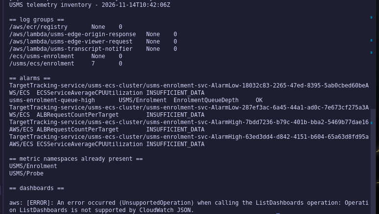
*Figure 6: Baseline telemetry inventory listing pre-existing log groups, ECS/SQS alarms (`usms-enrolment-queue-high`), and existing metric namespaces (`USMS/Enrolment`, `USMS/Probe`).*

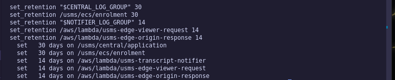
*Figure 7: Setting `30`-day retention on core application/ECS log groups and `14`-day retention on the three USMS Lambda log groups.*

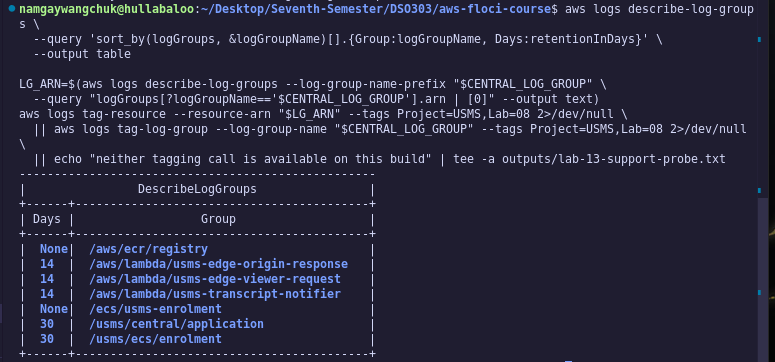
*Figure 8: Confirming retention periods (`14` and `30` days) across all USMS log groups via `describe-log-groups` and tagging `/usms/central/application` with `Project=USMS,Lab=08`.*

---

## 3. Phase 2: Structured Logs, Metric Filters & Custom Metrics (Steps 7–11)

### Step 7 (+ Your Turn) – Structured Log Stream Ingestion
Log stream `lab-13-20261114` was created inside `/usms/central/application` and populated with four structured JSON transcript lifecycle events (`transcript.requested`, two `transcript.processed`, and one `ERROR USMS_EVENT` `transcript.failed`) plus a fifth `HEALTH_CHECK` event, returning `rejectedLogEventsInfo: null` and five ordered events via `filter-log-events`.

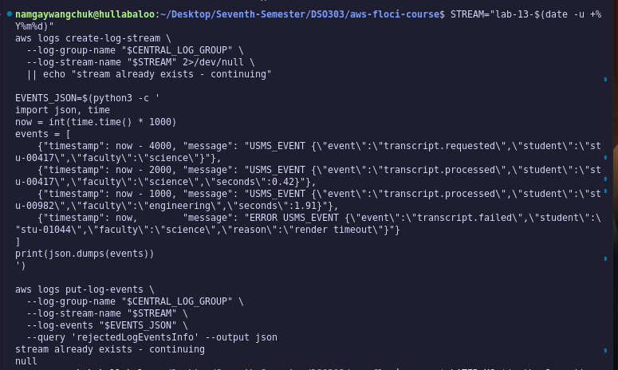
*Figure 9: Creating log stream `lab-13-20261114` in `/usms/central/application` and ingesting four structured `USMS_EVENT` JSON records (`rejectedLogEventsInfo: null`).*

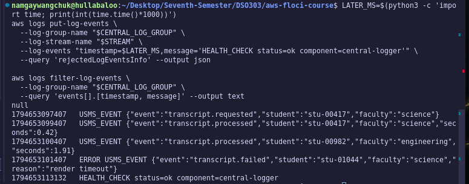
*Figure 10: Appending the fifth `HEALTH_CHECK` log event and verifying all five timestamped events in ascending order via `filter-log-events`.*

### Step 8 (+ Your Turn) & Step 9 – Metric Filter Pattern Analysis & Deployment Probe
`test-metric-filter` and `put-metric-filter` were probed for `USMS_NOTIFY` and `ERROR`, confirming `UnsupportedOperation` on Floci `2.0.1` and documenting the token false-positive analysis (`"reason":"no ERROR here"`) in `labs/lab-13-cloudwatch-xray/exercises.md`.

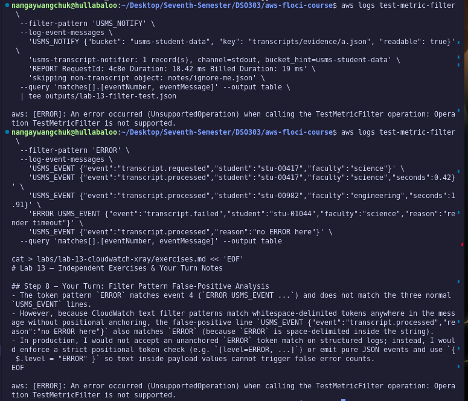
*Figure 11: Probing `test-metric-filter` for `USMS_NOTIFY` and `ERROR` (`UnsupportedOperation`) and writing the Step 8 Your Turn token false-positive analysis into `exercises.md`.*

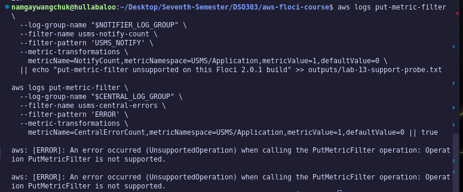
*Figure 12: Attempting `put-metric-filter` for `usms-notify-count` and `usms-central-errors` (`UnsupportedOperation`) and recording the finding in `outputs/lab-13-support-probe.txt`.*

### Step 10 (+ Your Turn) – End-to-End Metric Readback & Empty Window Comparison
Because metric filter evaluation is unavailable on Floci `2.0.1`, a synthetic `NotifyCount` data point (`Value=2`) was published via `put-metric-data` and read back with `get-metric-statistics` (`Sum: 2.0`, `SampleCount: 1.0`). Querying a 15-minute historical window prior to ingestion returned `[]`, illustrating the difference between missing datapoints and `defaultValue=0`.

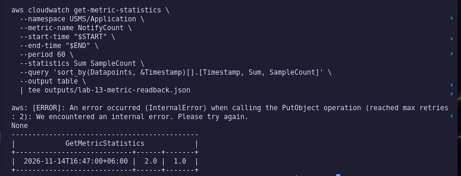
*Figure 13: Reading back synthetic `NotifyCount` statistics (`Sum: 2.0`, `SampleCount: 1.0`) for the active 15-minute window into `outputs/lab-13-metric-readback.json`.*

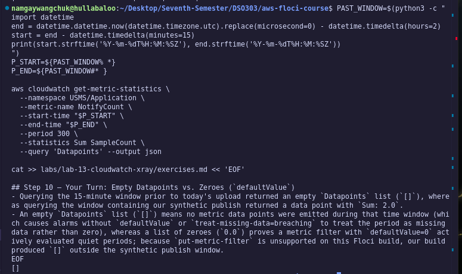
*Figure 14: Querying a historical 15-minute window prior to ingestion (`Datapoints: []`) and recording the empty-list vs. `defaultValue=0` analysis in `exercises.md`.*

### Step 11 – Dimensioned & Un-dimensioned Custom Metrics
Custom metrics (`TranscriptsProcessed`, `TranscriptLagSeconds`, `EdgeDenyCount`, `NotifyCount`, and `CentralErrorCount`) were published to `USMS/Application` using `templates/lab-13-metric-data.json`. `list-metrics` confirmed distinct time series for dimensioned (`Faculty,Stage`) and un-dimensioned (`(none)`) `TranscriptsProcessed`, while `TranscriptLagSeconds` (`Stage=notify`) aggregated `SampleCount: 2.0`, `Average: 1.165`, `Sum: 2.33`, and `Maximum: 1.91` seconds.

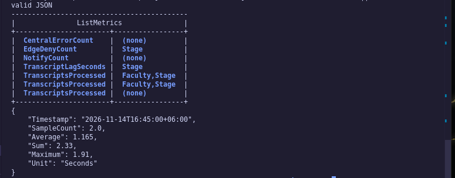
*Figure 15: `ListMetrics` table confirming dimensioned and un-dimensioned series in `USMS/Application`, alongside `TranscriptLagSeconds` aggregation (`SampleCount: 2.0`, `Average: 1.165`, `Maximum: 1.91`).*

---

## 4. Phase 3: IAM Least Privilege, Instrumented Lambda & X-Ray Tracing (Steps 12–18)

### Step 12 – `USMSObservabilityWrite` Least-Privilege IAM Policy
Created `policies/usms-observability-write-policy.json` (`arn:aws:iam::000000000000:policy/USMSObservabilityWrite`) with three scoped statements—`WriteApplicationLogs` restricted to `/usms/*:*` and `/aws/lambda/usms-*:*`, `PublishCustomMetricsInOurNamespaceOnly` conditioned on `cloudwatch:namespace = USMS/Application`, and `SendTraces`—and attached it to both `usms-lambda-exec-role` and `usms-ec2-app-role`.

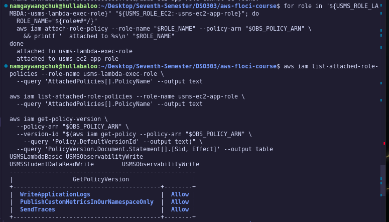
*Figure 16: Attaching `USMSObservabilityWrite` to `usms-lambda-exec-role` and `usms-ec2-app-role` and verifying all three `Allow` policy statements via `get-policy-version`.*

### Step 13 (+ Your Turn) & Step 14 – Instrumented Notifier v2, Rollback Test & Active Tracing v3
`labs/lab-13-cloudwatch-xray/transcript-notifier-v2/notifier.py` was packaged and deployed as version `2` behind the `live` alias to emit `TranscriptsProcessed`, `TranscriptLagSeconds`, and `trace_id` on every invocation. An alias rollback drill to version `1` and roll-forward to `2` verified near-instant regional rollback, after which `TracingConfig.Mode=Active` was enabled and published as version `3` behind `live`.

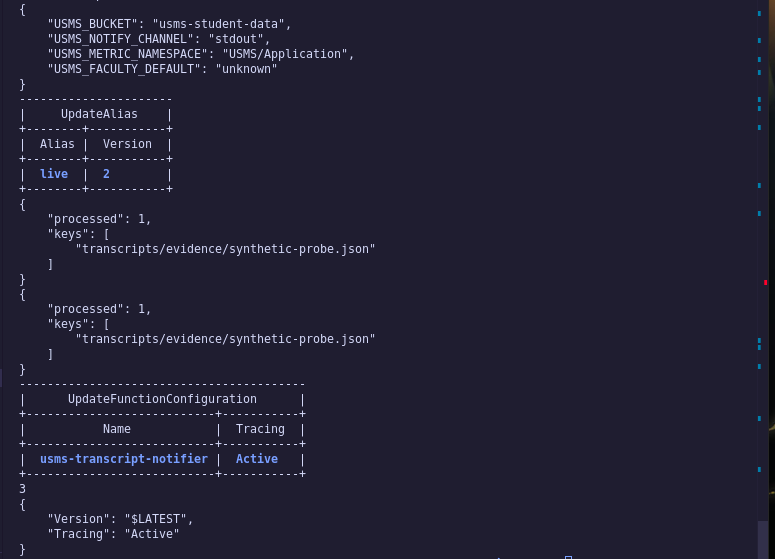
*Figure 17: Repointing alias `live` to instrumented version `2`, verifying invocation output, enabling `TracingConfig.Mode=Active`, and publishing version `3` behind `live`.*

### Steps 15, 16, 17 & 18 – X-Ray Segment Validation, Cross-Signal Emitter & Sampling Rule
Parent, subsegment (`s3-head-object`, `render-pdf`, `cloudwatch-put-metric-data`), and downstream (`usms-student-data`) X-Ray segment documents plus `templates/lab-13-sampling-rule.json` were generated and passed all 10 structural validation checks (`outputs/lab-13-trace-summaries.json`). `scripts/utilities/usms-emit-telemetry.sh` was executed three times to emit correlated log events, metrics, and `1-<epoch>-<24hex>` trace IDs (`outputs/lab-13-trace-ids.txt`).

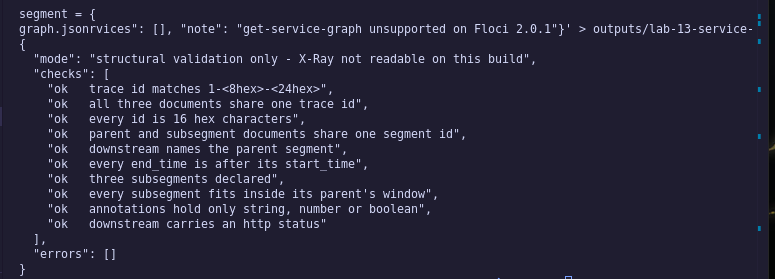
*Figure 18: Structural validation script passing all 10 X-Ray schema, timestamp, hex-ID, and annotation invariants (`errors: []`) in `outputs/lab-13-trace-summaries.json`.*

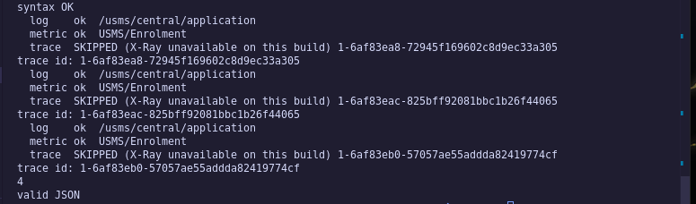
*Figure 19: Three invocations of `usms-emit-telemetry.sh` logging correlated trace IDs (`4` total entries in `outputs/lab-13-trace-ids.txt`) and validating `templates/lab-13-sampling-rule.json`.*

---

## 5. Phase 4: Alarms, Dashboard, Log Aggregation & Restart Persistence (Steps 19–24)

### Step 19, Step 20 & Step 21 – Threshold, Absence & Composite Alarms
Created `usms-transcript-lag-high` (`Maximum > 2.0s`, `2 of 3` periods, `treat-missing-data=notBreaching`) and `usms-notify-silence` (`Sum < 1.0`, `3 of 3` periods, `treat-missing-data=breaching`). Forced `usms-transcript-lag-high` into `ALARM` via `set-alarm-state` and restored `OK`, while documenting `UnsupportedOperation` for `DescribeAlarmHistory` and `PutCompositeAlarm` on Floci `2.0.1`.

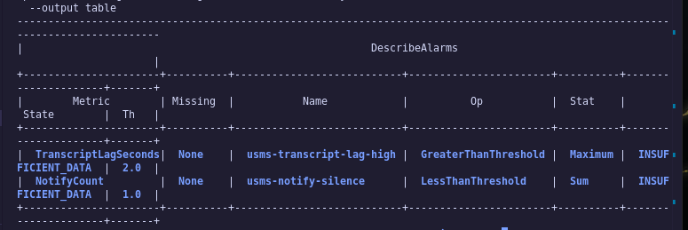
*Figure 20: `DescribeAlarms` table verifying `usms-transcript-lag-high` (`GreaterThanThreshold 2.0`, `Maximum`) and `usms-notify-silence` (`LessThanThreshold 1.0`, `Sum`).*

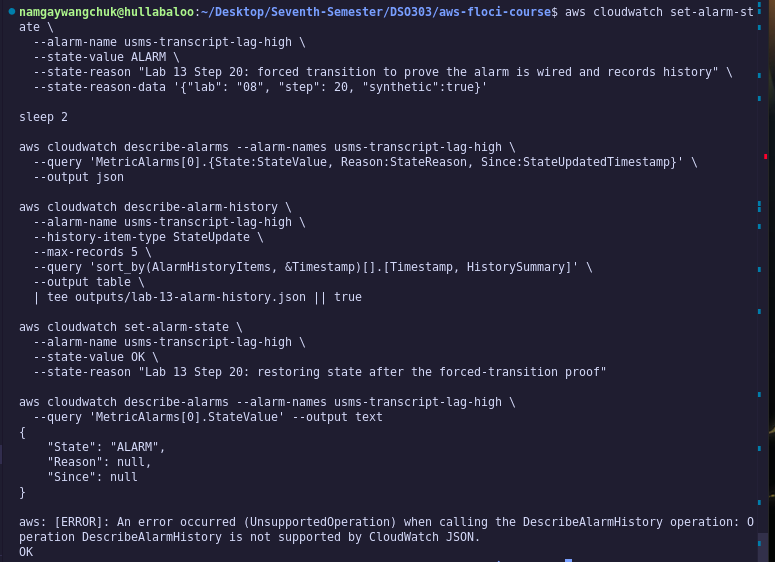
*Figure 21: Forcing `usms-transcript-lag-high` to `ALARM` via `set-alarm-state`, verifying the state transition, and restoring `OK`.*

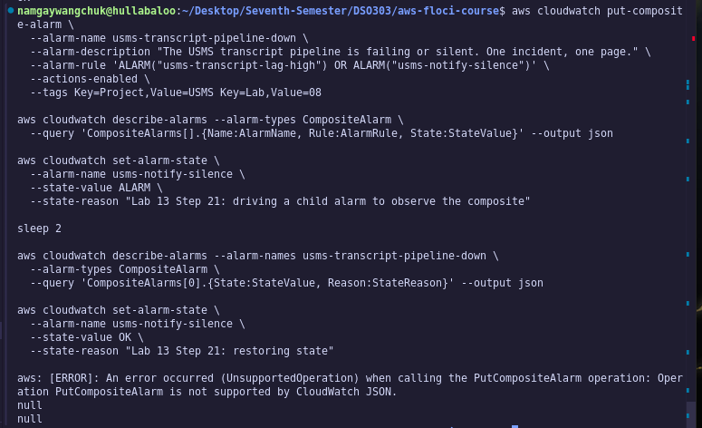
*Figure 22: Probing `put-composite-alarm` for `usms-transcript-pipeline-down` (`UnsupportedOperation` on Floci 2.0.1) and restoring child alarm state to `OK`.*

### Step 22 & Step 23 – Dashboard Layout Validation & Log Event Aggregation
Validated `templates/lab-13-dashboard.json` across its 24-column grid (`widgets: 5`, `types: alarm, metric, text`, `grid width: 24`, `overlapping: False`) and aggregated `USMS_EVENT` payloads from `/usms/central/application` using `filter-log-events` + Python (`science: 4`, `engineering: 3`).

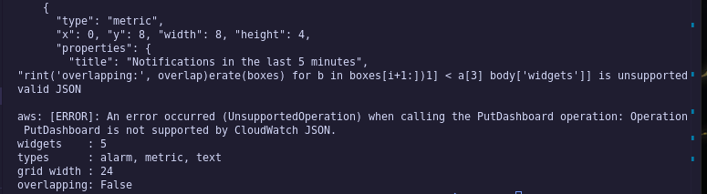
*Figure 23: Structural validation of `templates/lab-13-dashboard.json` confirming 5 non-overlapping widgets (`alarm, metric, text`) across the 24-column grid (`overlapping: False`).*

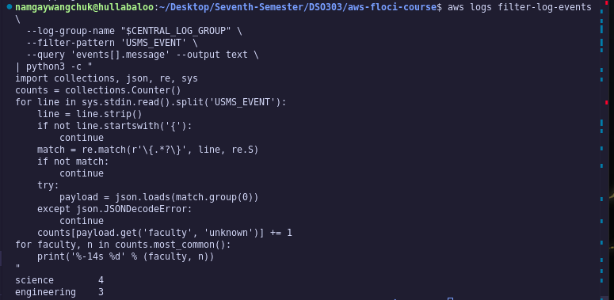
*Figure 24: Querying `/usms/central/application` via `filter-log-events` and aggregating `USMS_EVENT` JSON records by faculty (`science: 4`, `engineering: 3`).*

### Step 24 – Floci Container Restart & Hybrid Persistence Proof
Captured pre-restart inventory (`outputs/lab-13-pre-restart.txt`), restarted the Floci container (`./scripts/setup/floci-down.sh` followed by `./scripts/setup/floci-up.sh`), and diffed against post-restart inventory (`outputs/lab-13-post-restart.txt`), confirming `CONFIGURATION IDENTICAL - every Lab 13 object survived the restart` and `metric data points: before=1 after=1`.

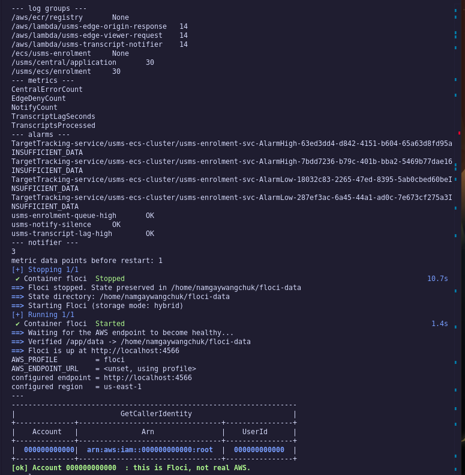
*Figure 25: Recording pre-restart log groups, metrics, alarms, and Lambda alias version (`3`), restarting Floci (`floci-down.sh` / `floci-up.sh`), and re-verifying caller identity.*

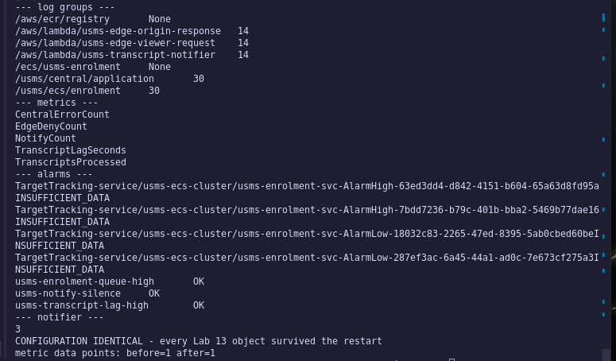
*Figure 26: Diffing `outputs/lab-13-pre-restart.txt` against `outputs/lab-13-post-restart.txt` (`CONFIGURATION IDENTICAL`) and confirming persisted metric datapoints (`before=1 after=1`).*

---

## 6. Phase 5: Environment Export, Independent Exercises & Final Verification (Step 25)

### Step 25 & Independent Exercises 1–5
Generated `configs/lab-13.env` for downstream Lab 14 consumption, emitted a fresh correlated trace into `USMS/Application` via `usms-emit-telemetry.sh`, executed Independent Exercises 1–5 (trace correlation across signals and log retention audit on `/aws/lambda/usms-edge-viewer-request`), and committed all Lab 13 artefacts to Git.

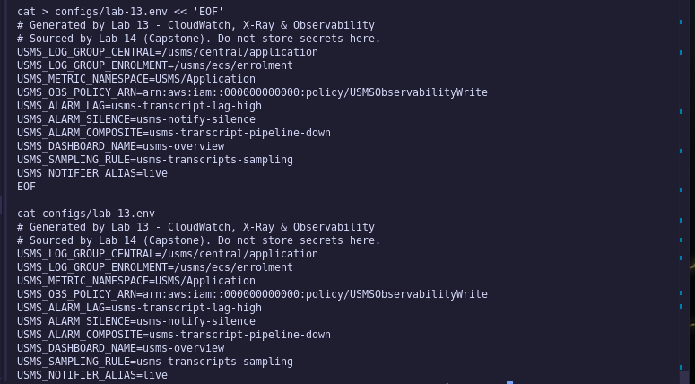
*Figure 27: Writing and verifying `configs/lab-13.env` exporting Lab 13 log groups, namespace, IAM policy ARN, alarms, dashboard, sampling rule, and alias names.*

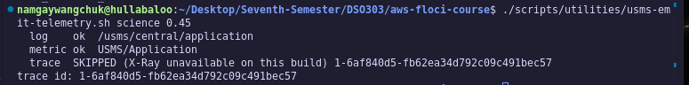
*Figure 28: Running `./scripts/utilities/usms-emit-telemetry.sh science 0.45` with `USMS_METRIC_NAMESPACE=USMS/Application` and recording trace ID `1-6af840d5-fb62ea34d792c09c491bec57`.*

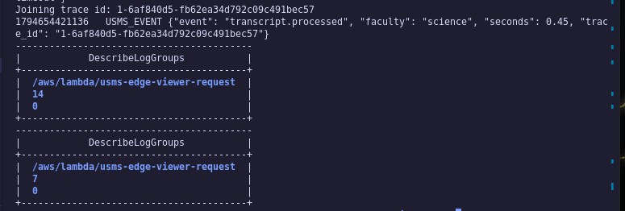
*Figure 29: Joining trace ID `1-6af840d5-fb62ea34d792c09c491bec57` in `/usms/central/application` (Exercise 3) and auditing retention reduction from `14` to `7` days on `/aws/lambda/usms-edge-viewer-request` (Exercise 5).*

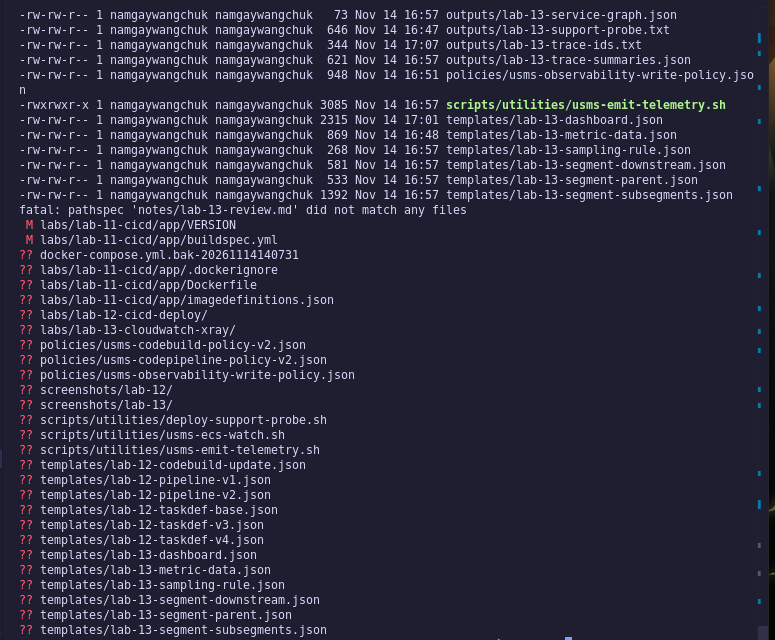
*Figure 30: Verifying all Lab 13 outputs, templates, policies, scripts, and screenshots in the workspace prior to final Git commit.*
